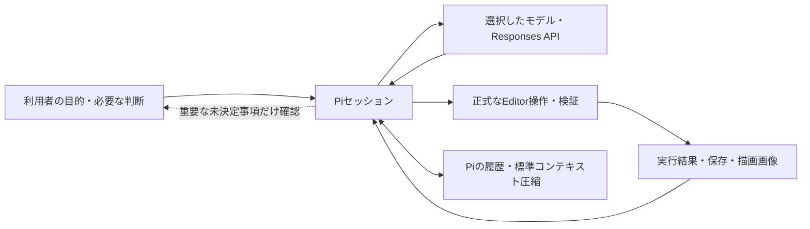

# Pi SDKによるStudio制作

制作チャットと`generate_chatgpt_world`は、Pi Coding Agent SDKの実行ループを使う。
モデルがSceneの情報を読み、Studioの正式ツールで編集し、検証結果を受けて修正する。
一括JSONプランを適用して再計画する旧実行ループは使わない。

## 利用者とPiを直接つなぐ

共有された「中間管理を避ける」と「コンテキスト・モデル・実行結果・圧縮を循環させる」図を設計原則として取り入れる。
目的と必要な選択は利用者が決め、Piが実装方法の選択、編集、検証、修正をまとめて進める。
プロデューサー、テクニカルリード、機能リードなどの管理用セッションや、通常の編集・確認ごとの承認工程を挟まない。
通常のbuild/goalは依頼された制作と確認を進める。利用者が明示的に頼んだPlanだけを読み取り専用で返す。



Studioは対象作品・Scene、revision、保存、描画などの実行境界を担当する。
別モデルの管理者へ仕様を送り直したり、別の要約・再計画の正本を持ったりしない。
図のサンドボックスに相当する責務は、Piのcodemodeの制限されたJavaScript環境と、正式なEditor・native操作の検証へ割り当てる。

## 実行経路

1. `pi-authoring-host.ts`が作品・Scene・会話・添付・制作方法を固定する。
2. `tauri.ts`の`chatgptPiRun`からnativeの`chatgpt_pi_run`を呼ぶ。
3. nativeがOS vaultの認証を更新し、アカウントのモデルと対応する思考量を確認する。
4. Studio専用Node.jsで`packages/studio-pi/dist/stdio.js`を起動する。認証情報は標準入力でメモリー上に渡し、画面・引数・ファイル・進行履歴へ書かない。
5. 正式ツールを入力スキーマごとPiへ直接登録する。Pi標準の`tool_search`で必要な定義を読み込み、`codemode`で複数の操作を組み立てる。
6. Editorの通常のrevision、Undo、インポート、検証、自動保存を通る。検証エラーはPiへ戻す。

制作のNode.jsは`background_process::tokio_command`から起動し、Windowsでコンソールの別ウィンドウを作らない。Blenderなどの補助処理も同じ起動処理を使い、進捗は制作チャット内で表示する。標準入出力の通信、終了コード、停止時の回収は既存の処理を保つ。

SDKの組み込みread/write/bash、利用者のPi設定・認証ファイルは読み込まない。
本体のStudio操作には正式ツールだけを許可し、公開・アカウント変更・作品切り替えを渡さない。
`create_blender_model`は既存の固定runner、モデル仕様検証、通常のAsset保存を使う。

## 実行中の追加指示と応答の終了

`chatgpt_pi_message`は進行中のgeneration・project・Scene・チャットを照合し、同じJSONL接続へ追加指示を送る。Node側で`AgentSession.steer()`または`followUp()`が受信してからnativeの呼び出しへ確認を返す。実行中の編集は強制中断しない。
SDKが追加のuserメッセージを実際に受信した境界で、以前の完成判定・画像・保存・healthの証拠を無効にする。標準圧縮後の現在の依頼にも受信済みの追加指示を含める。追加指示の再送は同じIDを重複して登録せず、未反映の入力は終了・停止時に会話へ残す。
通常のassistant応答の終了は失敗ではなく`completionVerified: false`として返す。画面は「応答済み」と表示し、成功した`studio_finish`による検証済みの結果と分ける。モデルの実際のエラー、保存・scope競合、停止は引き続き区別する。SDK名・内部のtool識別子は利用者向けの進捗へ表示しない。

## 実行の分担とツール探索

一つのPiセッションが読み取り、設計、編集、確認を進める。固定したモデル設計・配置・確認の担当セッションは作らない。
`teamwork.ts`、担当別のプロンプト・8ターン制限・設定項目を削除した。古い保存設定の分担指定と、削除済みの拡張登録は使用しない。

`get_editor_context`、`get_world_authoring_guide`、保存・整合性・撮影は最初からモデルへ公開する。
残りの正式ツールは`deferred`で登録し、`tool_search`で必要な入力定義を公開するか、`codemode`内の`searchTools`・`describeTool`で調べる。
独自の検索・汎用実行ラッパーは設けない。codemodeはPi標準のJavaScript実行環境で、Studioの正式ツールを呼ぶ。追加のモデル呼び出し用APIは有効にしない。

読み取りはPiに`executionMode: "parallel"`、書き込みは`"sequential"`で登録する。
nativeのJSONL transportは呼出IDごとに複数の応答を扱い、独立した読み取りを並行してEditorへ送る。
書き込みは外部MCPと共有するbroker lockを通る。revisionと作品・Scene・Edit状態を実際のEditor dispatcherで検査し、毎回の事前`get_editor_context`往復を省く。
内部Piの呼び出しには外部MCP runのjournalを重ねず、純粋な読み取りでScene全体のfingerprintを計算しない。

## モデル制作と配置

Piが`get_modeling_tools`、`create_blender_model`、`get_model_asset`、`place_asset`、`update_transform`、`get_entity_bounds`などの正式ツールを必要に応じて選ぶ。
専用の`studio_model_and_place`と16配置の上限を削除した。既存Assetの再利用、生成後の確認、複数配置、寸法の検査をPiが組み立てる。
モデル・Scene自体の形式検証や各正式ツールの入力条件は維持する。R3Fは`apply_r3f_scene`を使う。保存と完成確認は別途必要。

木やベンチなど繰り返し置くものは、一つを仕上げて`create_prefab`でPrefabにし、残りは`place_asset`で配置する。配置ごとに別のEntityとして作ると、利用者が後で直すときに複製の数だけ同じ編集を繰り返すことになる。`get_editor_context`の`prefabs`で既存のPrefabを確認し、元のEntityを編集した後は`update_prefab_from_source`で全配置へ反映する。共通ガイドと指示文の両方でこの手順を伝え、進捗には「プレハブの作成」「プレハブへの反映」と表示する。

### 空間UIと環境の設計

展示・教材・案内・メニューでは、共通ガイドの`spatial-ui`を読む。文字の階層、カードの余白、読む距離、立体見本と回遊を一緒に考える。ワールド全体や背景の変更では`environment`も読み、Skybox、IBL、照明と材質を調整する。ガイドの正本は`world-authoring-guide.json`で、MCPと制作スキルにも同じ内容を渡す。詳細とTSX例は必要なtopicだけ取得する。

静的R3F取り込みの`Text`は、`fontWeight`、`textAlign`、`lineHeight`、`letterSpacing`を保存し、既存のText共通ランタイムで描画する。Text背景の`borderRadius`はm単位で、編集・Play・公開の共通ジオメトリへ反映する。AIからAmbient Lightを有効にするには、`update_scene_settings`の`ambient.enabled`を指定する。

UIKitは静的R3F取り込みではなく、既存のTSX Script `Render`から実行する。`@react-three/uikit`と`@pmndrs/uikit`をStudioと公開物で使い、`uikit-panel`テンプレートを入口にする。日本語は宣言したFont Assetを`useTTF`へ渡す。公開物は同じScript原本を持ち、使用時にStudioと同じUIKit版を導入する。EditではScriptを実行しないため、表示確認にはPlayと実描画画像を使う。

Entityの右クリックは、対象IDとSceneを持つ入力依頼を制作チャットへ渡す。「チャットに送る」は添付のみ、「AIで作り替える…」は添付と依頼文、`modelSource: auto`を設定する。Textや空のEntityにも対応し、モデル内部の参照ノードは元のEntityから編集する。仕上がりの文を選択して入力へフォーカスし、既存の下書きと添付を保持する。制作方法は送信前に「AIにおまかせ」「素材ストア中心」「Blenderで制作」から変更できる。自動では外部素材・コード・UIKit・Blenderを用途に合わせて選び、既存の配置・しかけ・手動の子Entityを保つ。送信は既存のQueueと`generate_chatgpt_world`を使い、scope検証を維持する。

検証では、日本語の折り返し、パネルからのはみ出し、背景とのコントラストを読む位置から確認する。`analyze_performance`は件数の目安として使い、実機での操作やフレーム時間の確認と分けて報告する。

## 会話・Plan・進捗の正本

`packages/studio-pi/src/protocol.ts`が画面とPiで共通のJSON契約を持つ。Plan、質問、回答、使用量、履歴とイベントの型を二重に定義しない。
新しいPlanはPiの文章・質問だけを使い、旧JSONの作業object列を要求しない。
画面の実行状態は`PiAuthoringRun`で扱い、古い実行方式の型名は既存の保存データとドキュメント操作の互換用に残す。

通常の次の依頼ではPiのSessionManagerが会話を復元し、新しい依頼と現在の制作条件だけを加える。
毎回直近6件を独自に要約して付け直すことはしない。Pi履歴のない古い会話だけを最初の依頼時に移行する。
Planの承認は`approved_plan`、確認事項への回答は`answers`の継続メッセージとして同じ履歴へ加える。
旧Scene再計画の試行回数や、回答から独自の会話要約を作り直す制御は使わない。

履歴圧縮はPi標準の処理を使う。`context.ts`はPiの`context`フックを使い、復元された圧縮要約に現在の依頼・条件・承認・回答を添える。圧縮前の会話全体を再送せず、追加の要約モデル・管理役・永続化した独自要約も作らない。原本の履歴は変更しない。現在のSceneと実行結果を正本とする指示も添える。

Pi SDKの応答、再試行、履歴圧縮のイベントを画面へ流す。応答途中の文章は約150ms間隔にまとめ、内部思考は表示しない。
トークン使用量とモデル応答・ツール実行の回数は、Piの実際のイベントを数えて表示する。停止条件には使わない。Plan承認や質問への回答で再開した同じ依頼の使用量は合算する。
ストリーミング更新では会話全体を毎回保存し直さず、操作・履歴更新と終了時の保存へまとめる。

## Pi履歴と分岐

nativeが作品・Scene・会話IDから保存先を導出し、PiのJSONL履歴をアプリデータ内へ保存する。
画面には本文や画像を含まない履歴項目のID・親ID・ラベルと再開位置だけを返す。Unixでは履歴ファイルを0600にする。
開始前にPi履歴の参照を保存するため、失敗・中断した依頼でも同じ履歴から続きを進められる。
通常のエラーでは、作業途中のツール群を別の枝に保持し、安全な位置へStudioの失敗理由と元の依頼を記録する。
プロセスが強制終了した場合は、次の読込で安全な位置へ戻す。完了していない操作を実行済みとは扱わない。

1ファイルが32 MiBを超えた場合は次の読込を拒否し、新しいチャットを案内する。
最新300項目の概要を返し、履歴ツリーはそのうち最新80項目を表示する。
完了した通常応答だけを利用者が選ぶ分岐点とし、ツール実行途中・停止記録・エラー・中断応答は選べない。
再開位置は停止記録を指す場合もあり、最初の完了応答がなければnullになる。
分岐したチャットは元のPiファイルと選んだentry IDを参照し、その枝の履歴だけで次の依頼を実行する。
会話を分岐してもSceneは変更しない。SDKの履歴機構をStudio用UIで表示する。
履歴削除では他のチャットが参照しないPiファイルを削除する。分岐が参照するファイルは保持する。新しいWorldを作った記録が元のチャットにも表示される場合、Pi履歴の再開・分岐・削除は実際の対象作品・Sceneと一致する参照だけを使う。

## 保存と完成条件

`save_scene`は通常のEditor自動保存をflushする。保存中にSceneが変われば成功にせず再保存を求める。
`get_project_health`はdocumentの整合性を確認する。ファイルの存在、実行中のスクリプト、公開先の動作を保証するものではない。
`capture_scene_view`はStudioが実際に描画した画像をPiへ返す。撮影中にSceneが変われば画像を完成の証拠にしない。

Piの`studio_finish`は、現在のSceneのfingerprintと、保存・正常なProject Health・描画画像のfingerprintがすべて一致する場合にだけ受け付ける。
モデルは依頼された完成条件と根拠を返す。どれかが未達なら編集と検証を続ける。
撮影と完了確認はPiの`model-only`ツールにし、codemodeの内部で画像を捨てて完了できないようにする。ほかの正式ツールはcodemodeへ構造化した結果を返す。
後続の変更は以前の確認を無効にする。文章で「完了」と返しただけでは成功にしない。
画像を見たモデルの判断であり、作品の美術的品質や実行時の動作を機械的に保証するものではない。

変更のない操作は進捗に数えない。Studio独自の64ターン・256ツール呼び出し・native 600呼び出し・20分・無変更3回の停止条件を削除した。
Piの再試行・履歴圧縮を使い、完成確認、質問待ち、利用者の停止、実際のエラーで実行を終える。
モデル提供元の利用枠・レート制限・コンテキスト長、個別のHTTP・Editor操作・拡張導入のタイムアウトは残る。
自動停止の運用予算がない分、長い依頼や同じ操作の繰り返しで使用量と待ち時間が増える可能性がある。利用者は制作の停止を使える。

停止時は受け付け済みのEditor処理を待ってからPiプロセスと実行枠を解放する。
変更を戻すための控えは操作IDごとに持ち、実際の変更直前のfingerprintと一致する場合だけ更新する。
並行した読み取りはこの控えを上書きしない。取り込み中の手動編集などを巻き戻すおそれがあれば、その依頼のRevertを無効にする。

## Plan・質問・継続

MCPの`mode: "plan"`では読み取りだけを許可し、`studio_plan`の文章を公開用Planとして返す。
保存、撮影、編集はしない。`apply_chatgpt_plan`は確認後のSceneが同じ場合だけPiで実行する。
Sceneが変わった場合は手動編集を保持してエラーを返す。現在のSceneから新しいPlanを依頼する。

重要な利用者の判断が欠けている場合だけ、`studio_questions`で質問と理由を返し、既存の回答UIを使う。通常の実装・検証を進めるためだけの承認は求めない。
編集後に重要な判断が見つかった場合は、現在のSceneを`save_scene`で保存してから質問待ちへ移れる。明示的な保存結果が現在のSceneと一致しない場合は質問待ちを拒否し、先に保存を求める。
回答後は同じ依頼・会話・添付・保存件数・使用量を引き継いで続ける。変更を戻す控えも保持し、回答待ち中の手動編集を巻き戻すおそれがあればRevertを無効にする。
別Worldの作成後に質問した場合は、そのWorldで再開し、回答のたびに新しいWorldを作らない。元の依頼元と実際の編集先のIDを分けて保持する。
質問待ちの「この依頼を終了」は追加の制作を止め、保存済みの部分成果を保持する。読み取り専用Planの「変更を破棄」と区別する。
`/goal`も同じPiループを使い、元の目標に対して編集と見直しを進める。

## 停止と競合

停止後はnativeが次のツールを受け付けない。すでにEditorへ渡した処理は結果が返るまで待ち、子プロセスを終了してから依頼の実行枠を解放する。
保存済みの部分成果は残す。作品・Sceneの切り替えでも停止し、別の作品に依頼を転送しない。
手動編集の競合は正式ツールのSTALE_REVISIONで返し、Piが最新状態を読んで未完了の作業を考え直す。

履歴にはモデル、思考量、公開用Plan、実際の保存結果、エラーを残す。
旧実行記録の型と厳密な読み取りだけを`chatgpt-legacy-history.ts`に残し、既存履歴を壊さない。
旧入力packetの生成・保存・再送と旧ハーネスの実行機能は削除した。
旧JSONプランの解析・適用、操作用の別カタログとレジストリ、モデル向けScene要約生成も削除した。モデル制作やR3F変換などの正式なEditor処理は維持し、Piが直接呼ぶ。

## 配布と検証

`pnpm pi:prepare`はSDKを型検査し、導入済みのlockfileに一致する依存を`src-tauri/resources/pi`へ実ファイルとして配置する。
追加の依存解決・インストールスクリプト・シンボリックリンクには依存しない。
Tauriの配布リソースにこのディレクトリを含める。開発時はworkspaceのコンパイル済みrunnerを使う。
開発起動と配布ビルドはいずれも、MCP sidecar・アプリ本体のビルド前に`pnpm pi:prepare`を実行する。開発ビルドでもTauriは配布リソースの存在を検査する。
MCP sidecar単体のビルド中だけ、`TAURI_CONFIG`で`externalBin`と`resources`を空配列にする。未生成のアプリ用リソースを必要とせずsidecarを準備でき、アプリ本体の検査・同梱設定は変わらない。

```bash
pnpm pi:test
node --test scripts/chatgpt-authoring-host.test.mjs scripts/chatgpt-sessions.test.mjs
node --test scripts/world-design-guide.test.mjs scripts/component-code-authoring.test.mjs
pnpm typecheck
pnpm e2e:typecheck
pnpm e2e:test e2e/chatgpt-pi-authoring.spec.ts
cargo check --locked --manifest-path src-tauri/Cargo.toml
```

SDK試験は実際のPiセッションとテスト用モデル応答を使う。Editor試験はnative IPCだけを置き換え、正式なScene編集・保存・R3F変換を実行する。
実アカウントでの推論・認証、OS別の配布アプリ起動は別途確認する。
