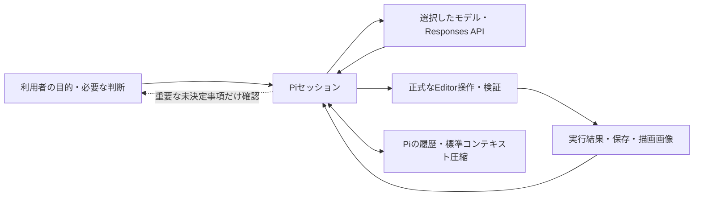

# Pi SDK による Studio 制作

制作チャットと `generate_chatgpt_world` は、Pi Coding Agent SDK の実行ループを使っている。
モデルがシーンの情報を読み取り、Studio の正式ツールで編集し、検証結果を受け取って修正する仕組みである。
一括 JSON プランを適用して再計画する旧来の実行ループは廃止した。

## 利用者と Pi を直接つなぐ

中間管理の層を挟まず、「コンテキスト・モデル・実行結果・履歴圧縮」を直接循環させる構造を設計原則としている。
目的と必要な方針決定は利用者が行い、Pi が実装方法の選択、編集、検証、修正をまとめて進める。
プロデューサー・テクニカルリード・機能リードといった管理用セッションや、通常の編集・確認ごとの承認ステップは挟まない。
通常のビルドや目標達成の依頼では制作と確認をそのまま進め、利用者が明示的にプラン作成を求めた場合だけ、読み取り専用の Plan を返す。



Studio は対象の作品・シーン、リビジョン、保存、描画といった実行境界を担当する。
別モデルの管理者へ仕様を送り直したり、別の要約や再計画データを独自に管理したりはしない。
隔離された実行環境の役割は、Pi の `codemode` が提供する制限付き JavaScript 環境と、正式なエディター操作・ネイティブ処理側の検証が担う。

## 実行経路

1. `pi-authoring-host.ts` が対象の作品・シーン・会話・添付・制作方法を固定する。
2. `tauri.ts` の `chatgptPiRun` からネイティブ側の `chatgpt_pi_run` を呼び出す。
3. ネイティブ側が OS の資格情報ストレージ（Vault）から認証情報を更新し、アカウントで利用可能なモデルと対応する思考量を確認する。
4. Studio 専用の Node.js で `packages/studio-pi/dist/stdio.js` を起動する。認証情報は標準入力経由でメモリ上だけに渡し、画面・コマンド引数・ファイル・進行履歴には書き出さない。
5. 正式ツールを入力スキーマごと Pi へ直接登録する。Pi 標準の `tool_search` で必要な定義を読み込み、`codemode` で複数の操作を組み立てて実行する。
6. 編集はエディター通常のリビジョン管理、Undo、インポート、検証、自動保存を通る。検証エラーが発生した場合はそのまま Pi へ返す。

制作用の Node.js は `background_process::tokio_command` から起動し、Windows 環境でコンソールの別ウィンドウが開かないようにしている。Blender などの補助処理も同じ起動経路を使い、進捗は制作チャット内に表示する。標準入出力の通信、終了コード、停止時のプロセス回収は従来の処理を維持している。

SDK 組み込みの `read` / `write` / `bash` や、利用者個人の Pi 設定・認証ファイルは読み込まない。
Studio 本体の操作には正式ツールだけを許可し、公開・アカウント変更・作品切り替えの操作は渡さない。
`create_blender_model` は既存の固定ランナー、モデル仕様の検証、通常の素材保存フローを使う。

## 実行中の追加指示と応答の終了

`chatgpt_pi_message` は進行中の生成 ID・プロジェクト・シーン・チャットを照合し、同じ JSONL 接続へ追加指示を送る。Node 側で `AgentSession.steer()` または `followUp()` が受信したことを確認してから、ネイティブ側の呼び出しへ応答を返す。実行中の編集は強制中断しない。

SDK が追加のユーザーメッセージを実際に受信した時点で、それ以前の完成判定・撮影画像・保存・整合性チェックの証拠を無効化する。標準圧縮後に組み立てる現在の依頼にも、受信済みの追加指示を含める。追加指示の再送時は同じ ID を重複登録せず、未反映の入力は終了・停止時に会話履歴へ残す。

通常のアシスタント応答の終了はエラーではなく `completionVerified: false` として返す。画面では「応答済み」と表示し、`studio_finish` が成功した検証済みの完了結果と区別する。モデルの実エラー、保存・対象範囲の競合、利用者による停止も引き続き区別して扱う。SDK 名や内部のツール識別子は利用者向けの進捗表示には出さない。

## 実行の分担とツール探索

1 つの Pi セッションが読み取り、設計、編集、確認を一貫して進める。モデル設計・配置・確認といった固定の担当別セッションは作らない。
`teamwork.ts` および担当別プロンプト・8 ターン制限・関連設定項目は削除した。古い保存設定の分担指定や、削除済みの拡張登録は使わない。

`get_editor_context`、`get_world_authoring_guide`、および保存・整合性確認・撮影に関するツールは最初からモデルへ公開する。
残りの正式ツールは `deferred` として登録し、`tool_search` で必要な入力定義を読み込むか、`codemode` 内の `searchTools`・`describeTool` で調べて利用する。
独自の検索ラッパーや汎用実行ラッパーは設けない。`codemode` は Pi 標準の JavaScript 実行環境であり、Studio の正式ツールだけを呼び出せる。追加のモデル呼び出し用 API は有効にしない。

読み取り系ツールは Pi に `executionMode: "parallel"`、書き込み系ツールは `"sequential"` で登録する。
ネイティブ側の JSONL トランスポートは呼び出し ID ごとに複数の応答を処理できるため、独立した読み取り操作を並行してエディターへ送信できる。
書き込み操作は外部 MCP と共有するブローカーのロックを通る。リビジョンや作品・シーン・編集モードの状態は実際のエディター側ディスパッチャーで検査するため、書き込みのたびに事前に `get_editor_context` で往復確認する処理は省いている。
内部 Pi からの呼び出しには外部 MCP 実行用のジャーナルを重ねず、純粋な読み取り操作ではシーン全体のフィンガープリントを計算しない。

## モデル制作と配置

Pi は `get_modeling_tools`、`create_blender_model`、`get_model_asset`、`place_asset`、`update_transform`、`get_entity_bounds` などの正式ツールを状況に応じて使い分ける。
専用の `studio_model_and_place` と 16 配置の上限は廃止した。既存素材の再利用、生成後の確認、複数配置、寸法の検査を Pi 自身が組み立てて実行する。
モデルやシーン自体の形式検証と、各正式ツールの入力条件は維持している。R3F の取り込みには `apply_r3f_scene` を使い、保存と完成確認は別途行う。

木やベンチのように繰り返し配置するオブジェクトは、1 つ目を仕上げて `create_prefab` でプレハブ化し、残りを `place_asset` で配置する。配置ごとに別の Entity として作ってしまうと、後から修正するときに複製の数だけ同じ作業を繰り返す必要が生じるためである。`get_editor_context` の `prefabs` で既存プレハブを確認し、元の Entity を編集した後は `update_prefab_from_source` で全配置へ反映する。元の Entity を変更した書き込み結果には `prefabsPendingUpdate` で未反映のプレハブが示されるため、反映漏れに気づきやすい。1 つだけ個別に変えたい配置や、元の Entity を削除したプレハブは `unpack_prefab_instance` で展開する。`analyze_performance` は配置されたプレハブを展開した状態で集計する。共通ガイドとシステム指示の両方でこの手順を案内し、進捗表示では「プレハブの作成」「プレハブへの反映」「プレハブの展開」と表記する。

既存のモデル、動作、案内の品質を改善するときは、共通ガイドの `refinement` トピックを参照する。依頼内容と基準版を照らし合わせて不具合が出る状況を再現し、原因に対して最小単位の修正を加える。修正前後を同じ視点や同じ操作で比較し、維持した点・修正した箇所・確認した条件・残る課題を報告する。制作チャットでは Play を開始できないため、動作の比較は `simulate_interactivity_asset` で確認できる範囲に限られ、残りは利用者側の確認項目として報告する。

主役となるモデルを作り込む場合や、既存モデルの見た目を修正する場合は、共通ガイドの `model-quality` トピックも参照する。対象のモデル・Entity・見る距離・残すべき特徴を先に決め、`set_scene_view_camera` と `capture_scene_view` を使って問題が見える視点から実際の描画を確認する。資料から形状と比率を把握して先に形を作り込み、表面の仕上げは後から合わせる。通常の鑑賞距離で目立つ欠点から優先的に直し、再取り込みした結果を同じ視点の前後画像で比較する。`reimport_model_asset` や `set_entity_model` を使って既存の配置を維持し、修正箇所・残る課題・未確認の環境を報告する。この流れの要点は共通ガイドの基本方針にも含めているため、個別トピックを読まない制作にも反映される。なお制作チャットは参考画像の添付・画像生成・Play 開始に対応していないため、資料のない部分は推定として報告し、動作途中の挙動確認は利用者側の確認項目に含める。この手順はガイドライン上の運用方針であり、Studio が前後比較を機械的に検査するものではない。

### 空間 UI と環境の設計

展示・教材・案内・メニューを制作する場合は、共通ガイドの `spatial-ui` トピックを参照する。文字情報の階層、カードの余白、読む距離、立体見本と回遊動線を一体で設計する。ワールド全体や背景を調整する場合は `environment` トピックも参照し、Skybox、IBL、照明、マテリアルを合わせて整える。ガイドの元データは `world-authoring-guide.json` に一本化しており、MCP と制作スキルにも同じ内容を渡している。詳細や TSX のコード例は必要なトピックだけを取得する。

静的 R3F 取り込みの `Text` は、`fontWeight`、`textAlign`、`lineHeight`、`letterSpacing` を保存し、既存の Text 共通ランタイムで描画する。Text 背景の `borderRadius` はメートル単位で指定し、編集・Play・公開の共通ジオメトリへ反映する。AI から Ambient Light を有効にする場合は、`update_scene_settings` の `ambient.enabled` を指定する。

UIKit は静的 R3F 取り込みではなく、既存の TSX スクリプトの `Render` から実行する。Studio と公開物の両方で `@react-three/uikit` と `@pmndrs/uikit` を使い、`uikit-panel` テンプレートを入り口とする。日本語表示には、宣言済みの Font アセットを `useTTF` に渡す。公開物も同じスクリプト原本を持ち、利用時に Studio と同じバージョンの UIKit を導入する。`uikit-panel` の `Render` は編集モードでも描画され、既存スクリプトも `runIn: play-and-edit` を指定することで編集画面でプレビューできる。制作チャットには `set_play_mode` を渡していないため Play を開始できない。そのため UIKit の見た目と文字表示は編集モードの実際の描画画像で確認し、`start`・`update`・インタラクションなど Play 中にしか起きない動作は利用者側の確認項目として報告する。

Entity の右クリックメニューからは、対象 ID とシーン情報を含む入力依頼を制作チャットへ送れる。「チャットに送る」は添付のみを行い、「AI で作り替える…」は添付と依頼文に加えて `modelSource: auto` を設定する。Text や空の Entity にも対応し、モデル内部の参照ノードを選んだ場合は元の Entity 経由で編集する。仕上がり指定の文を選択した状態で入力欄へフォーカスを移し、既存の下書きと添付はそのまま残す。制作方法は送信前に「AI におまかせ」「素材ストア中心」「Blender で制作」から切り替えられる。「AI におまかせ」では外部素材・コード・UIKit・Blender を用途に応じて選択し、既存の配置・仕掛け・手動で追加した子 Entity を維持する。送信時は既存のキューと `generate_chatgpt_world` を使い、対象範囲の検証もそのまま維持する。

検証では、日本語の折り返し、パネルからのはみ出し、背景とのコントラストを実際に読む位置から確認する。`analyze_performance` はオブジェクト数などの目安として使い、実機での操作感やフレーム時間の確認とは分けて報告する。

## 会話・Plan・進捗の管理

`packages/studio-pi/src/protocol.ts` が画面側と Pi 側で共通の JSON 契約を定義している。Plan、質問、回答、トークン使用量、履歴、イベントの型を二重に定義しない。
新しい Plan は Pi の文章と質問だけを使い、旧来の JSON 形式による作業オブジェクト列は要求しない。
画面の実行状態は `PiAuthoringRun` で管理し、旧実行方式の型名は既存の保存データとドキュメント操作の互換性維持のためだけに残している。

通常の継続依頼では、Pi の `SessionManager` が会話を復元し、新しい依頼と現在の制作条件だけを追加する。
毎回直近 6 件を独自に要約し直す処理は行わない。Pi 履歴が存在しない古い会話だけを、初回依頼時に移行する。
Plan の承認は `approved_plan`、確認事項への回答は `answers` の継続メッセージとして同じ履歴に加える。
旧来のシーン再計画の試行回数制限や、回答から独自の会話要約を再生成する制御は使わない。

履歴圧縮には Pi 標準の仕組みを使う。`context.ts` は Pi の `context` フックを使い、復元された圧縮要約に現在の依頼・条件・承認・回答を添える。圧縮前の会話全体を再送したり、追加の要約モデル・管理役・永続化した独自要約を作ったりはしない。元の履歴データは書き換えず、現在のシーンと実行結果を基準として判断するよう指示を添える。

Pi SDK の応答、再試行、履歴圧縮のイベントは画面へ逐次反映する。応答途中の文章は約 150ms 間隔でまとめて描画し、内部思考は表示しない。
トークン使用量とモデル応答・ツール実行の回数は、Pi の実イベントを数えて表示する。これらは停止条件には使わない。Plan 承認や質問への回答で再開した同一依頼の使用量は合算する。
ストリーミング更新のたびに会話全体を保存し直すことはせず、操作・履歴の更新時と終了時の保存にまとめる。

## Pi 履歴と分岐

ネイティブ側が作品・シーン・会話 ID から保存先パスを導出し、Pi の JSONL 履歴をアプリデータディレクトリ内へ保存する。
画面側には本文や画像を含めない履歴項目の ID・親 ID・ラベル・再開位置だけを返す。Unix 環境では履歴ファイルのパーミッションを `0600` に設定する。
実行開始前に Pi 履歴の参照を保存するため、失敗・中断した依頼でも同じ履歴から続きを再開できる。
通常のエラー時は、作業途中のツール実行列を別の枝に退避した上で、安全な位置に Studio 側の失敗理由と元の依頼を記録する。
プロセスが強制終了した場合は、次回読み込み時に安全な位置へ戻す。完了していない操作を実行済みとして扱うことはない。

1 ファイルが 32 MiB を超えた場合は次回読み込みを拒否し、新しいチャットを開始するよう案内する。
概要として返すのは最新 300 項目で、履歴ツリーにはそのうち最新 80 項目を表示する。
利用者が分岐点として選べるのは完了した通常応答だけであり、ツール実行途中・停止記録・エラー・中断応答は選択できない。
再開位置は停止記録を指す場合もあり、最初の完了応答がまだ存在しない場合は `null` になる。
分岐したチャットは元の Pi ファイルと選択したエントリー ID を参照し、その枝の履歴だけを使って次の依頼を実行する。
会話を分岐してもシーンの内容は変更しない。SDK の履歴機構を Studio 向けの UI として表示している。
履歴を削除するときは、他のチャットから参照されていない Pi ファイルだけを削除し、分岐先が参照しているファイルは残す。新しいワールドを作成した記録が元のチャットにも表示される場合でも、Pi 履歴の再開・分岐・削除は実際の対象作品・シーンに一致する参照だけを使う。

## 保存と完成条件

`save_scene` はエディター通常の自動保存を確定（flush）する。保存中にシーンが変更された場合は成功とみなさず、再保存を求める。
`get_project_health` はドキュメント上の整合性を検査するツールであり、実ファイルの存在、スクリプトの実行時挙動、公開先での動作を保証するものではない。
`capture_scene_view` は Studio が実際に描画した画像を Pi へ返す。撮影中にシーンが変更された場合、その画像は完成の証拠として採用しない。

Pi の `studio_finish` は、現在のシーンのフィンガープリントと、保存結果・正常な Project Health・描画画像の各フィンガープリントがすべて一致する場合にだけ受け付ける。
モデルは依頼された完成条件と根拠を合わせて返す。条件のどれかが未達であれば編集と検証を継続する。
撮影と完了確認は Pi の `model-only` ツールとして扱い、`codemode` の内部で画像を捨てて完了扱いにできないようにしている。それ以外の正式ツールは `codemode` へ構造化された結果を返す。
完了確認後に変更が加わった場合、それ以前の確認結果は無効になる。モデルが文章で「完了」と返しただけでは成功とみなさない。
なお完成判定は画像を見たモデルの判断によるものであり、作品の美術的品質や実行時の動作を機械的に保証するものではない。

変更を伴わない操作は進捗として数えない。Studio 独自の 64 ターン・256 ツール呼び出し・ネイティブ 600 呼び出し・20 分・無変更 3 回といった停止条件は廃止した。
Pi の再試行と履歴圧縮を活用し、完成確認・質問待ち・利用者の停止・実エラーのいずれかで実行を終える。
ただし、モデル提供元の利用枠・レート制限・コンテキスト長、および個別の HTTP 通信・エディター操作・拡張導入のタイムアウトは引き続き有効である。
自動停止の上限を設けない分、長い依頼や同じ操作の繰り返しではトークン使用量と待ち時間が増える可能性がある。必要な場合は利用者が制作を停止できる。

停止操作を受けたときは、すでに受け付け済みのエディター処理の完了を待ってから Pi プロセスと実行枠を解放する。
変更を戻すための控えは操作 ID ごとに管理し、実際の変更直前のフィンガープリントと一致する場合にだけ更新する。
並行実行される読み取り処理がこの控えを上書きすることはない。取り込み中の手動編集などを誤って巻き戻すおそれがある場合は、その依頼の元に戻す機能（Revert）を無効化する。

## Plan・質問・継続

MCP の `mode: "plan"` では読み取り操作だけを許可し、`studio_plan` の文章を公開用 Plan として返す。
このモードでは保存・撮影・編集を行わない。`apply_chatgpt_plan` は、確認時のシーンから変更がない場合にだけ Pi で実行する。
シーンが変更されていた場合は手動編集を保護するためにエラーを返し、現在のシーンをもとに新しい Plan を作成するよう促す。

利用者の重要な判断が不足している場合にだけ、`studio_questions` で質問内容と理由を返し、既存の回答 UI を表示する。通常の実装や検証を進めるためだけの確認は求めない。
編集を進めた後で重要な判断事項が見つかった場合は、現在のシーンを `save_scene` で保存してから質問待ち状態へ移行できる。明示的な保存結果が現在のシーンと一致しない場合は質問待ちへの移行を拒否し、先に保存を完了するよう求める。
利用者が回答した後は、同じ依頼・会話・添付・保存件数・使用量を引き継いで制作を再開する。変更を戻す控えも維持し、回答待ちの間に手動編集が入って巻き戻しの危険がある場合は Revert を無効化する。
別のワールドを作成した後に質問した場合は、そのワールド上で再開し、回答のたびに新しいワールドを作り直すことはしない。元の依頼元と実際の編集先の ID を分けて管理している。
質問待ち画面の「この依頼を終了」は追加の制作を止め、保存済みの途中成果を残す操作であり、読み取り専用 Plan の「変更を破棄」とは区別される。
`/goal` も同じ Pi ループを使い、元の目標に沿って編集と見直しを進める。

## 停止と競合

停止後はネイティブ側が新たなツール呼び出しを受け付けない。すでにエディターへ渡した処理は結果が返るまで待機し、子プロセスを終了してから依頼の実行枠を解放する。
保存済みの途中成果はそのまま残る。作品やシーンを切り替えた場合も実行を停止し、別の作品へ依頼を引き継ぐことはない。
手動編集との競合は正式ツールの `STALE_REVISION` として返し、Pi が最新状態を読み直して未完了の作業を再検討する。

履歴にはモデル名、思考量、公開用 Plan、実際の保存結果、エラーを記録する。
旧実行記録の型定義と厳密な読み取り処理だけを `chatgpt-legacy-history.ts` に残し、過去の履歴データを壊さないようにしている。
旧来の入力パケット生成・保存・再送と、旧ハーネスの実行機能は削除した。
旧 JSON プランの解析・適用、操作用の別カタログとレジストリ、モデル向けシーン要約生成も削除済みである。モデル制作や R3F 変換などの正式なエディター処理はそのまま残し、Pi から直接呼び出す構成としている。

## 配布と検証

`pnpm pi:prepare` は SDK の型検査を行い、インストール済みのロックファイルに一致する依存パッケージを `src-tauri/resources/pi` へ実ファイルとして配置する。
追加の依存解決、インストールスクリプト、シンボリックリンクには依存しない。
Tauri の配布リソースにこのディレクトリを含めており、開発時はワークスペース内のコンパイル済みランナーを使用する。
開発起動と配布ビルドのいずれも、MCP sidecar とアプリ本体のビルド前に `pnpm pi:prepare` を実行する。開発ビルド時にも Tauri が配布リソースの存在を検証するためである。
MCP sidecar 単体のビルド中だけは、`TAURI_CONFIG` で `externalBin` と `resources` を空配列に設定している。これにより未生成のアプリ用リソースを要求せずに sidecar を準備でき、アプリ本体側の検証・同梱設定には影響を与えない。

```bash
pnpm pi:test
node --test scripts/chatgpt-authoring-host.test.mjs scripts/chatgpt-sessions.test.mjs
node --test scripts/world-design-guide.test.mjs scripts/component-code-authoring.test.mjs
pnpm typecheck
pnpm e2e:typecheck
pnpm e2e:test e2e/chatgpt-pi-authoring.spec.ts
cargo check --locked --manifest-path src-tauri/Cargo.toml
```

SDK のテストでは実際の Pi セッションとテスト用のモデル応答を使う。エディターのテストではネイティブ IPC だけを置き換え、正式なシーン編集・保存・R3F 変換を実行して検証する。
実アカウントでの認証・推論および各 OS での配布アプリ起動は別途確認する。
