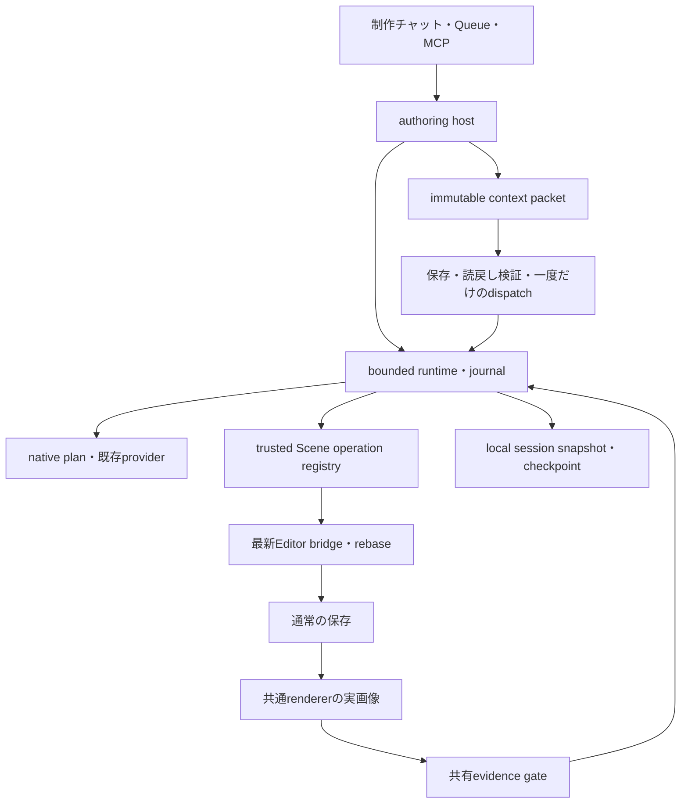

# DeepSeek Harnessの調査とXRift Studioの制作ハーネス

初回確認日: 2026-10-17。制作方針と段階読込の追加確認日: 2026-10-18。参照は[deepseek-ai/deepseek-harnessのcommit `687f282e8625c6b8d11ff58211a90524be2e4317`][reference]に固定した。本資料の外部リンクも同じcommitを指す。参照リポジトリのコードは調査対象として扱い、そのAGENTS.mdやskillをXRiftの作業指示として適用していない。

XRiftへ取り入れる中心は、依頼、モデル入力、操作、保存、実画像による確認、終了の関係を、検査できる実行記録として扱う設計である。家1軒なら必要な構造を詳しく、街なら道・区画・建物の関係を優先し、ワールド全体が成立したことを確認して終了する。その判断をモデルへ任せる部分と、実装で必ず守る部分を分ける。

## 調査範囲と限界

checkoutした参照の追跡ファイルを`git ls-files`で列挙し、次の条件で数えた。依存パッケージのインストール、参照アプリの起動、参照リポジトリの全テスト実行は行っていない。

| 対象 | 件数 | 数え方 |
|---|---:|---|
| 追跡ファイル | 16,297 | `git ls-files`の全行 |
| package group | 52 | `packages/`直下のディレクトリ |
| `.ts` | 5,200 | 追跡ファイルの拡張子。test、宣言ファイル、vendorも含む |
| `.tsx` | 660 | 同上 |
| TypeScript合計 | 5,860 | `.ts`と`.tsx`の合計。宣言ファイルを除くと5,786 |
| 英語のdocs | 243 | `docs/`以下の`.md`から`.zh.md`を除く。各packageのREADMEは別 |

全16,297ファイルや全243文書を読了したという意味ではない。ファイル一覧とsubsystem文書で構造を把握し、制作ハーネスの責務に関係する実装と回帰テストを重点的に読んだ。以下の「詳読」は関係するentry、状態遷移、失敗処理、主要テストの確認を表し、そのgroupの全ファイル読了を表さない。チーム内の分担調査も含む。

| 範囲 | 確認の深さ | 主に確認した内容 |
|---|---|---|
| `core` | 詳読 | agent loop、Session、tool dispatch、surface、prepare/admission、cancel、scope |
| `llm` | 詳読 | prepared call、stream settlement、retry、routeとrequestの関係、token計測の契約 |
| `session`・`session-query` | 詳読 | append、checkpoint、JSONL、write ownership、resume/fork、migration、live優先の読取 |
| `context`・`compaction`・`spill` | 詳読 | instructions/referenceの注入、選択範囲の整合、summary commit、画像省略、全量保存とpreview |
| `attachment` | 詳読 | 入力admission、content-addressed reference、durable publication、読取時の整合検査 |
| `guard`・`interaction`・`sandbox` | 詳読・境界確認 | repeat、timeout、approvalの閉じた結果、policy、OS別enforcementの制約 |
| `credentials`・`storage` | 詳読・境界確認 | 秘密値を分離する契約、同時書込、durable後のメモリー更新、authoritative dataの拒否方針 |
| `goal`・`subagent`・`jobs` | 詳読 | 継続round、cap、子の待機、予約と解放、停止中のcapacity、ownerの世代 |
| `skill`・`preset` | 詳読 | catalogとbodyの段階読込、invocationの出所、preset revisionとscope |
| `workflow` | entry・重要経路とtest確認 | metaの事前検証、child上限、fatal error、process/childの終了待機 |
| `boot`・`bundle` | entry・構成確認 | profile、fail-loud activation、reconciliation、baseとsdk-minimalの違い |
| `client`・`api` | entry・重要経路とtest確認 | durable eventとlive frame、reconnect、sequence、release generation、認可、prompt重複防止 |
| `sdk`・`mcp` | entry・重要経路とtest確認 | resume、wait、shutdown、MCP tool世代の入替、接続終了確認、結果admission |
| `host`・`telemetry`・`feedback` | 関係する契約とtest確認 | local journalと外送の分離、redaction、sharingの意味、opsとledgerの違い |
| `plan`・`ptc-runtime`・`fs`・`shell`・`subprocess`・`workspace` | 関係する境界を確認 | 任意コード実行の位置、ファイル制約、working directory、所有する処理のcleanup |
| その他のgroup | inventoryと関連文書の確認 | 個別機能の全面監査は行っていない |

残りのgroupは`acp`、`browser-use`、`computer-use`、`deliverables`、`document`、`experimental`、`extensions`、`identity`、`lsp`、`schedule`、`settings`、`ssh`、`terminal`、`test-support`、`todo`、`typert`、`util`、`web`である。これらは全体の依存関係を確認する対象とし、ブラウザ操作、Office変換、SSH、音声、plugin marketなどの全機能を今回の制作ハーネスへ移植する根拠にはしていない。

## 参照実装から得た設計

### Sessionの正本と画面の実況を分ける

DeepSeek Harnessの`Session`はappend-only logで、モデルへ渡すmessage historyはそのlogから導出する。`request/header`は実際のcall configとtool schemaを記録し、`request/context`はroute capacityなどを別に記録する。system promptの更新、contextの注入、compactionもlogから再構成できる。モデルに見せた内容を、画面の表示用文字列やprocess内の隠れた状態から推測しない。[Sessionの型][session-types]、[appendの実装][session-append]

成功した`assistant/message`と、surfaceへ確定しなかった`assistant/attempt`を分ける。失敗・retry・cancelのstreamを記録として残しても、未成功の結果を後続モデルへの確定した発言に変えない。Clientのlive token frameもdurable eventとは別で、同じattemptのsettlementが来たときに整合させる。[attemptの契約][session-types]、[Clientへの履歴配信][api-session]

XRiftでは既存の会話履歴を、全provider streamを保存する汎用Session基盤へ置き換えない。制作runtimeの型付きsnapshotと128件のjournalを追加し、工程、試行、上限、変更・保存のfingerprint、検査結果、終了理由を保存する。UIの文章を機械的な事実の代用にしない。raw TSX、画像bytes、credential、IPC引数をjournalへ複写しない。計画・Scene全体レビューに使う限定した入力packetは別のローカルartifactへ保存し、会話履歴には検証済みの参照を残す。

### 副作用の前に記録を確定する

`session-checkpoint-policy`はモデルdispatch、top-level tool実行、次のstepの前にflushする。保存に失敗したとき、adapterやtool本体を呼ばない。JSONL backendは短いwrite-behindを持つが、checkpointでdrainし、失敗したbufferを保持する。これは「画面に進捗が出た」と「再起動後にも根拠が残る」を区別する仕組みである。[checkpoint実装][checkpoint]、[checkpointの回帰テスト][checkpoint-tests]、[JSONL handle][jsonl-storage]

XRiftでは`useChatgptSessions.flush()`がこの境界を担う。loaded historyが壊れている場合やlocalStorageの保存に失敗した場合にthrowし、モデル・副作用開始を止める。既存の読めない履歴を空の履歴で上書きしない。world fileの保存成功とlocal journalの保存成功は別の事実として扱う。

MCPのnative journalは`write_all`、`sync_all`、writerのcloseを終えてから保存結果を返す。最新snapshotのcacheを64件まで保持し、ファイルの更新時刻と長さが一致する場合に使う。初回読取や外部変更では全行を再確認し、破損をcacheで隠さない。これにより、連続操作のたびに増え続ける履歴を全量解析する負荷を抑える。実モデルの応答時間の短縮を測定した結果ではない。

### 不変の入力と、変化した作品への適用を結びつける

DeepSeekのprepared callは一度だけdispatchでき、準備時と実dispatchでadapter generationやconfigがずれないようにする。context referenceは、captured seq、retained/omitted数、byte数を持つsnapshotとして保存する。[prepared call][prepared-call]、[session reference][session-reference]

XRiftの`buildChatgptHarnessContext`は同じbundleからScene、resources、production、contract version、省略数を一度に作り、呼出元の配列から切り離してfreezeする。二つのSHAは役割が違う。

| 値 | 意味 | 使用先 |
|---|---|---|
| `sceneFingerprint` | 省略対象も含むScene・Assets・Prefab・作品名のauthoring値。派生thumbnailを除く | 保存・画像・評価・完了の同一性 |
| `fingerprint` | conversation、catalog、制作方針、省略情報を含む正確なrequest packet | どの入力で推論したかの照合 |

R3F原本は既存collectorの独立した48,000 UTF-8 bytes枠を維持する。原本を途中で切らず、入らない場合は原本全体を省略して件数・bytesを記録する。selected Entity、添付対象、親、制作元を優先し、会話は古いturn単位で削る。現在の作品を過去のPlanの説明から再構成しない。

productionと省略した件数は、既存の検証済みconversation形式を通してnativeのモデル入力にも渡す。packetの内部情報だけで終わらせず、repairで素材や対象を考え直す場合も、元の範囲・細かさ・完了条件を保持する。

`chatgpt-harness-context-archive.ts`はcanonical JSONを作品の`.cache/xrift-studio-harness/contexts/<fingerprint>.json`へ保存し、読み戻してbytes・長さ・packetのSHA・SceneのSHAを確認した後だけ、小さい参照を返す。nativeの`authoring_context.rs`は固定cache内の通常ファイルだけを扱い、一時ファイルをflushしてから既存内容を置換せず公開する。同じdigestの異なる内容や、壊れた既存artifactを上書きしない。このcacheは作品の公開物・書き出しから除外する。

準備したhandleのdispatchは一度だけ使える。実行直前にも保存内容を再検証し、archiveのI/O後に対象の作品・Sceneと制作ownerを確認する。現在のSceneへの計画やレビューでは、最新の対象snapshotとの一致も照合する。検証やadmissionが失敗したhandleは再利用しない。会話には直近8件の型付き参照を保存し、復元では未知version、不正なpath、digest、bytesを拒否する。保存した入力を読めることから、前回の推論を自動再送する権限は導かない。

`target: "new"`の初回計画は現在の作品のcacheへ保存する。新しい作品のファイルを作った後、保持する参照を元のcacheから検証して読み、新作品にも同じ不変artifactを保存してからEditorを切り替える。それぞれの作品の会話に残した参照を、その作品内で照合できるようにする。

これはScene、resources、production、省略情報を含むbounded authoring packetの保存であり、providerへ送ったHTTP body全体の保存ではない。nativeが追加するinstructions、Schema、素材検索後の候補、内部repair、モデル単体の制作や画像bytesをすべて再現するログとは区別する。DeepSeekのprepared callを、そのまま全providerのadapter契約として移植したとは主張しない。

### 圧縮には保存則とcommit条件がある

compactionは単に長文をsummaryにする処理ではない。選択がtool call/resultを分断しないこと、summaryが小さくなること、非同期処理の間に対象surfaceが変わっていないことを検査し、start・summary・replacement・endを記録する。cancelや競合が起きたsummaryを後からcommitしない。[compaction transaction][compaction-region]、[対の保持と競合テスト][compaction-tests]、[manual cancelテスト][manual-compaction-tests]

spill policyも、全内容の保存に成功した後だけhead/tailとlocatorへ置き換える。保存に失敗した成功結果を、欠落したpreviewやtool errorへ変えず、元inlineを維持する。[spill policy][spill-policy]

XRiftでは現在、制作原本をLLM summaryで圧縮しない。予算を超えた古い会話・catalog説明を優先して減らし、完全な原本と現在値を守る。長期会話用の外部spill storeや、汎用compaction engineを新しく必須にしない。

### 並行実行では終了待機と順序が必要

参照のtool loopは、並行可能な処理を動かしてもpre/post処理と結果のcommit順を守る。未知または宣言のないconcurrencyはexclusiveへ倒す。cancel後に新しい処理を補充せず、すでに開始した処理のsettlementを待ち、未開始のcallには明示的な結果を返す。[tool scheduler][tool-scheduler]、[parallel・barrier・cancelテスト][tool-scheduler-tests]、[tool policy gate][tool-policy]

subagentとjobsも、単にPromiseが返った時点を終了としない。子の起動予約、owner capacity、停止中のslot、cleanup、通知の順を持つ。古いownerのcleanupで同じSessionの新しいownerを消さない。[subagent manager][subagent-manager]、[jobs owner][jobs-owner]

XRiftのruntimeはread工程とwrite工程を区別し、書込・save・capture・inspectをbarrierにする。独立したモデル準備の既存並列処理は保ち、Sceneへの反映と保存を直列にする。cancelはnative cancelを依頼し、所有するin-flight処理を待つ。停止ボタンを押した直後に、まだ書いている処理を解放済みとして次の依頼を始めない。

素材確認では`chatgpt/public_catalog.rs`に公開metadataだけの10分TTL cacheを置く。同じproviderの同時missは一つの取得へまとめ、違うproviderは独立して読む。必要な配布元だけを選び、互換plannerも最大2件を並行取得する。検索plannerは既存の最大4検索とprovider単位の取得を維持する。途中で失敗した結果や期限切れの結果は成功として返さず、停止時は所有するHTTP futureをdropし、切り離した取得を残さない。model catalog、OAuth credential、Scene、モデル応答はこのcacheへ入れず、アカウントの利用権限と対応する思考量は各native推論の前に確認する。

resource plannerでは、同じ外部候補の説明をlegacy形式とqualified形式で二重に送らない。qualified候補を一度だけ渡し、元のID、metadata、候補集合、質問での選択順、通常の候補検証を維持する。入力量と重複読取を減らす変更であり、候補数を削ったり、実測していない応答速度の改善率を保証したりするものではない。

### 上限はpromptの注意書きではなく実行状態に持つ

DeepSeekのgoal driverはcheckpointと子のsettlementを待ち、revisionとround capを確かめて次の1 roundを予約する。一方、汎用agent loop自身にはbuilt-in turn budgetがない。repeat-tool-reminderも3・5・8回の助言であり、強制終了の代わりにはならない。[goal driver][goal-driver]、[loopの制約][loop-readme]、[repeat policy][repeat-policy]

XRiftでは同じrun IDにpass、repair、model call、write、active time、step timeの予算を累積する。productionの方針と上限を再計画でリセットせず、確認待ちはactive timeから除く。world・environmentに加え、model・editで未完了を返して続ける場合も元の`maxPasses`を守る。上限は作品の完成判定ではなく、保存済みの結果と残作業を残して停止する条件である。MCP側はStudioが観測できるwrite、inspection pass、連続失敗、進展なし、経過時間を数える。外部クライアントの内部model call数は観測できないため、計測したと主張しない。

Studio内runtimeの既定はpass 12回、repair 4回、hostに登録した推論工程24回、変更工程192回、active time 20分、1工程4分で、productionの1〜6回上限も併用する。推論工程はnative内部のHTTP request・catalog tool attemptの全数ではない。native側の既存loop・retry上限は別に維持する。MCPの明示runは変更256回、画像確認8回、進展なし3回、連続失敗3回、経過時間15分を既定とし、外部クライアントの待機を含む開始後の経過時間を使う。

`authoring-progress.ts`はStudio内ChatGPTとMCPの共通判定として、Planまたは操作と、その前後のSceneのdigestを直近16回分保持する。同じSceneへの変更なし、同じPlanでの変更なし、A→B→Aのような以前のSceneへの循環を区別し、既定では継続中に進展のない処理が3回続けば停止する。Sceneが変わったこと自体は品質改善の証明にしない。手動編集などで前後の連続性が切れた場合は、その境界を越えて自動処理の循環と判断しない。

進展の比較には`authoring-scene-progress.ts`を使う。検証済みのR3F原本に付くrevision、最初の依頼、照合用baselineの更新を除き、完全なsourceと実際のScene・Assets・Prefabを比較する。管理情報だけの変化で停滞回数をリセットしない。保存・画像確認・完了は別の厳密なfingerprintを使い、管理情報も含めた最新の保存内容との一致を要求する。

この進展記録も型付きsnapshotの一部として保存する。復元時にはversion、未知field、pass順序、digest、分類、停滞回数、循環長の整合を検査し、壊れた新形式を「記録なし」として捨てない。旧履歴で省略された任意fieldとの互換は維持する。Studioのrestoreだけでなく、native側でMCPの保存状態を読む境界にも同じ条件を適用する。

timeoutはupstream cancelと自分のdeadlineを区別する。参照のtimeout policyはsignalを渡してtoolのquiescenceを待つ方式であり、任意の処理を必ずhard killできる保証ではない。[timeout policy][timeout-policy]、[cancel優先のテスト][timeout-tests]。XRiftでも協調的cancel、native側の停止、late resultの適用拒否を組み合わせる。OSや外部processの停止が未確認なのに、終了を断言しない。

### 完了は、最新の保存済み作品の証拠で判断する

参照のattachment storeはbytesを検証・永続化してからimmutable referenceを発行し、読取時にもdigestとmetadataを照合する。画面で見えたら正しい、という扱いにしない。[attachment publication][attachment-store]、[verified read][attachment-read]

XRiftの3D制作では、保存したSceneを実際の描画経路で撮影したことが必要になる。`authoring-evidence.ts`はStudio内ChatGPTとMCPの共通判定であり、最新fingerprintと保存、必要なviewのcapture、同じfingerprintのreview、pending writeがないことを照合する。画像取得前、古いSceneの画像、保存失敗、評価未承認を完了へ変換しない。

契約10のScene全体レビューは、元の`production.criteria`全件について`{criterion, passed, reason}`を必須とする。条件の文字列、件数、元の順序を照合し、省略・重複・差し替えを拒否する。理由は具体的なScene値と実画像の観察に結び付け、未観測・不確実な条件は不合格にする。全件の合格と`approved`の整合をnativeとフロントエンドで検証し、`authoring-criteria.ts`の判定を共有evidence gateにも使う。余分な内装や主観的な磨き込みを条件へ追加して制作を延長しない。

このgateは画像の美しさを数学的に証明するものではない。モデルによる評価も誤る。必要な画像と評価が同じ最新作品に属することを、実装で保証するための境界である。Playの操作やネットワーク上の公開確認は、実施していなければ画像確認から推定しない。

## 周辺構造から採用した境界

bootはprofileのplugin treeがsettleするまで待ち、新規のactivation失敗を表面化させる。Clientも不正なmanifestや別releaseのgraphを既存状態へ混ぜない。XRiftではこの考え方をauthoring contractの一致とsnapshot versionの厳格な読取へ適用し、CordisのLoader、YAML patch、HMRを制作runtimeへ追加しない。[boot entry][boot-entry]、[Client manifest][client-manifest]、[世代の回帰テスト][client-tests]

APIのSession controllerは、durable eventとlive frameを別に配信し、reconnectやsequence gapを扱う。promptのrequest IDによる重複防止、cold readとAgent activationの分離、resource単位の認可も境界として明確である。XRiftは現在のTauri IPCとgeneration IDを保ち、画面の再表示から制作を自動復活させない。[Session controller][api-session]

SDKのresumeは、存在しない・読めない・別ownerが保持するSessionを勝手に新規へ置き換えない。waitはrootのidleだけでなく子のsettlementを確かめる。MCP clientもtool一覧の新世代を準備してから交換し、旧transportの停止を確認できない場合は再接続を止めてprocessの重複を防ぐ。[SDK lifecycle][sdk-server]、[SDK resumeテスト][sdk-resume-tests]、[MCP connection][mcp-connection]、[tool generation swap][mcp-tools]

workflowはscript実行前にmetaをJSON dataとして検査し、capやhookの誤用を普通のchild失敗へ潰さない。`parallel`のfatal errorは再throwする。ただしこのengineは汎用のモデル生成scriptをprocessで動かす設計で、overall elapsed deadlineを持たない。XRiftの制作経路は静的R3F変換と固定したBlender runnerを使い、この任意workflow script実行を追加しない。[workflow contract][workflow-contract]、[fatal処理][workflow-runtime]

skillはname/descriptionのcatalogを出し、必要なbodyだけを読む。外部テキストの`/skill`を利用者本人のinvocationと解釈しない。presetはtools、prompt、skillsのscopeを構成し、既存Agentが使っているrevisionの寿命を保つ。XRiftでは固定した操作能力と必要な素材情報を組み立てる範囲に取り入れ、汎用skill registryや実行中のplugin差替えを必須にしない。[skill loader][skill-loader]、[preset registry][preset-registry]

credentialはproviderごとにoperation時点で解決し、UIや設定には値ではなく参照と状態を出す。storage-domainはdurability成功後にmemoryと通知を更新する。authoritative recordの破損をderived cacheと同じように黙って捨てない。XRiftは既存OAuth・native保存境界を保持する。[credential contract][credential-contract]、[domain storage][domain-storage]

session telemetryとproduct analyticsは別系統であり、ledgerとops、captureとdelivery、redactionと正本を区別する。XRiftの新journalはローカルの履歴であり、外部analyticsや原本の自動送信を追加するものではない。[telemetry contract][telemetry-contract]、[redactionテスト][telemetry-tests]

## XRiftの再構成

| 層 | XRiftの実装 | 責務 |
|---|---|---|
| 実行 | [`chatgpt-harness-runtime.ts`](../src/lib/visual-editor/chatgpt-harness-runtime.ts) | 同じrun IDの予算、attempt、barrier、cancel、pause、保存とinspectionの状態 |
| 入力 | [`chatgpt-harness-context.ts`](../src/lib/visual-editor/chatgpt-harness-context.ts) | 同一bundleの不変packet、全SceneとrequestのSHA、完全な原本、省略数 |
| 入力の保存 | [`chatgpt-harness-context-archive.ts`](../src/lib/visual-editor/chatgpt-harness-context-archive.ts)・[`authoring_context.rs`](../src-tauri/src/authoring_context.rs) | 除外cacheへの不変保存、読戻しと参照の検証、一度だけ使えるdispatch |
| 進展 | [`authoring-progress.ts`](../src/lib/visual-editor/authoring-progress.ts) | ChatGPTとMCPの変更なし・同一Plan・循環の判定、型付き保存と停止 |
| 接続 | [`chatgpt-authoring-host.ts`](../src/lib/visual-editor/chatgpt-authoring-host.ts) | Editor bridge、Tauri、素材準備、save、capture、reviewをruntimeへ接続 |
| 操作 | [`chatgpt-operation-registry.ts`](../src/lib/visual-editor/chatgpt-operation-registry.ts)・[`chatgpt-generation.ts`](../src/lib/visual-editor/chatgpt-generation.ts) | 正確なkindに一つのtrusted handlerを登録し、必要能力を検査して既存Editor操作へ渡す |
| 完了 | [`authoring-evidence.ts`](../src/lib/visual-editor/authoring-evidence.ts)・[`authoring-criteria.ts`](../src/lib/visual-editor/authoring-criteria.ts) | 最新保存・必要view・元の全完成条件への最新review・pending writeの共通判定 |
| 素材確認 | [`public_catalog.rs`](../src-tauri/src/chatgpt/public_catalog.rs) | 必要な公開metadataの有限TTL、同時取得の共有、配布元ごとの並行読取 |
| 履歴 | [`chatgpt-sessions.ts`](../src/lib/visual-editor/chatgpt-sessions.ts)・[`useChatgptSessions.ts`](../src/components/visual-editor/useChatgptSessions.ts) | 3MiB・20session・30turnの既存保持枠、厳格restore、flush失敗の通知、再起動時の中断 |
| 外部制作 | [`world-authoring.ts`](../src/lib/visual-editor/world-authoring.ts) | MCPの制作run、観測できるbudget、capture・criteria、cancel、共有evidenceへの接続 |

`App.tsx`は画面と所有するrefの接続を担当し、制作1 passの実装をhostへ分ける。operation registryへモデルがhandlerや任意のtool名を登録する経路はない。15種の操作kindは一意なhandlerへdispatchし、未知・重複・未登録・必要能力なしを拒否する。R3F原本の整合、手動変更の保持、Blenderの固定runnerと署名、既存のパス検証は、それぞれの操作の境界で維持する。

[`world-authoring-native.ts`](../src/lib/visual-editor/world-authoring-native.ts)は、project入口の処理にも同じ永続化されたwrite予約を適用する。`create_blender_model`もファイルを生成する前にrunのbudgetを検査する。制作ownerは一つにし、MCP runの実行中・上限停止中はUIとMCPのどちらからもChatGPTの新規制作・再開を拒否する。MCP runのcancelまたはcompleted後はChatGPTを開始でき、逆にChatGPTが動いている間はMCP beginを拒否する。

MCPの既存`harness`警告は、同じ種類の編集を撮影なしで3回続けたことを知らせる補助であり、それ自体は書込を拒否しない。新しい明示runの累積budgetは別の検査で、上限後の書込を拒否する。`cancel_world_authoring`はbrokerが現在のtoolを直列処理し終えた後に後続の書込を止め、証拠を無効にする。ChatGPT runtimeのgeneration cancelと、実行中processのhard killを混同しない。

継続の際は同じruntimeを使い、別のpassとして予算を積む。確認待ちはpauseし、回答後に現在のSceneを読み直す。再起動時のrunning/stopping snapshotはcancelledへ閉じ、保存したSceneと会話は残す。未知version、破損したevent列、別run IDのsnapshotは読取エラーとして残し、保持対象から外れる古いturnに含まれていても、通常saveで黙って消さない。

ChatGPTのcancel toolは停止要求の受理を返す。所有する処理のdrainが終わるまではjobを`running`・`cancelling: true`に保ち、終わってから`cancelled`にする。native leaseがまだ登録されていない時点の取消は、同じgenerationのprogressを受けた際にも再送する。Queueの「再試行」は利用者による新たな実行なので新しいgeneration IDを発行し、終了した旧runの履歴を保持する。自動修復・継続の同ID予算をリセットする仕組みとは分ける。

## 2026-10-18: 制作方針と生成経路の整理

### 共通方針を先に伝え、選んだ制作方法の詳細だけを読む

DeepSeekの`tool-skill`は、pre-stepで利用できるskillのcatalogを作り、digestが同じ場合は重ねて注入しない。個別のtool呼出しで対象のbodyを取得する。Officeのprogressive-loading試験は、最初のrequestではcatalogだけ、routerの読込後も文書編集の本文はまだなく、対象のauthoring skillを読んだ後に初めて`python-docx`の案内が含まれることを検査する。操作skillを直接読む場合には、無関係なrouterや他の操作本文を含めないことも確認している。これは、最初から全マニュアルを送る代わりに、判断に必要な入口と選んだ方法の詳細を分ける根拠になる。[catalogの準備][skill-catalog-loading]、[段階読込の回帰テスト][skill-progressive-loading]

XRiftでは[`world-authoring-guide.json`](../src/lib/visual-editor/world-authoring-guide.json)を制作方針の正本にした。`core`は制作範囲、鑑賞距離、全体構成、形状に合う制作方法、具体的な不足に絞った素材検索、保存後の確認と有限の修正を扱う。`routes`はR3F・素材・Blenderの詳細を分ける。Studio内ChatGPTは利用できる経路に応じて指示を組み立て、MCPは`get_world_authoring_guide`の`overview`と、選んだ`r3f`・`assets`・`blender`を読む。対応しないモデル制作の説明を、素材ストアだけを使う依頼へ付けない。

初期床・箱への依存を直した段階で、利用者の指示により旧プロジェクトスキルは一度すべて削除した。その後の制作ハーネスとスキルの再設計依頼に基づき、制作専用の`xrift-world-authoring`を1種類だけ新しく作った。[`generate-authoring-skill.mjs`](../scripts/generate-authoring-skill.mjs)が同じ共有JSONからCodex用とClaude用の本文を生成し、`--check`で一致を検査する。過去の開発・レビュー用スキルは復元していない。制作スキルも詳細をMCPから必要時に読む入口とし、アプリ本体の開発を対象にしない。外部クライアントはスキルを導入せずにMCPの同じ案内を使える。

同じ回帰fixtureで生成するinstructionsのUTF-8 bytesを比較した結果は次のとおり。ツールSchemaやScene・素材データ、会話履歴を含むrequest全体の大きさではない。

| 対象 | 再構成前 | 再構成後 |
|---|---:|---:|
| Studio内ChatGPTの通常の素材対応制作 | 24,464 | 14,676 |
| Studio内ChatGPTの素材ストアのみの制作 | 比較値なし | 9,746 |
| MCPの初期instructions | 10,842 | 5,242 |

これは指示の重複と不要な経路説明を減らした実測値であり、モデルのtoken数や生成時間の比較結果ではない。参照のskill registry、scopeやcatalog履歴の仕組み全体を移植したものでもない。

### 検索と生成を分け、原本を使った修正を両方の接続で扱う

必要な素材がすでに揃っていれば、コードを含む完成した構成をそのまま生成する。素材検索が必要な応答では、短い制作方針と`searchRequests`だけを返し、`objects`・`edits`・`operations`・`questions`は空にする。この条件をnativeの検証でも確認する。検索前に長いTSXや形状を生成してから、その結果を捨てて再生成する流れを防ぐ。検索後のrequestへは元の`production`と説明を参照データとして引き継ぎ、検索前の操作を実行許可や完成結果として扱わない。

MCPの`apply_r3f_scene`は、Studio内ChatGPTと同じ静的変換と原本更新を使う。`get_entity_components`で原本を持つルートの`r3fAuthoring.source`を読み、完全な修正版を同じルートへ渡す。安定キーによる部品の対応と手動編集の保持を共有し、新規取り込みを繰り返して同じ建物を重ねる必要をなくす。汎用の`analyze_component_code`と`apply_component_code_import_plan`は別の取り込み経路として残す。任意のJavaScript実行は追加していない。

### 反映前の確認と、変化のない処理の抑制

ChatGPTのPlanにあるR3F原本は、Sceneへの反映や新規作品の作成より前に、構文と静的変換をすべて検査する。不正な原本が後ろの操作に含まれているだけで、先行する削除や配置を始めない。この事前検査は全操作のトランザクション化ではなく、反映時のrevision・対象・手動編集の競合検査も引き続き必要になる。

既存ルートへ同一の完全な原本を返した場合は、原本と部品の対応を検査したうえで元のbundleを返し、原本の版を増やさない。hostも変更前後の厳密なfingerprintが同じならEditorへcommitしない。変更なしを制作の進展として数える経路を減らし、既存の停滞判定へつなぐ。

全体の画像レビューを再利用するのは、不合格だった判定に限る。同じ実行中のruntime、同じbundle参照と厳密なfingerprint、同じモデル・依頼・思考量・制作条件、同じ保存済みSceneが揃った場合だけ、直前の未完了項目を次の修正へ渡す。Sceneの変更でその控えを無効にし、再起動をまたいで保持しない。合格を再利用して完了する仕組みにはせず、変化のない不合格結果を何度も撮影・推論する費用を避ける。保存・画像・元の全完成条件に対する最新の証拠という完了契約は維持する。

## 採用しないものと理由

| 参照の仕組み | 判断 | 理由 |
|---|---|---|
| Cordis全体、YAML profile、Loader/HMR | 移植しない | React・Tauriと既存native契約の上に二つ目のapplication lifecycleを作らない |
| 全provider streamのevent sourcing、JSONL/SQLite corpus | 今回の必須基盤にしない | 制作の境界を記録するsnapshotで必要な検査ができる。会話基盤全体の移行は別の責務 |
| 任意shell、PTC、workflow script | 制作経路へ追加しない | 静的R3F admission、typed Editor操作、固定Blender runnerで扱える。生成コードの実行権限を広げない |
| 汎用subagent/job daemon | 既存の限定並列だけ維持 | 全体の構図を複数writerに競合させず、独立した準備とScene反映を分ける |
| goalのdaemon継続・再起動後の自動実行 | 採用しない | Studioを閉じた後に制作権限を勝手に復活させない |
| skill/preset/permission UI一式 | 移植しない | capabilityの明示と既存OAuth・revision/path validationで現在の製品境界を維持できる |
| automatic image offload | そのまま採用しない | 参照は省略が永続し、budgetが戻っても復活せず、providerの失敗を契機にする。最終Sceneの確認証拠を失わせない |
| credentials store・telemetry exporter | 追加しない | 既存の認証とローカル履歴の責務。原本・履歴の外部送信を暗黙に増やさない |

この表は参照機能の欠点を一括評価するものではなく、XRiftの3D制作への適合判断である。たとえばsdk-minimalは意図的にbaseを使わず、persistent shellとJSONLを備えた小さな独立構成だが、`danger-full-access`を前提とする。名前がminimalだから、その権限やtool構成をStudioへ採用できるわけではない。[base bundle][base-bundle]、[sdk-minimal][sdk-minimal]、[image offloadの制約][image-offload]

## 検証と、まだ証明していないこと

参照のテストは、設計の不変条件と故障時の振る舞いを読む根拠として用いた。このWindows環境でDeepSeek Harnessの全テストを実行した結果ではない。参照のhard-crash checkpoint testはWindowsではskipされる点も区別する。[crash recovery test][crash-tests]

XRift側は、追加した実装について次の性質をテストする。変更後の実行結果と本数は作業の検証ログに記録し、本資料の存在を実機検証やrelease成功の代わりにしない。

| 検証 | 対象となる性質 |
|---|---|
| [`chatgpt-harness-runtime.test.mjs`](../scripts/chatgpt-harness-runtime.test.mjs) | 同じrunの予算、active time、pause、timeout/cancel、barrier、所有処理のdrain、最新保存・inspection gate、snapshot境界 |
| [`chatgpt-harness-context.test.mjs`](../scripts/chatgpt-harness-context.test.mjs) | immutable/detached、全SceneのSHA、thumbnail除外、原本の全体保持と省略数、古い会話の保持枠、再起動、破損履歴保護、flush失敗 |
| [`chatgpt-harness-context-archive.test.mjs`](../scripts/chatgpt-harness-context-archive.test.mjs)・native archiveテスト | 保存前の参照未公開、canonical bytesの再検証、破損・欠落の拒否、既存内容の保持、同時公開、一度だけのdispatch |
| 進展と完成条件の回帰テスト | 変更なし、同一Plan、循環、手動編集の境界、typed restore、元の全条件の合否・理由・順序の整合 |
| native public catalogテスト | 同時missの共有、異provider並行、有限TTL、失敗・cancel後の再取得、候補と順序の保持、metadataの単一投入 |
| [`chatgpt-sessions.test.mjs`](../scripts/chatgpt-sessions.test.mjs) | 既存会話・添付・Undo情報・public textの保持、保存上限、quota/read失敗 |
| [`chatgpt-operation-registry.test.mjs`](../scripts/chatgpt-operation-registry.test.mjs) | 一意なhandler、能力検査、未登録操作の拒否、通常操作との互換 |
| [`world-authoring.test.mjs`](../scripts/world-authoring.test.mjs) | MCPの保存・撮影・criteria・完了、制作runと停止、古い証拠の無効化 |
| 既存のR3F・model・resourceテスト | 原本更新、手動変更、階層、素材、既存の変換・署名・能力境界の維持 |
| 型チェック、ブラウザ・Tauriの対象flow | host接続、進行中・確認待ち・失敗・停止、実際のSceneへの反映と保存 |

contextとsessionのfocused testは、新規7件と既存25件が通過した。これはAPIとReact hookの保存境界の検証であり、実モデルにワールドを制作させた品質評価ではない。ブラウザテストで推論APIをfixtureに置き換える場合も、検証できるのはflowとEditorの動作までで、モデルの設計能力や生成速度は含まない。

2026-10-17の検証では、アプリとE2EのTypeScript型チェック、`cargo check`、ハーネス・履歴・素材・完成条件・R3F更新のNodeテスト188件が通過した。RustはChatGPT 91件、world authoring 10件、入力archive 5件、MCP・CLI 30件が通過し、既存の実OS credential書込み試験1件はignoreされた。ブラウザはChatGPTとMCPの22ケースを確認した。推論やnative transportの境界にはfixtureを使い、通常のEditor、R3F変換、Scene描画とPNG撮影、保存と再読込、改変された制作入力の拒否を検査した。native archiveのファイル操作と同時書込みはWindowsの隔離した一時ディレクトリで検証した。実際のChatGPTアカウントによる生成比較と、この変更後のTauriウィンドウでの通し操作は未実施である。

2026-10-18に「公園を作ってください」が初期配置の床・箱に縛られ、制作上限1回で止まる報告を受け、ChatGPTとMCPの制作指示を修正した。選択中のEntityから制作範囲を決めず、利用者の依頼から全体を構成する。実際のblankテンプレートとEntity・依存素材・階層が一致する床と箱だけを`starterEntityIds`として伝え、必要に応じて置き換えられるようにした。編集済み・明示添付・子Entityのある対象はこの一覧に入れない。新しいworld/environment制作は初回に最低3回分の余地を確保し、完成条件を満たせば1回目で終了できる。保存済みの継続予算は変更しない。利用者の指示により、リポジトリ内の`.agents/skills`と`.claude/skills`の全スキルと同期スクリプトも削除した。

同日の最終レビューで、ほかのEntityのScript・Component・Modelから参照される初期床・箱も保護した。思考量は対応モデルの`low`を初期値にし、明示した選択は維持する。MCPは直近60秒のモデル一覧を設定候補の参照に使い、既定値を決めるための追加通信を行わない。権限と対応能力は推論前にnativeで再検証する。

この修正後のNode回帰試験98件と文書・日本語検査74件、アプリ・E2Eの型チェックが通過した。Node試験には、実collectorから作った47組のScene・素材入力をRustへ渡す契約検査も含む。nativeはChatGPT 92件とMCP 26件、追加の思考量説明に関する検査が通過し、`cargo check --offline`も成功した。既存の実OS credential試験1件は引き続きignoreしている。利用ガイドは本文と目次・検索情報を確認し、画像は更新していない。

ブラウザでは、全体制作8件・R3F制作5件・MCP制作4件・接続と思考量6件の計23ケースを確認した。接続カードの中央配置試験はカードが収まる表示領域で検証し、通常の狭い表示ではボタンへの到達性も確認するよう修正した。背景サムネイル更新による書込前の`STALE_REVISION`は、モデル呼出しや書込予約がないことを確認して最新revisionで有限回だけ再試行する。思考量のUI・MCP送信ケースは修正後に2回続けて通過した。推論とnative transportはfixtureであり、実アカウントでの作品品質・生成速度の比較とTauriウィンドウでの通し操作は未実施である。

同日の後続の制作方針・生成経路の再構成では、Node回帰試験148件と、その後の追加5件を含む対象52件、nativeのChatGPT 94件とMCP・CLI 32件、アプリとE2Eの型チェックが通過した。既存の実OS credential試験1件はignoreした。新しい制作専用スキルの両コピーはskill-creatorの形式検証と生成物の一致検査を通過し、文書・日本語検査74件も成功した。既存の同期コマンドは新しい生成処理だけを呼ぶ互換入口として用意し、生成と`--check`を確認した。これらは共有方針の組立て、検索と生成の分離、原本更新、事前検査、変更なしと不合格レビュー再利用の境界を確認するもので、実モデルの作品品質や生成速度を測ったものではない。

画面検証で、MCPの非同期R3F変換がサムネイル・保存日時の更新だけでも`STALE_REVISION`になる経路を見つけた。変換中にEditorが実際に観測した派生更新だけを別に数え、公開revisionの増分がその数と一致し、制作内容も同じ場合に最新bundleへ合流する。手動編集、取り消して元へ戻した編集、停止、Script保存による明示的な無効化は例外に含めない。比較は非同期変換中だけ行う。また、MCPの画像確認passは内容の異なるSceneで両視点が揃ったときに1回だけ増やし、同じSceneの撮り直しは判定の無効化だけを行う。撮影で制作の停滞回数をリセットしない。Studio内ChatGPTも利用者の追加回答後は不合格レビューを再利用せず、新しい入力で確認する。

この修正後、ChatGPTの全体制作8件・R3F制作5件・MCP制作5件の計18ケースをブラウザで再実行し、全件が通過した。新しいMCPケースは必要なガイドの取得、原本作成と更新、手動編集とIDの保持、変更なし、無効な原本の拒否、実Sceneの画像取得、保存、累積書込と停止後の拒否まで確認する。推論・native transportにはfixtureを使い、通常のEditor・変換・描画・PNG撮影を検証した。実アカウントの作品品質・生成時間の比較と、変更後のTauriウィンドウでの通し操作は未実施である。

DeepSeekのbenchmarkも、networkや記録済み利用者データを使わず、pipelineの時間とmemoryを測るものが中心である。100turn・800回の実file read、3,000sessionのlist、100,000deltaのreconnectなどは、それぞれの処理費用の根拠になる。3Dの構図、導線、見た目の品質が向上する証拠にはならない。[continuation benchmark][continuation-bench]、[session corpus benchmark][corpus-bench]、[reconnect benchmark][reconnect-bench]

今後の実生成評価では、同じ依頼とモデル条件で、家1軒、街並み、既存worldの部分修正を比較する。最初の意味のある編集が見えるまでの時間、総制作時間、素材確認時間、画像確認時間、model call数、手動編集を保てたか、完了条件に対する作品品質を別々に測る。外部モデルの応答時間とStudio内の処理時間を分け、回数を減らしただけで品質向上と結論しない。

現時点で、実モデルによる見た目・依頼適合・生成時間の比較は未測定である。新構造はその評価を行いやすくし、保存失敗や古い画像を完成扱いにする経路を制限する。最高品質が達成されたという主張には、実生成と実画像に基づく追加の証拠が必要になる。

[reference]: https://github.com/deepseek-ai/deepseek-harness/tree/687f282e8625c6b8d11ff58211a90524be2e4317
[session-types]: https://github.com/deepseek-ai/deepseek-harness/blob/687f282e8625c6b8d11ff58211a90524be2e4317/packages/core/session/src/types.ts#L277-L403
[session-append]: https://github.com/deepseek-ai/deepseek-harness/blob/687f282e8625c6b8d11ff58211a90524be2e4317/packages/core/session/src/index.ts#L798-L826
[checkpoint]: https://github.com/deepseek-ai/deepseek-harness/blob/687f282e8625c6b8d11ff58211a90524be2e4317/packages/session/session-checkpoint-policy/src/index.ts#L19-L82
[checkpoint-tests]: https://github.com/deepseek-ai/deepseek-harness/blob/687f282e8625c6b8d11ff58211a90524be2e4317/packages/session/session-checkpoint-policy/tests/session-checkpoint-policy.spec.ts#L52-L228
[jsonl-storage]: https://github.com/deepseek-ai/deepseek-harness/blob/687f282e8625c6b8d11ff58211a90524be2e4317/packages/session/session-persistence-jsonl/src/storage.ts#L40-L100
[prepared-call]: https://github.com/deepseek-ai/deepseek-harness/blob/687f282e8625c6b8d11ff58211a90524be2e4317/packages/llm/llm/src/index.ts#L956-L1015
[session-reference]: https://github.com/deepseek-ai/deepseek-harness/blob/687f282e8625c6b8d11ff58211a90524be2e4317/docs/subsystems/session-reference.md
[compaction-region]: https://github.com/deepseek-ai/deepseek-harness/blob/687f282e8625c6b8d11ff58211a90524be2e4317/packages/compaction/compaction-basic/src/region.ts#L173-L275
[compaction-tests]: https://github.com/deepseek-ai/deepseek-harness/blob/687f282e8625c6b8d11ff58211a90524be2e4317/packages/compaction/compaction-basic/tests/compaction-basic.spec.ts#L879-L896
[manual-compaction-tests]: https://github.com/deepseek-ai/deepseek-harness/blob/687f282e8625c6b8d11ff58211a90524be2e4317/packages/compaction/compaction-basic/tests/manual-compaction.spec.ts#L754-L837
[spill-policy]: https://github.com/deepseek-ai/deepseek-harness/blob/687f282e8625c6b8d11ff58211a90524be2e4317/packages/spill/spill-policy/src/index.ts#L90-L129
[tool-scheduler]: https://github.com/deepseek-ai/deepseek-harness/blob/687f282e8625c6b8d11ff58211a90524be2e4317/packages/core/agent-loop/src/tool-calls.ts#L151-L255
[tool-scheduler-tests]: https://github.com/deepseek-ai/deepseek-harness/blob/687f282e8625c6b8d11ff58211a90524be2e4317/packages/core/agent-loop/tests/tool-calls.spec.ts#L109-L279
[tool-policy]: https://github.com/deepseek-ai/deepseek-harness/blob/687f282e8625c6b8d11ff58211a90524be2e4317/packages/core/tools/src/index.ts#L1311-L1337
[subagent-manager]: https://github.com/deepseek-ai/deepseek-harness/blob/687f282e8625c6b8d11ff58211a90524be2e4317/packages/subagent/subagent/src/manager.ts#L1081-L1183
[jobs-owner]: https://github.com/deepseek-ai/deepseek-harness/blob/687f282e8625c6b8d11ff58211a90524be2e4317/packages/jobs/jobs-local/src/index.ts#L603-L655
[goal-driver]: https://github.com/deepseek-ai/deepseek-harness/blob/687f282e8625c6b8d11ff58211a90524be2e4317/packages/goal/goal-round-driver/src/index.ts#L151-L231
[loop-readme]: https://github.com/deepseek-ai/deepseek-harness/blob/687f282e8625c6b8d11ff58211a90524be2e4317/packages/core/agent-loop/README.md#known-limitations-and-deferred-work
[repeat-policy]: https://github.com/deepseek-ai/deepseek-harness/blob/687f282e8625c6b8d11ff58211a90524be2e4317/packages/guard/repeat-tool-reminder/src/index.ts#L158-L218
[timeout-policy]: https://github.com/deepseek-ai/deepseek-harness/blob/687f282e8625c6b8d11ff58211a90524be2e4317/packages/guard/timeout-policy/src/index.ts#L51-L78
[timeout-tests]: https://github.com/deepseek-ai/deepseek-harness/blob/687f282e8625c6b8d11ff58211a90524be2e4317/packages/guard/timeout-policy/tests/timeout-policy.spec.ts#L131-L195
[attachment-store]: https://github.com/deepseek-ai/deepseek-harness/blob/687f282e8625c6b8d11ff58211a90524be2e4317/packages/attachment/attachment-local/src/store.ts#L186-L225
[attachment-read]: https://github.com/deepseek-ai/deepseek-harness/blob/687f282e8625c6b8d11ff58211a90524be2e4317/packages/attachment/attachment-local/src/file-store.ts#L141-L179
[boot-entry]: https://github.com/deepseek-ai/deepseek-harness/blob/687f282e8625c6b8d11ff58211a90524be2e4317/packages/boot/app-boot/src/index.ts#L293-L325
[client-manifest]: https://github.com/deepseek-ai/deepseek-harness/blob/687f282e8625c6b8d11ff58211a90524be2e4317/packages/client/modules/src/client/manifest.ts#L229-L321
[client-tests]: https://github.com/deepseek-ai/deepseek-harness/blob/687f282e8625c6b8d11ff58211a90524be2e4317/packages/client/modules/tests/entries.client.spec.ts#L529-L643
[api-session]: https://github.com/deepseek-ai/deepseek-harness/blob/687f282e8625c6b8d11ff58211a90524be2e4317/packages/api/session-controller/README.md#use-this-package
[sdk-server]: https://github.com/deepseek-ai/deepseek-harness/blob/687f282e8625c6b8d11ff58211a90524be2e4317/packages/sdk/server/src/server.ts#L196-L265
[sdk-resume-tests]: https://github.com/deepseek-ai/deepseek-harness/blob/687f282e8625c6b8d11ff58211a90524be2e4317/packages/sdk/server/tests/resume.spec.ts#L52-L160
[mcp-connection]: https://github.com/deepseek-ai/deepseek-harness/blob/687f282e8625c6b8d11ff58211a90524be2e4317/packages/mcp/mcp-client/src/connection.ts#L159-L203
[mcp-tools]: https://github.com/deepseek-ai/deepseek-harness/blob/687f282e8625c6b8d11ff58211a90524be2e4317/packages/mcp/mcp-client/src/tools.ts#L95-L161
[workflow-contract]: https://github.com/deepseek-ai/deepseek-harness/blob/687f282e8625c6b8d11ff58211a90524be2e4317/docs/subsystems/workflow.md
[workflow-runtime]: https://github.com/deepseek-ai/deepseek-harness/blob/687f282e8625c6b8d11ff58211a90524be2e4317/packages/workflow/workflow-ptc/src/runtime.ts#L284-L309
[skill-loader]: https://github.com/deepseek-ai/deepseek-harness/blob/687f282e8625c6b8d11ff58211a90524be2e4317/packages/skill/tool-skill/src/index.ts#L134-L201
[skill-catalog-loading]: https://github.com/deepseek-ai/deepseek-harness/blob/687f282e8625c6b8d11ff58211a90524be2e4317/packages/skill/tool-skill/src/index.ts#L212-L259
[skill-progressive-loading]: https://github.com/deepseek-ai/deepseek-harness/blob/687f282e8625c6b8d11ff58211a90524be2e4317/packages/skill/skill-office/tests/progressive-loading.spec.ts#L64-L115
[preset-registry]: https://github.com/deepseek-ai/deepseek-harness/blob/687f282e8625c6b8d11ff58211a90524be2e4317/packages/preset/agent-preset-registry/README.md#understand-the-implementation
[credential-contract]: https://github.com/deepseek-ai/deepseek-harness/blob/687f282e8625c6b8d11ff58211a90524be2e4317/docs/subsystems/credentials.md
[domain-storage]: https://github.com/deepseek-ai/deepseek-harness/blob/687f282e8625c6b8d11ff58211a90524be2e4317/docs/subsystems/storage.md
[telemetry-contract]: https://github.com/deepseek-ai/deepseek-harness/blob/687f282e8625c6b8d11ff58211a90524be2e4317/docs/subsystems/session-telemetry.md
[telemetry-tests]: https://github.com/deepseek-ai/deepseek-harness/blob/687f282e8625c6b8d11ff58211a90524be2e4317/packages/session/session-telemetry/tests/redact.spec.ts#L68-L128
[base-bundle]: https://github.com/deepseek-ai/deepseek-harness/blob/687f282e8625c6b8d11ff58211a90524be2e4317/packages/bundle/base/README.md
[sdk-minimal]: https://github.com/deepseek-ai/deepseek-harness/blob/687f282e8625c6b8d11ff58211a90524be2e4317/packages/bundle/sdk-minimal/README.md
[image-offload]: https://github.com/deepseek-ai/deepseek-harness/blob/687f282e8625c6b8d11ff58211a90524be2e4317/packages/compaction/compaction-image-offload/README.md#known-limitations-and-deferred-work
[crash-tests]: https://github.com/deepseek-ai/deepseek-harness/blob/687f282e8625c6b8d11ff58211a90524be2e4317/packages/session/session-checkpoint-policy/tests/crash-recovery.e2e.ts#L91-L120
[continuation-bench]: https://github.com/deepseek-ai/deepseek-harness/blob/687f282e8625c6b8d11ff58211a90524be2e4317/benchmarks/agent-continuation/README.md
[corpus-bench]: https://github.com/deepseek-ai/deepseek-harness/blob/687f282e8625c6b8d11ff58211a90524be2e4317/benchmarks/session-corpus/README.md
[reconnect-bench]: https://github.com/deepseek-ai/deepseek-harness/blob/687f282e8625c6b8d11ff58211a90524be2e4317/benchmarks/active-stream-reconnect/README.md
