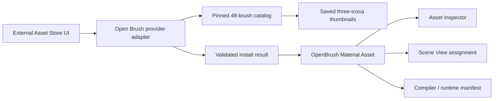

# Open Brushマテリアル Provider 設計

## ステータス

- 対象機能: F-21 外部素材ストア / F-18 Open Brush 取り込み
- 参照: MI-03, MI-04, MI-05, MI-09, MI-15, MI-21, MI-49, MI-52
- 状態: 設計記録。現在はカタログおよび外部素材プロバイダーの実装が存在する。詳細な対応範囲は `src/lib/visual-editor/open-brush-catalog.ts`、`external-store-providers.ts`、`external-store.ts` と照合する。

## ユーザーが得たい結果

ビジュアルエディターの Assets から Open Brush のブラシを見た目で選び、再利用可能なマテリアルとして現在のプロジェクトへ追加できるようにする。

## 入口と情報設計

素材の見出しにある「アセットストア」はそのまま維持する。ダイアログ左のプロバイダー一覧では、Open Brush を Poly Haven と同じ階層に追加し、Poly Haven のマテリアル絞り込みや下位カテゴリには含めない。

```text
外部リソースを追加
┌────────────────┬──────────────────────────┬───────────────────┐
│ リソース集       │ Open Brush               │ 選択したMaterial    │
│                │ [検索................]    │ [実ストロークPreview]│
│ Poly Haven     │ [すべて][描画][発光][形状] │ OilPaint           │
│ Open Brush  選択│                          │ Apache-2.0          │
│                │ [OilPaint] [Ink]          │ three-icosa対応      │
│                │ [Fire]     [Light]        │                   │
│                │ [Comet]    [Wire]         │ [Materialを追加]    │
└────────────────┴──────────────────────────┴───────────────────┘
```

プロバイダー一覧では、既存の Poly Haven の直下に Open Brush を並べる。カードの大きさ、選択時の表示、バッジの位置は双方で揃える。

| 項目 | Poly Haven | Open Brush |
| --- | --- | --- |
| プロバイダーバッジ | CC0 | Apache-2.0 |
| 主な対象 | HDRI、PBRマテリアル | Open Brushマテリアル |
| 取得単位 | 解像度と形式を選ぶファイル | バージョン固定のブラシプリセット |
| 主操作 | プロジェクトへインストール | マテリアルを追加 |
| プレビュー | 配布元のサムネイル | 実ストロークをthree-icosaで描画 |

## カタログの範囲

最初のリリースでは、XRift Studio にバージョン固定で同梱している `three-icosa` の `all_brushes.glb` に含まれ、代表ストローク形状と `GOOGLE_tilt_brush_material` GUID の両方を確認できる 48 マテリアルを表示する。

同梱のブラシリソースに含まれていても、代表形状を持たないプリセットは表示しない。Open Brush の実験段階のブラシや、現在の `three-icosa` で再現を検証していないブラシも対象外とする。画面や案内では「Open Brush の全ブラシ」とせず、「XRift Studio で検証済みの 48 ブラシ」と明記する。

カタログの各項目には次の情報を持たせる。

- プロバイダー ID: `open-brush`
- 安定 ID: ブラシ GUID
- 表示名と `three-icosa` が解決するブラシ名
- 元データのマテリアル番号と代表ノード番号
- 検索用のカテゴリとタグ
- レンダラー名・バージョン
- カタログのリビジョン
- 配布ページ、ライセンス名、ライセンス URL
- プレビュー・サムネイルの状態

複数のリビジョンに同名のブラシが存在しても、同一ブラシかどうかの判定には GUID を使う。GUID が異なるものは別のマテリアルとして扱う。

## Preview

Open Brush のシェーダーは、通常の球体や平面に貼るだけでは元ストロークが持つ頂点属性を再現できない場合がある。そのため、カタログ上では CSS 図形、色見本、汎用の球体をマテリアルの見本として使わない。

- 一覧サムネイルは、固定した `all_brushes.glb` から各項目の代表ノードだけを分離し、同梱のブラシライブラリと `three-icosa` で実際に描画して全 48 件の保存済み WebP を生成する。
- 一覧と右側の詳細欄は GUID をキーに同じ保存画像を表示し、ストアを開くだけでは WebGL Canvas を生成しない。
- レンダラー、カタログリビジョン、代表ノードの対応を変更したときだけ、専用の生成スクリプトで全件を再生成する。
- シェーダーリソース不足、コンパイルエラー、属性不一致が発生した場合は、PBR フォールバックで成功表示にせず、生成工程自体を失敗させる。
- 保存済みサムネイルが欠落または破損している場合は、マテリアル名、ブラシアイコン、プレビューを表示できない旨を即座に表示し、「プレビューを生成中」のまま放置しない。

## 選択したマテリアルの詳細

右側の詳細欄には次の項目を表示する。

1. 保存済みの実ストロークサムネイル
2. マテリアル名
3. 分類タグ（例: 描画、発光、半透明、粒子表現、形状）
4. プロバイダー、作者、Apache-2.0、配布元へのリンク
5. `three-icosa` のレンダラーバージョンとカタログリビジョン
6. 「ストローク向けマテリアル。メッシュattributeにより見た目が変わります」という互換性説明
7. 主操作「マテリアルを追加」

Open Brush には解像度選択がないため、Poly Haven で表示している「解像度」「ファイル形式」「ダウンロード目安」は表示しない。代わりに「収録版: XRift Studio検証済み」と描画ライブラリのバージョンを読み取り専用で表示する。

## 状態設計

### 操作前

- ダイアログを開いたときは従来どおり Poly Haven を初期選択とし、Open Brush は左サイドバーから 1 操作で切り替えられるようにする。
- プロバイダーを切り替えたときは、検索語・カテゴリ・選択中マテリアルをプロバイダーごとに保持し、ダイアログ背後のシーン、素材の選択状態、カメラは変更しない。
- Open Brush を選んだ際はカタログの先頭項目を初期選択とし、右側の詳細欄でライブプレビューを開始する。
- プロジェクトが未保存のとき、動作確認（Play）中のとき、あるいは別の素材処理が進行中のときは、理由を表示して「マテリアルを追加」を無効にする。

### 処理中

- 主操作のラベルを「追加中」に切り替え、プロバイダー切替、マテリアル切替、閉じる操作、二重実行をすべて無効にする。
- インストール要求では任意の URL やシェーダーソースを受け取らず、プロバイダー ID、ブラシ GUID、カタログリビジョンだけをネイティブ／プロバイダー境界へ渡す。
- プロバイダー側で GUID とリビジョンを固定カタログと照合したうえで、マテリアル記述子（descriptor）を返す。
- `AssetManifest` への反映は 1 件の編集履歴トランザクションにまとめ、途中で失敗した場合はマテリアルを作成しない。

### 成功時

- `External/Open Brush` フォルダーにマテリアルを 1 件作成する。
- 作成したマテリアルには、ブラシ名、GUID、レンダラーバージョン、ブラシのリソース参照元、元データのマテリアル番号、プロバイダーの帰属情報（attribution）を保存する。
- シーンやメッシュへは自動割り当てせず、新しく追加したマテリアルを `assetSelection` に設定して、右側の素材設定で実際のプレビューと互換性を確認できる状態にする。
- 同じプロバイダー・GUID・レンダラーバージョンのマテリアルがすでに存在する場合は複製せず、既存のマテリアルを選択したうえで「追加済みです」と表示する。
- 成功時は「素材で開く」を主操作、「続けて追加」を副操作として表示する。「素材で開く」を押すとダイアログを閉じ、選択したマテリアルの設定を表示する。

### 失敗時

- カタログの読み込みに失敗した場合は、Open Brush の選択・検索語・カテゴリをそのまま残し、中央領域から再試行できるようにする。
- プレビューの失敗とインストールの可否は切り分けて扱い、実際のレンダラーで描画できなかった事実を示したうえでプレビューの再試行を用意する。
- GUID 不一致、未対応プリセット、レンダラーバージョン不一致、素材保存失敗のいずれかが起きた場合、追加を完了扱いにしない。
- インストールに失敗しても `AssetManifest`、シーン、選択状態、編集履歴は一切変更せず、同じマテリアルから再試行できるようにする。

### 戻り先

- 取り消した場合は、ダイアログを開く前のビジュアルエディター、シーンの選択状態、素材の選択状態、カメラ位置へ戻る。
- 成功後に「素材で開く」を押した場合は、追加したマテリアル（または重複検出された既存マテリアル）を選択し、その設定を表示する。

## 保存モデル

Open Brush ではブラシ固有のシェーダーとストローク属性に対応した処理が必要になる。保存時には `MaterialAsset.shader.kind = "openbrush"` を使い、Poly Haven の PBR テクスチャ展開処理とは分離する。

```ts
type OpenBrushCatalogEntry = {
  providerId: "open-brush";
  externalId: string; // brush GUID
  name: string;
  brushName: string;
  sourceMaterialIndex: number;
  sourceNodeIndex: number;
  category: "paint" | "drawing" | "light-effect" | "shape";
  tags: string[];
  renderer: "three-icosa";
  rendererVersion: string;
  catalogRevision: string;
  assetUrl: string;
  licenseName: "Apache-2.0";
  licenseUrl: string;
};
```

作成するマテリアルの ID は表示名に依存させず、`external-open-brush-{guid}-material` を基準に決定する。帰属情報は既存の `AssetAttribution` にプロバイダー、作者、元データ URL、ライセンスを保存する。

エディターは XRift Studio に同梱した固定のブラシライブラリを使い、生成されたランタイムはマテリアルに保存した固定のレンダラーバージョンとブラシのリソース参照元を使う。この入口ではユーザー指定 URL や任意 GLSL の取得を許可しない。将来的にプロジェクト所有のリソースとして書き出す場合でも、同じカタログ ID とマテリアル記述子を使い、コンパイラー側のリソース解決処理だけを差し替える。

## レイヤー境界



- UI はプロバイダー固有の GUID テーブル、ライセンス文言、レンダラーのリソースパスを持たない。
- プロバイダーアダプターがカタログ、オプション、帰属情報、インストール結果を共通仕様へ変換する。
- 素材作成は既存の `applyExternalStoreInstall` の境界で分岐させ、`VisualEditor` コンポーネントへ Open Brush 固有の処理を散在させない。
- カスタムマテリアルのプレビューは、元の 3D モデルに付属する取り込みマテリアルと、カタログから追加した単独マテリアルの双方を同じアダプターで表示する。

## 実装順

1. プロバイダーメタデータと共通仕様に `material` および Open Brush 用のプレビュー記述子を追加する。
2. 固定 48 ブラシのカタログと GUID 検証をプロバイダーアダプターに追加する。
3. プロバイダーサイドバーへ Open Brush を Poly Haven と同列で追加する。
4. 代表ノードを使う専用のサムネイル生成スクリプトと GUID 単位の保存画像を追加する。
5. 単独 Open Brush マテリアルのインストールと重複検出を追加する。
6. 成功後の `assetSelection`、設定表示、元に戻す / やり直す、保存・再読み込みを確認する。
7. コンパイラーとランタイムで同じブラシ名、GUID、レンダラーバージョンが使われることを確認する。

## 受け入れ条件

- Open Brush が Poly Haven と同じプロバイダーサイドバー階層に表示される。
- 検証済みマテリアルを名前、カテゴリ、タグで絞り込める。
- 選択したマテリアルの実ストロークプレビュー、ライセンス、レンダラーバージョンを追加前に確認できる。
- 1 回の操作で 1 つの Open Brush マテリアルが作成され、シーンは自動で変更されない。
- 追加後はそのマテリアルが選択され、設定パネルから実際のプレビューと出典を確認できる。
- 処理中・失敗・取り消し時に二重実行や不完全な `AssetManifest` 更新が起きない。
- 保存・再読み込み、元に戻す / やり直す、シーンへのマテリアル割り当て、コンパイル後も GUID とレンダラーバージョンが失われない。

## この入口で扱わないもの

- Open Brush のすべての実験的ブラシへの自動追従
- 任意の URL からのブラシシェーダー・GLSL 取り込み
- 複数マテリアルの一括追加
- Open Brush アプリへブラシプリセットを逆書き出しする機能
- マテリアル追加と同時にメッシュやシーンを自動作成する機能

## 固定ソース

- [Open Brush](https://github.com/icosa-foundation/open-brush)
- [three-icosa](https://github.com/icosa-foundation/three-icosa)
- [XRift Studioに同梱したbrush libraryの由来](../public/visual-editor/openbrush/SOURCE.md)
- [XRift Studioの第三者素材記録](../THIRD_PARTY_ASSETS.md)
