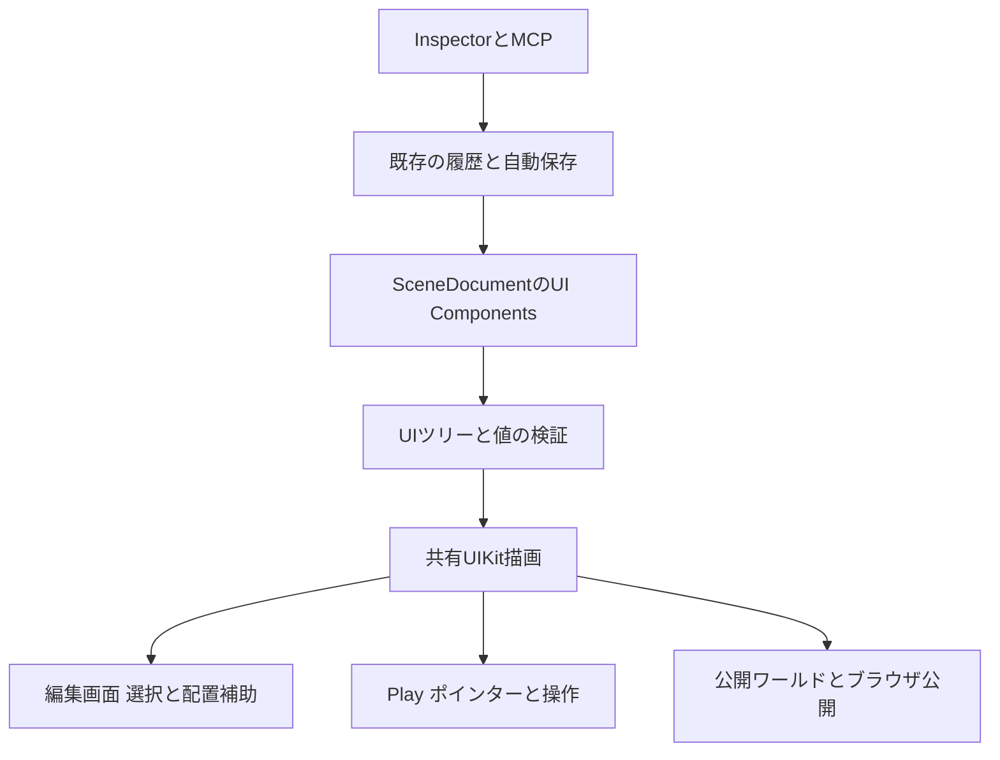

# UIKitを標準Componentとして編集する設計

Container・Text・Image を Hierarchy で自由に組み、Inspector から編集できる UI 制作機能を設計する。UIKit は Studio に同梱し、通常の制作では Script Asset の作成や npm パッケージの登録を不要とする。編集画面に常時表示し、Play と公開先でも同じ保存データと描画処理を使う。

本設計は UI 編集機能全体を対象とする。v1.0.13 の Script Render 編集プレビューは既存作品向けの修正であり、以下で扱う標準 Component 機能とは別の実装段階にある。

## 制作者の操作

「追加」メニューの UI カテゴリーから UI Canvas を配置し、その下に Container・Text・Image を追加して、Hierarchy で並び替え・複製・親の変更を行う。Canvas を選ぶと空間内の位置・回転・幅を、子要素を選ぶと余白・整列・文字・画像を Inspector で変更できる。

Scene View 上の要素をクリックすると、対応する Hierarchy の行が選択される。編集補助として Container の枠、余白、子の配置方向を表示する。通常クリックは選択に使い、ボタンの動作・スクロール・入力は Play で確認する。レイアウト上のドラッグ操作は並び順や絶対配置の値を更新するだけで、計算済みの座標は保存しない。

案内板、画像付きカード、横並びメニュー、スクロールする説明文、操作ボタンなどを自由に組み合わせられる。完成した UI は親 Entity を Prefab として保存し、別の場所でも再利用できる。

## Componentと階層

UI 要素も通常の Entity として保存する。UI 専用の別ドキュメントを重ねるのではなく、既存の Entity ID、親子関係、Undo、Prefab、選択状態、MCP のリビジョンをそのまま活用する。Component の識別子は Studio 側で固定し、UIKit の内部クラス名には依存させない。

| 標準Component | 保存するtype | 主な設定 |
|---|---|---|
| UI Canvas | `ui-canvas` | 空間内の幅・高さ、pixelSize、基準点、共通フォント・色 |
| UI Container | `ui-container` | row/column、整列、折り返し、gap、padding、背景、角丸、overflow |
| UI Text | `ui-text` | 本文、フォント、太さ、サイズ、色、行間、字間、折り返し、文字揃え |
| UI Image | `ui-image` | Texture Asset、サイズ、objectFit、比率の保持、色 |

UI Canvas を UI ツリーの境界とする。Canvas 自体は既存の Transform で 3D 空間へ配置し、子要素は Canvas または Container に所属させる。UI の子要素では 3D の Transform を単位変換やレイアウト計算へ混ぜず、保存値を単位変換（identity）に固定し、Inspector にも UI レイアウトの設定を表示する。

- 親子関係は 1 箇所だけで管理する。子の並び順は `Entity.children`、Component の値は `Entity.components` を唯一の管理元とする。
- 各 UI Entity に置ける UI Component は 1 つだけとする。Canvas と Container が子を持ち、Text と Image は末端要素とする。
- 通常の 3D Entity を UI Container へ直接入れたり、UI 要素を Canvas の外へ移動したりする操作は、理由を表示して反映しない。種別を変換したい場合は明示的な別操作として提供する。

この制約は手動編集、MCP、Prefab 展開、読み込みのすべてで共通の検証処理に通す。なお、UIKit 1.x では Image に子を持たせない仕様のため、画像の上に文字を重ねるときは Container の兄弟要素として配置する（[UIKit 1.xへの移行仕様](https://pmndrs.github.io/uikit/docs/migration/from-version-0)）。

## 寸法とスタイル

Canvas の幅と高さは m、内部のレイアウトと文字サイズは px で扱う。たとえば幅 1.8m、`pixelSize` 0.005m であれば内部幅は 360px になる。Inspector には必ず単位を表示し、Canvas の幅を変えても内部の px 余白や文字サイズは維持する。UI 全体を同じ比率で拡大・縮小したいときは Canvas の Transform Scale を使う（[UIKitの寸法仕様](https://pmndrs.github.io/uikit/docs/tutorials/sizing)）。

- 幅・高さは固定 px、親に対する %、`auto` を区別して保存し、`0` と未指定を混同しない。
- `padding`、`margin`、`borderRadius` は四辺・四隅をまとめて編集でき、必要なときだけ個別入力へ展開できるようにする。
- 初期のレイアウト方式は Flexbox とし、必要に応じて絶対配置を選べるようにする。ドラッグによる位置移動だけで Flexbox から絶対配置へ勝手に切り替えることはしない。
- 親からの継承と要素自身の指定を明確に区別し、上書きを解除できるようにする。
- 保存できるスタイルは Studio が許可した型付き項目に限り、UIKit のすべてのプロパティや JavaScript 関数を JSON へそのまま流し込まない。`hover` や `active` などの状態変化も、許可項目の差分として保存する（[UIKitのComponentとプロパティ](https://pmndrs.github.io/uikit/docs/getting-started/components-and-properties)）。

日本語フォントは Canvas で設定して Text へ継承させ、太さが異なるフォントも Asset として解決する。日本語対応の初期フォントは、再配布条件を確認した実ファイルとライセンスを同梱する。独自フォントには既存の Font Asset を使い、公開物へ依存ファイルを含める。字形生成は Canvas 内の文字集合をもとにメモ化し、長文によるアトラス容量超過、読み込み失敗、欠けた字形を診断として通知する。

Image には既存の Texture Asset ID を保存する。画像の縦横比、`objectFit`、透明度、色空間の処理は編集と公開で共通にする。表示用 URL、生成した Three.js オブジェクト、計算後の寸法、フォントアトラスといった派生データは保存しない。

## 共通の描画と編集

共有の型・既定値・検証処理は `packages/xrift-studio-runtime/src/ui/` に置き、同じパッケージ内の R3F アダプターが実際の UIKit の Container・Text・Image へ変換する。`ui-canvas` は Studio の標準 Component として扱い、UIKit 1.x で非推奨となった Root クラスには依存しない。

- Scene View の通常 Entity 描画では、Canvas 単位で UI サブツリーを共有レンダラーへ渡し、子要素を別経路で二重描画しない。
- 各 UI Entity は既存の `scene-entity-tree-store.ts` と同じ単位で更新を購読する。1 つの Text を書き換えただけでシーン全体を作り直さず、変更していない Entity の参照を維持する。
- Classic 書き出しとランタイムマニフェストの双方に UI Component を追加する。公開用コードには共有レンダラーを同梱し、ブラウザ公開用シェルも同じランタイム契約で再構築する。UIKit、React、R3F、Three、World Components のバージョンと Provider の同一性を揃え、配布ビルドでは UIKit の登録に必要なコンストラクター名を保持する。
- 描画エラーは Canvas ごとに隔離し、失敗した Canvas に対象 Entity と診断を表示する。エラー時でも Hierarchy と Inspector は操作できる状態を維持し、該当 Component を修正・無効化できるようにする。部分的な表示成功だけで保存データを書き換えたり、問題のある Entity を自動削除したりはしない。

## 操作とGraph

表示と動作を分離し、通常の UI を表示するだけでは Script を読み込まない。Button は Container・Text・状態スタイルに、型付きの UI 操作 Component を組み合わせた標準プリセットとして提供する。クリック・ホバー・選択は共有のポインターアダプターで処理し、Entity ID と Component ID を持つイベントを Graph へ渡す。ソースコード文字列をイベント欄に保存することはない。

UI の数値・色・表示状態を Graph から変更できるよう、既存のランタイムブリッジを拡張する。文字列や Texture Asset の変更には文字列ソケットを新設せず、固定の設定値を持つアクションとして表現し、参照する Asset は依存解析の対象に含める。Play 中の変更は実行時の一時的な上書きとして扱い、Stop で保存済みの値へ戻す。

マウス操作に続き、XRift のレイ・タッチ入力への接続、スクロール、Input、キーボードフォーカスを実装する。イベントの二重発火、UI から背後の 3D 物体へのクリック伝播、Canvas をまたぐフォーカス移動は共通アダプターで制御する。ワールド空間に置く UI と画面に追従する UI では座標アダプターだけを分け、レイアウトと描画本体は共有する。

## MCPと既存機能への接続

`add_component` と `update_component` で標準 UI Component を追加・編集できるようにする。既存の作成・並び替え・親変更・Prefab 操作にも同じ親子制約を適用する。複数要素をまとめて作成する専用ツールを追加する場合は、一括検証後に 1 件の履歴として反映し、途中で半分だけ保存される状態を作らない。

AI に UI 作成を依頼するときは標準 Component を既定とし、Script Render は複雑な計算や特殊な描画が必要な場合に限定する。MCP での選択・撮影・診断では UI 要素の Entity ID とレイアウト設定を取得できるようにし、生成した JSX を提出する流れを通常ルートにしない。

主な実装対象は、`scene-document.ts` とシリアライズ処理、Component 一覧と追加処理、Inspector、Hierarchy の移動検証、Scene View、共有ランタイム、コンパイラー、Asset 依存解析、MCP スキーマ、Graph ブリッジ、ユーザーガイドである。既存の 3D Text と Image はそのまま残し、「3D Text」「UI Text」のように名前で用途を区別する。

## 既存Scriptからの移行

既存の Script はそのまま読み込める状態を維持し、任意の TSX を解析して自動置換する処理は行わない。Studio が管理する UIKit Panel テンプレートの既知バージョンのみを変換候補とし、変換前に対象・引き継ぐ値・移行できない処理を明示する。

変換時は新しい Canvas と UI 要素を作成し、Entity の空間配置、見出し・本文、寸法、色、角丸、Font Asset を引き継ぐ。元の Script は保管したまま 1 回の Undo で元に戻せるようにする。独自の `start` 処理、イベント、外部参照を含む Script は自動置換せず、標準 UI を新規作成して段階的に移行する。

## 実装の順序と受け入れ条件

| 段階 | 実装範囲 | 完了条件 |
|---|---|---|
| 1 | Canvas・Container・Text・Image、階層、Inspector、Asset、Prefab、MCP、共通公開レンダラー | コードを書かず画像付き日本語案内を作成・保存・再読込でき、Play前に見える。編集・Play・Classic公開・ブラウザ公開で同じ内容を描画する |
| 2 | 状態スタイル、Button、Graph、スクロール、XRポインター | マウスと実機のXR入力で操作を確認し、Stopで値・購読・フォーカスが戻る |
| 3 | Input、フォーカス移動、レスポンシブ設定、画面追従UI、編集用2Dフォーカスビュー | サイズ変更・日本語入力・タッチ・フォーカスを検証し、ワールド空間と画面追従でレイアウト処理を共有する |
| 4 | 既知テンプレートの変換支援、UIプリセットの拡充 | 元のScriptと配置を保管し、変換結果を確認してUndoできる |

各段階では、保存・Undo・Prefab 展開・不正な親変更の拒否において、途中で半端な状態が残らないことを検証する。

描画比較は同一のカメラ、Asset、フォント、サイズで行い、日本語長文、画像の透過、角丸、`overflow`、入れ子構造、欠けた Asset、壊れた Canvas を検証ケースに含める。検証には配布用の圧縮ビルド、実物の UIKit、実際の公開成果物を使う。さらに段階 1 で実用規模の要素数を測定し、再描画範囲・字形更新・GPU メモリの許容値を定める。
