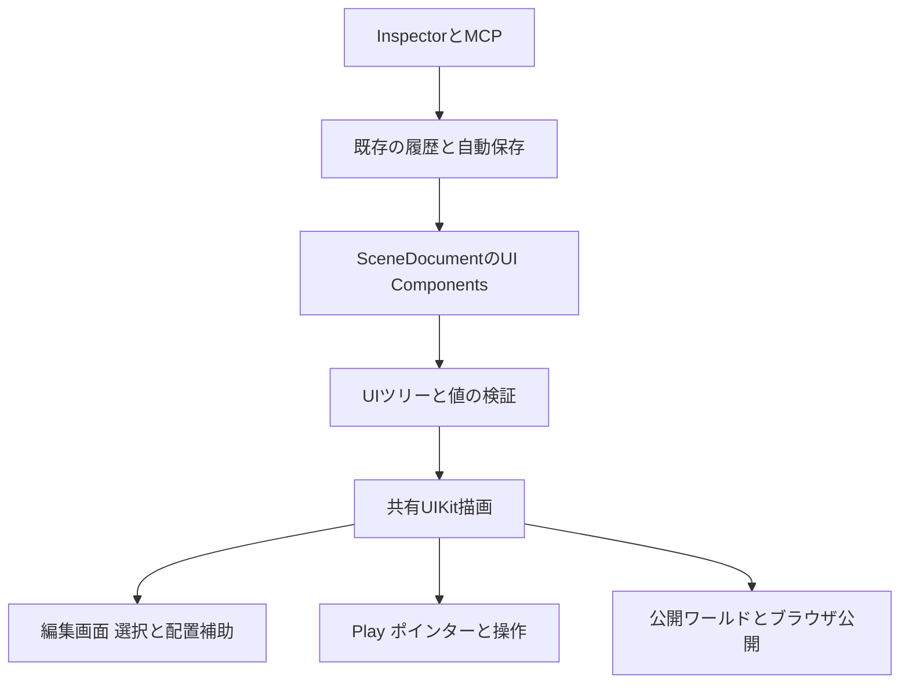

# UIKitを標準Componentとして編集する設計

Container・Text・ImageをHierarchyで自由に組み、Inspectorから編集できるUI制作機能を提案する。UIKitはStudioに同梱し、通常の制作ではScript Assetの作成やnpmパッケージの登録を必要としない。編集画面に常時表示し、Playと公開先にも同じ保存データと描画処理を使う。

本設計はUI編集全体を対象とする。v1.0.13のScript Render編集プレビューは既存作品の修正であり、以下の標準Component機能とは別の実装段階にある。

## 制作者の操作

「追加」のUIカテゴリーからUI Canvasを配置する。Canvasの下にContainer・Text・Imageを追加し、Hierarchyで並び替え、複製、親の変更を行う。Canvasを選ぶと空間内の位置・回転・幅を、子を選ぶと余白・整列・文字・画像をInspectorで変更できる。

Scene View上の要素をクリックすると対応するHierarchy行を選択する。Containerの枠、余白、子の配置方向を編集補助として表示する。通常のクリックは選択に使い、ボタンの動作・スクロール・入力はPlayで確認する。レイアウト上のドラッグは並び順や絶対配置の値を変更し、計算済みの座標を保存しない。

案内板、画像付きカード、横並びメニュー、スクロールする説明、操作ボタンを組み合わせられる。完成したUIの親EntityをPrefabとして保存し、ほかの場所でも利用する。

## Componentと階層

UI要素も通常のEntityとして保存する。別のUI専用ドキュメントを重ねず、既存のEntity ID、親子関係、Undo、Prefab、選択、MCPのrevisionを使う。Componentの識別子はStudio側で固定し、UIKitの内部クラス名に依存させない。

| 標準Component | 保存するtype | 主な設定 |
|---|---|---|
| UI Canvas | `ui-canvas` | 空間内の幅・高さ、pixelSize、基準点、共通フォント・色 |
| UI Container | `ui-container` | row/column、整列、折り返し、gap、padding、背景、角丸、overflow |
| UI Text | `ui-text` | 本文、フォント、太さ、サイズ、色、行間、字間、折り返し、文字揃え |
| UI Image | `ui-image` | Texture Asset、サイズ、objectFit、比率の保持、色 |

UI CanvasをUIツリーの境界にする。Canvas自体は既存のTransformで3D空間へ配置し、子はCanvasかContainerに所属させる。UIの子では3D Transformを単位変換やレイアウトへ混ぜず、保存値をidentityに固定し、InspectorもUIレイアウトの設定を表示する。

親子関係は一か所だけに保存する。子の順序は`Entity.children`、Component値は`Entity.components`を正本とする。各UI EntityにはUI Componentを一つだけ置く。CanvasとContainerが子を持ち、TextとImageは末端とする。通常の3D EntityをUI Containerへ直接入れる操作や、UI要素をCanvasの外へ移す操作は、理由を表示して反映しない。変換する場合は明示的な別操作にする。

この制約は手動編集、MCP、Prefab展開、読み込みで共通のvalidatorを通す。UIKit 1.xではImageに子を持たせず、画像に文字を重ねるときはContainerの兄弟として配置する。[UIKit 1.xへの移行仕様](https://pmndrs.github.io/uikit/docs/migration/from-version-0)

## 寸法とスタイル

Canvasの幅・高さはm、内部のレイアウトと文字サイズはpxとする。例えば幅1.8m、pixelSize 0.005mなら内部幅は360pxになる。Inspectorには必ず単位を表示し、Canvasの幅変更ではpxの余白や文字サイズを維持する。全体を同じ比率で拡大する操作はCanvasのTransform Scaleを使う。[UIKitの寸法仕様](https://pmndrs.github.io/uikit/docs/tutorials/sizing)

幅・高さは固定px、親に対する%、autoを区別して保存する。`0`と未指定を混同しない。padding・margin・borderRadiusは四辺・四隅をまとめて変更でき、必要なときに個別入力へ展開する。初期の配置はFlexboxとし、絶対配置も選択できる。位置のドラッグでFlexboxから絶対配置へ勝手に切り替えない。

親からの継承と要素自身の指定を区別し、上書きを解除できるようにする。保存するstyleはStudioが許可した型付きの項目に限る。UIKitの全propsやJavaScript関数をJSONへそのまま流し込まない。hover・activeなどの状態も許可項目の差分として保存する。[UIKitのComponentとプロパティ](https://pmndrs.github.io/uikit/docs/getting-started/components-and-properties)

日本語フォントをCanvasで設定し、Textへ継承する。太さが異なるフォントもAssetとして解決する。日本語対応の初期フォントは、再配布条件を確認した実ファイルとライセンスを同梱する。独自フォントは既存のFont Assetを使い、公開物へ依存ファイルを含める。字形の生成はCanvasの文字集合を基にメモ化し、長文のアトラス容量、読み込み失敗、欠けた字形を診断する。

Imageは既存のTexture Asset IDを保存する。画像の比率、fit、透明度・色空間の処理は編集と公開で共通にする。表示用URL、生成したThree.js Object、計算後の寸法、フォントアトラスは保存しない。

## 共通の描画と編集

共有の型・既定値・検証を`packages/xrift-studio-runtime/src/ui/`へ置き、同じパッケージ内のR3F adapterが実際のUIKit Container・Text・Imageへ変換する。`ui-canvas`はStudioの標準Componentであり、UIKit 1.xで非推奨になったRootクラスへの依存は作らない。

Scene Viewの通常Entity描画はCanvasでUIサブツリーを共有rendererへ渡し、その子を別経路で二重に描画しない。UIの各Entityは既存の`scene-entity-tree-store.ts`と同じ単位で更新を購読する。一つのTextを書き換えてもScene全体を作り直さず、変更していないEntityの参照を保つ。

Classic書き出しとランタイムmanifestの双方にUI Componentを追加する。公開用コードは共有rendererを同梱し、ブラウザ公開のシェルも同じruntime contractで再構築する。UIKit、React、R3F、Three、World ComponentsのバージョンとProviderの同一性を揃える。配布ビルドではUIKitの登録に必要なコンストラクター名を保持する。

Canvasごとに描画エラーを隔離し、失敗したCanvasに対象Entityと診断を表示する。HierarchyとInspectorは利用できる状態を保ち、該当Componentを修正・無効化できるようにする。部分的に表示できただけで保存データを書き換えたり、問題のEntityを削除したりしない。

## 操作とGraph

表示と動作を分離し、通常のUIを表示するだけではScriptを読み込まない。ButtonはContainer・Text・状態スタイルと、型付きのUI操作Componentを組み合わせた標準プリセットにする。クリック・ホバー・選択は共有のポインターadapterで処理し、Entity ID・Component IDを持つイベントをGraphへ渡す。ソースコード文字列をイベント欄に保存しない。

UIの数値・色・表示状態はGraphから変更できるよう、既存のruntime bridgeへ追加する。文字列やTexture Assetの変更は文字列socketを新設せず、固定した設定値を持つactionとして表現する。参照するAssetは依存解析の対象に含める。Playの変更は実行時overrideとし、Stopで保存済みの値へ戻す。

マウス操作に続き、XRiftのレイ・タッチとの入力接続、スクロール、Input、キーボードフォーカスを実装する。イベントの二重発火、UIから背後の3D物体へのクリックの伝播、Canvasをまたぐフォーカスを共通adapterで扱う。ワールド空間のUIと、画面へ追従するUIの座標adapterを分け、レイアウトと描画本体は共有する。

## MCPと既存機能への接続

`add_component`と`update_component`で標準UI Componentを追加・編集する。既存の作成・並び替え・親変更・Prefab操作を拡張し、同じ親子制約を適用する。複数要素を作る正式ツールを追加する場合は、一括検証後に一つの履歴として反映し、途中で半分だけ保存しない。

UIをAIに依頼するときは、標準Componentを既定にする。Script Renderは計算や特殊な表示が必要な場合に選ぶ。MCPでの選択・撮影・診断では、UI要素のEntity IDとレイアウト設定を取得できるようにし、生成したJSXの提出を通常ルートにしない。

実装対象は`scene-document.ts`とserialization、Component一覧と追加処理、Inspector、Hierarchyの移動検証、Scene View、共有runtime、compiler、Asset依存解析、MCP schema、Graph bridge、ガイドである。既存の3D TextとImageは保持し、名前は「3D Text」「UI Text」のように用途を区別する。

## 既存Scriptからの移行

既存Scriptはそのまま読み込む。任意のTSXを解析して自動置換する処理は行わない。Studioが管理するUIKit Panelテンプレートの既知の版だけを変換候補にでき、変換前に対象、引き継ぐ値、移行できない処理を表示する。

変換は新しいCanvasとUI要素を作り、Entityの空間配置、見出し・本文、寸法、色、角丸、Font Assetを引き継ぐ。元Scriptを保管し、一つのUndoで戻せるようにする。独自のstart・イベント・外部参照があるScriptは自動置換せず、標準UIを新規作成して段階的に移す。

## 実装の順序と受け入れ条件

| 段階 | 実装範囲 | 完了条件 |
|---|---|---|
| 1 | Canvas・Container・Text・Image、階層、Inspector、Asset、Prefab、MCP、共通公開renderer | コードを書かず画像付き日本語案内を作成・保存・再読込でき、Play前に見える。編集・Play・Classic公開・ブラウザ公開で同じ内容を描画する |
| 2 | 状態スタイル、Button、Graph、スクロール、XRポインター | マウスと実機のXR入力で操作を確認し、Stopで値・購読・フォーカスが戻る |
| 3 | Input、フォーカス移動、レスポンシブ設定、画面追従UI、編集用2Dフォーカスビュー | サイズ変更・日本語入力・タッチ・フォーカスを検証し、ワールド空間と画面追従でレイアウト処理を共有する |
| 4 | 既知テンプレートの変換支援、UIプリセットの拡充 | 元のScriptと配置を保管し、変換結果を確認してUndoできる |

各段階で保存・Undo・Prefab展開・不正な親変更の原子性を検証する。描画は同じカメラ、Asset、フォント、サイズで比較し、日本語長文、画像の透過、角丸、overflow、入れ子、欠けたAsset、壊れた一つのCanvasを含める。配布用の圧縮ビルドで検証し、実物のUIKitと公開成果物を使う。想定する実用規模の要素数を段階1で測定し、再描画範囲・字形更新・GPUメモリの許容値を決める。
