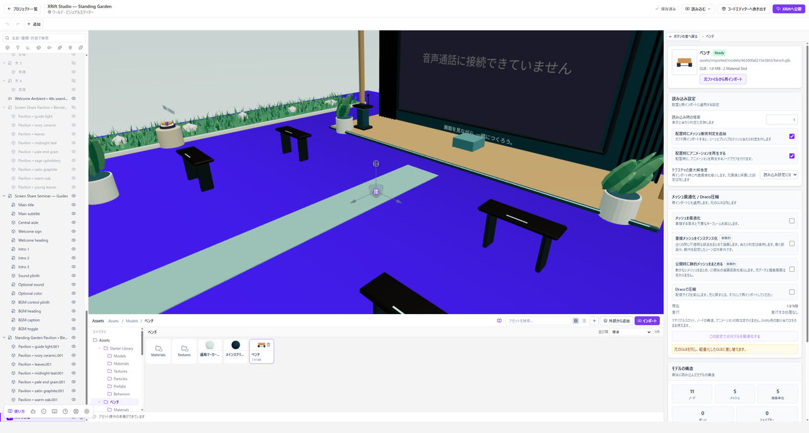

# モデルや画像を取り込む

動画で操作を確認する：[外部GLBを読み込んで配置する](./lesson-02-01.md)

モデル、画像、音声はAssetsに取り込んでから使います。モデルはシーンに配置し、画像はマテリアルなどに割り当てます。

*取り込んだモデルはAssetsに表示されます。シーンへドラッグすると配置できます。*

## 3Dモデルを取り込む

「Assets → ファイルから素材を追加」でファイルを選ぶか、Assetsパネルへ直接ドラッグ＆ドロップして取り込みます。読み込み設定の画面が表示されたら、内容と取り込み結果を確認してください。

Assetsに取り込んだだけではシーンに表示されません。Assetsから中央のシーンへドラッグして配置し、HierarchyでそのEntityを選んで位置や大きさを調整します。

初めて取り込む場合は、モデルとテクスチャなどの素材を1つのファイルにまとめられるGLB形式が扱いやすくおすすめです。GLTFのように外部の画像ファイルを参照する形式を使うときは、参照先のファイルも一緒に用意してください。

同じ形状を複数並べたGLB（`EXT_mesh_gpu_instancing`）は、並べた数のままシーンに表示されます。インスタンスごとの独自属性をシェーダーで使う方法は、[モデルの属性を読む](./custom-shaders.md#モデルの属性を読む)を参照してください。

## Blenderで作ったパーツを保存・編集する

デスクトップ版では、`.blend` ファイルをAssetsへドラッグして取り込めます（端末にBlenderのインストールが必要です）。家、家具、人物などをパーツごとの `.blend` に分けておくと、後から個別に編集しやすくなります。

1. Blenderで外部リンクをローカル化し、使用している画像を「ファイル → 外部データ → リソースをパック」でまとめて保存します。
2. `.blend` ファイルをAssetsへ追加します（1ファイルの上限は128MBです）。プロジェクト内に編集元がコピーされ、表示用のGLBと関連づけて保存されます。
3. Assetsで対象のModelを選び、Inspectorの「Blenderで編集」を押します。
4. Blenderで修正・保存したら、Studioで「Blenderから再取り込み」を押します。シーンに配置済みのモデルも、同じModelを参照したまま自動で更新されます。

取り込み後の扱いには、いくつか注意点があります。

- **編集元はプロジェクト内のコピー**：取り込み後はプロジェクト内にコピーされた `.blend` を編集します。元の外部ファイルを書き換えても自動では反映されません。AIがBlenderで生成した新しいモデルも、同様にプロジェクト内へ編集元が保存されます。なお、既存のGLBファイルだけから制作時の `.blend` を復元することはできません。
- **表示や公開に使うデータ**：Scene、Play、公開では表示用のGLBが使われます。Blender固有の機能や材質はglTFとして書き出せる範囲で反映されるため、再取り込み後はStudio上で見た目を確認してください。
- **既存GLBから編集用 `.blend` を追加した場合**：同じ「Blenderで編集」から開いて、GLBに残っているメッシュやボーンを編集できます。ただし、制作時のモディファイアや作業履歴は復元されません。移行直後は元のGLBがそのまま表示され、Blenderから再取り込みするまで形状は変わりません。
- **MToon設定の扱い**：移行用ツールで保存したテクスチャ参照のないMToon設定は、マテリアルのカスタムプロパティに記録され、再取り込み時に復元されます。Blender上の表示はMToon描画そのものではないため、形状の修正はBlender、MToonの見た目の確認と調整はStudioで行ってください。

## VRMアバターを取り込む

VRM 0.xとVRM 1.0の `.vrm` ファイルも、通常の3Dモデルと同じ手順で取り込めます。取り込んだあとはAssetsからシーンへドラッグして配置します。

モデルのフォルダー内にあるMaterialsからマテリアルを選ぶと、Inspectorで色や輪郭線を調整できます。VRM 0.xのMToonは「MToon 0.x」、VRM 1.0のMToonは「MToon 1.0」と表示され、どちらもShade Color、Outline Color、Outline Widthを編集でき、「マテリアルの種類」から切り替えることもできます。詳しくは[MToonの陰影と輪郭線](./materials.md#mtoonマンガのような陰影と輪郭線を付ける)を参照してください。

配置したVRMのポーズや動きについては、次の仕組みになっています。

- **ポーズとシェイプキーの調整**：NodeやBoneはHierarchyから選んで位置・回転・大きさを調整でき、シェイプキーはInspectorの「モデルポーズ」から調整できます。同じモデルを複数配置してもポーズはEntityごとに設定できますが、マテリアルの色を変えると、同じマテリアルを使っているすべての箇所に反映されます。
- **編集中のプレビューと取り消し**：数値欄やSceneのギズモをドラッグしている間も姿勢の変化をリアルタイムに確認できます。1回の操作は「元に戻す」で取り消せるほか、数値のドラッグ中ならEscapeキーでもキャンセルできます。Boneの回転、シェイプキーの変更、「ポーズをリセット」を実行しても、Nodeごとに調整した位置・回転・大きさはそのまま残ります。
- **髪や服の揺れもの（SpringBone）**：Play中と公開後のワールドで動き、揺れ方や当たり判定にはVRMファイルの設定がそのまま使われます。編集中は揺れずに調整したポーズのまま表示され、Stopを押すと元の姿勢に戻ります。

別の作品へ渡すときは、Model本体を[Hierarchyから.xriftstudioで書き出してください](./hierarchy-transfer.md#mtoonvrmモデルを渡す)。プロジェクト全体のバックアップや[コードエディターへの書き出し](./save-and-open.md#コードエディターへ書き出す)にも、VRMファイルと編集後のマテリアルが含まれます。

## 画像・音声を取り込む

画像や音声も、モデルと同じようにAssetsへ取り込んで使います。画像はマテリアルの模様や背景に、音声は音源などに割り当てます。

取り込んだ画像をモデルに貼るにはマテリアルへの割り当てが必要です。設定方法は[テクスチャを貼る](./textures.md)を、音声の設定は[音を鳴らす](./audio.md)を参照してください。

## Open BrushのGLBを取り込む

Open Brushで書き出したGLBも、Assetsへ追加してシーンに配置できます。`OilPaint (Instance)` などのブラシ名が自動で認識され、編集画面でも公開先でも対応するブラシシェーダーで描画されます。GLBに埋め込まれた画像はTexture Assetとして取り込まれ、マテリアルやブラシシェーダーへの割り当ても引き継がれます。

Open Brushのモデルを編集するときは、次の点を確認しておくと調整しやすくなります。

- **一部のブラシだけ材質を変える**：Hierarchyで `diamondhull_0` などのメッシュノードを選び、InspectorのMesh Rendererで別のマテリアルを割り当てます。MToonやPBRを指定するとそのノードのブラシシェーダーだけが置き換わり、同じ種類のブラシを使うほかのノードは元の材質のまま残ります。
- **DiamondHullの縁の発光**：面を浅い角度から見ると縁が強く発光する特性があり、床などに使うと遠くの部分が白く見えることがあります。角度による発光を避けたい場合は、そのノードに別のマテリアルを割り当ててください。
- **切り抜きを使うブラシの輪郭**：ThickPaintなどは、対応する端末で輪郭が滑らかに描画されます。Post Processingを有効にした場合も、編集画面と公開先で同じ処理が使われます。ただし、メッシュ自体の角張った輪郭は元の形のまま残ります。
- **動きのあるブラシ**：Dots、Bubbles、Embers、Smokeなどは、ブラシ専用の頂点属性を使って動きを描きます。書き出し時にこの属性が失われると、GLBだけから元の動きを復元できません。元のOpen Brush作品を残し、頂点属性を含む形式で書き出してから取り込み直してください。

## モデルが小さい・大きい

配置したモデルが見当たらないときは、Hierarchyで対象のEntityを選び、`F` キーで視点を合わせます。モデルが見つかったら、Inspectorで大きさを調整してください。制作元の単位や原点の違いによって、配置した直後の位置や大きさが想定と異なることがあります。

モデルが見えるようになったら、床との位置関係もあわせて確認します。カメラを近づけて大きく見えても、モデル自体のサイズは変わっていません。

## 色や質感を変える

配置したモデルを選び、Mesh Rendererでマテリアルの割り当てを確認します。複数のマテリアルスロットがあるモデルでは、色を変えたい面に対応するスロットを選んで編集します。

モデルから取り込んだマテリアルには、再インポート時の扱いがInspectorに表示されます。編集を始める前に内容を確認し、大きく差し替えるときは事前にバックアップを取っておくと安心です。

## ファイルを差し替える前に

ファイルを差し替える前に、プロジェクトを[ファイルに書き出す](./save-and-open.md#バックアップする)などしてバックアップしておきましょう。取り込み済みの素材を先に削除すると、その素材を使っているシーンに影響が出ることがあるため、削除画面で使用箇所を確認してから進めてください。

読み込みエラーが表示された場合は、原因を確認してから取り込み直します。Assetsに項目が増えていても、モデルが正しく読み込めているかシーン上で確かめておくと確実です。

## VehicleとSeatを追加する

車を配置するには、「アセットストア → ギミック → カスタム車」から「カスタム車をシーンへ追加」を押します。「XRift公式コンポーネント → Vehicle」からも、同じ設定済みの車を追加できます。椅子だけを置きたい場合は、「XRift公式コンポーネント → Seat」を選んでください。

カスタム車には、屋根のない車体、運転席、同乗席、4本のタイヤ、排気煙がまとめて設定されており、Hierarchyに親子構造で配置されます。編集画面でも車体や座席を確認でき、子Entityを選べばInspectorで位置、マテリアル、Scriptを調整できます。座席の高さは、座席EntityのTransformから変えられます。

車のモデルはAssetsにGLBとして追加されます。色には通常のglTFマテリアルのBase Colorが使われており、座席のマテリアルは1つです。色や質感を変えたいときはMesh Rendererから編集します。

配置と調整が終わったら、[Playで運転や着席を試してください](./play-mode.md#vehicleとseatを試す)。変更内容は自動で保存されます。
