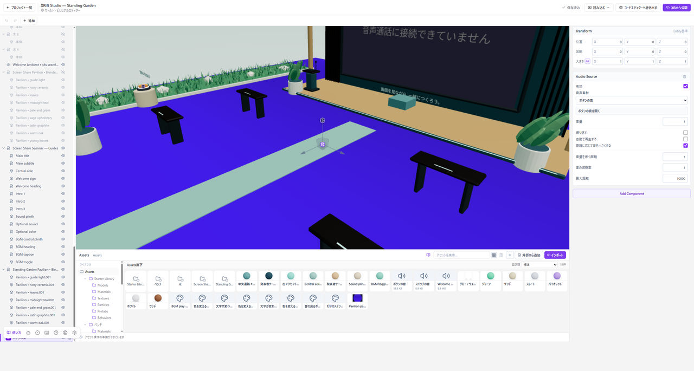

# BGMや環境音を鳴らす

音声ファイルをAssetsに取り込み、シーン内の音源に割り当てるとワールド内で音を鳴らせます。全体で均一に流すBGMか、近づいたときだけ聞こえる環境音かに合わせて設定を使い分けます。

*音源のEntityを選ぶと、使用する音声、音量、繰り返し再生などをInspectorで調整できます。*

## まず動く見本で試す

まずは「Assets → アセットストア → 3Dセット → 環境音のスピーカー」を追加してみてください。繰り返し再生する音源があらかじめ設定されているため、Playでスピーカーに近づいたり離れたりして音の聞こえ方を体験できます。

設定項目の配置が分かったら、手元の音声ファイルに差し替えてみましょう。

## 自分の音声に替える

1. 使いたい音声ファイルをAssetsに取り込みます。
2. Hierarchyで音源のEntityを選び、Inspectorの音源設定でその音声を指定します。
3. 音量、繰り返し、再生の開始条件を設定し、Playで実際に聞いて確認します。

音声ファイルをAssetsに取り込んだだけでは音は鳴りません。必ず音源へ割り当て、再生を始める設定を行ってください。

## 聞こえる範囲を確認する

Audio Sourceの「グローバル」のオン・オフで、空間内での聞こえ方を切り替えられます。

- **BGMとして全体に流す場合**：「グローバル」をオンにします。音源との距離や向きに関係なく一定の音量で再生されます。必要に応じて「繰り返す」と「自動で再生する」もオンにしてください。
- **環境音として場所ごとに鳴らす場合**：「グローバル」をオフにします。音源の方向と距離に応じて聞こえ方が変化します。「音量が下がり始める距離」を超えると、離れるにつれて音が小さくなります。「音量の下がり方」が0のときは距離による減衰がなく、値を大きくするほど距離に応じて音量が下がりやすくなります。

環境音は近くと遠くの両方で聞き比べ、BGMもワールドの各所を歩いて想定どおりの音量か確かめてください。

なお、音源の「音量」と、マテリアルの厚みを設定するVolumeは別の項目です。

## ボタンを押したときだけ鳴らす

「3Dセット → 音の出るボタン」を追加すると、操作したタイミングで音が鳴る見本を試せます。自分で仕組みを組みたい場合は、[Node Graph](./interactivity.md)を使ってボタン操作から音源の再生をつなぎます。

## 音が鳴らない

再生されないときは、次の項目を上から順に確認してください。

- 音声ファイルの読み込みエラーが出ていないか
- 音源に音声ファイルが正しく割り当てられているか
- 音量が0になっていないか、再生の開始条件が設定されているか
- プレイヤーが音の聞こえる範囲にいるか
- パソコンやスマートフォン、ブラウザがミュートになっていないか

また、公開するワールドに使う音声は、使用と配布が許可された素材を選んでください。
