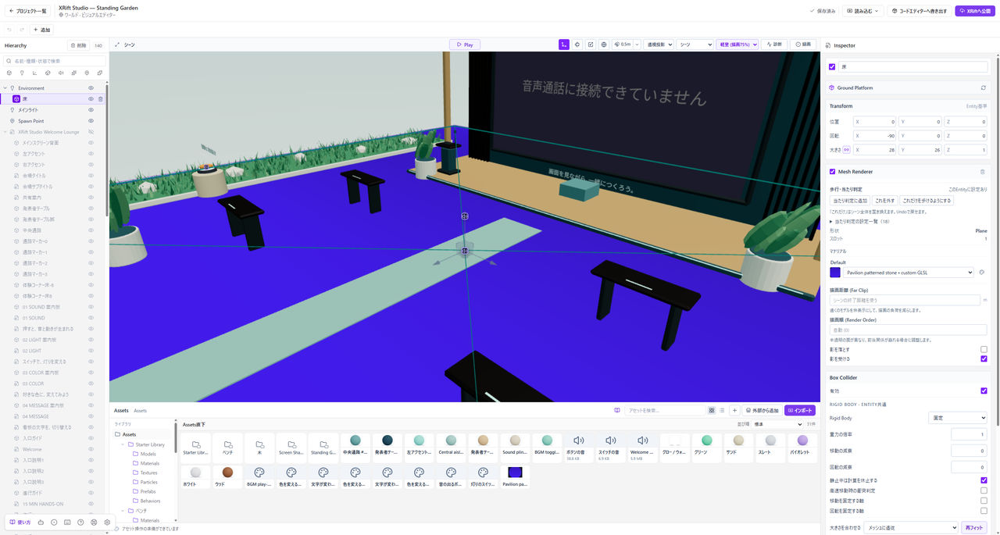

# 歩ける床と開始位置を作る

動画で操作を確認する：[床Collider・SpawnPoint・Playを確認する](./lesson-01-05.md)

プレイヤーが床の上を歩けるようにするには、床にCollider（衝突判定）を設定する必要があります。床が見えているのにすり抜けて落ちてしまうときは、Colliderの設定とプレイヤーの開始位置を見直します。

*Hierarchyで床を選び、Box Colliderが有効で、Rigid Bodyが固定になっていることを確認します。*

## 床のColliderを確認する

Stopを押して編集画面に戻り、Hierarchyで床のEntityを選びます。InspectorでColliderが追加されて有効になっているか、またColliderの形や大きさが実際に歩かせたい範囲と一致しているかを確認してください。

新しく追加するPlaneには、最初からBox Colliderが付いています。初期の厚みは0.02 mで、TransformのScale Zを変えると厚みも連動して変わります。床の広さはScale XとScale Yで調整すればよく、Mesh Colliderへ切り替える必要はありません。

Colliderが付いていないオブジェクトには、Add ComponentからBox ColliderやMesh Colliderなど形状に合うものを追加します。床や壁など動かさないEntityでは、Rigid Bodyを `fixed` に設定してください。なお、薄い床や複雑な形のモデルでは、見た目の形状とColliderの判定がずれることがあるため注意が必要です。

## 開始位置を確認する

HierarchyでSpawnPointなどの開始位置Entityを選び、歩ける床のすぐ上に配置されているか確認します。床や壁の内部に埋まっていたり、ワールドの外に出ていたりすると正しく着地できません。

「空のワールド」には最初からPlaneとSpawnPointが用意されています。最初の練習では、この2つを消さずにそのまま活用して進めると安全です。

## Playで確認する

Playを押し、読み込みが終わったら実際に歩いて確かめます。床の中央だけでなく、端や段差の近くも歩いてみてください。床をすり抜けて開始位置へ戻され続ける場合は、Colliderの設定と開始位置の高さを見直します。

## 押せるボタンとの違い

ボタンを押したり触ったりして反応させるには、Interactableの設定が必要です。プレイヤーがぶつかって止まるためのColliderとは役割が異なるため、ボタンが反応しない場合は[仕掛けの設定](./interactivity.md)を確認してください。

## Mesh Colliderへ切り替える

Mesh RendererのCollision欄には、現在設定されているBox ColliderやMesh Colliderが表示されます。

- **固定Mesh Colliderにする**：既存のColliderを無効にし、固定・Trimesh・TriggerなしのMesh Colliderへ切り替えます。単にBox Colliderのサイズを変えたいだけなら、この操作ではなく下にあるBox Colliderの欄で調整してください。
- **これだけにする**：シーン全体にあるほかのColliderと自動生成をすべて無効にします。床やTriggerにも影響するため、対象をよく確認してから使ってください。意図せず変更してしまった場合は「元に戻す」で戻せます。

## 見た目を変えたらColliderも確認する

モデルの差し替え、大きさの変更、親子関係の整理を行ったあとは、もう一度Playで歩いて確認してください。見た目だけチェックしていると、通れなくなった通路やすり抜けてしまう床を見落としやすくなります。
