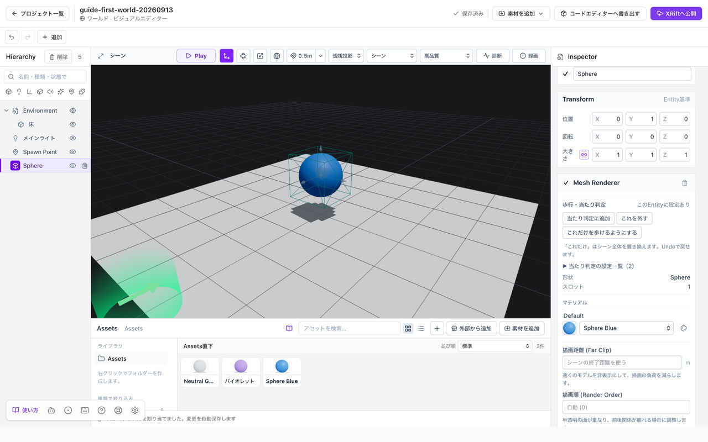

# 画面の見方と視点操作

動画で操作を確認する：[Hierarchyで選ぶ・視点を動かす](./lesson-01-03.md)

ビジュアルエディターは、4つの領域に分かれています。左のHierarchyで配置したものを選び、中央のシーンで見た目を確認します。細かな設定は右のInspector、素材の管理は下のAssetsで行います。

*HierarchyでSphereを選ぶと、右のInspectorに位置やマテリアルの設定が表示されます。*

## Hierarchy：配置したものを選ぶ

Hierarchyには、シーン内に配置したオブジェクトが一覧で並びます。カメラの外にあって画面に映っていないものも、ここから選べます。シーンに置く一つひとつのオブジェクトをEntityと呼びます。

「床」「机」「入口」のように分かりやすい名前を付けておくと、数が増えても迷わず探せます。親子関係でグループにまとめる方法は、[配置と整理](./objects.md)をご覧ください。

## シーン：作っている空間を見る

中央の3D画面がシーンです。制作中の空間を確認したり、オブジェクトをクリックして選んだり、視点を動かして別の角度から見たりできます。

作業中にオブジェクトを見失ったときは、Hierarchyで対象のEntityを選んでFキーを押すと、その位置に視点が合います。マウスホイールで近づいたり離れたりしても、Entity自身の位置は変わりません。

編集画面での視点操作キーは、画面下部のステータスバーにある「ショートカットキー一覧」で確認できます。なお、Play中の移動には別のキーを使います。

## Inspector：選んだものを調整する

右側のInspectorには、現在選択している対象の設定が表示されます。Entityを選べば位置や追加した機能、Assetsのマテリアルを選べば色や質感を編集できます。

手順どおりの設定欄が見当たらないときは、何が選ばれているかを確認してみてください。マテリアルの色や質感を変えたいときは、EntityではなくAssets側で対象のマテリアルを選びます。

## Assets：使う素材を管理する

下部のAssetsでは、3Dモデル、画像、音声、マテリアルなどの素材を管理します。3Dモデルを中央のシーンへドラッグ＆ドロップすると、Entityとして配置できます。

Assetsに取り込んだだけではシーンに現れません。シーンへ配置したときに初めてEntityが作られます。同じモデル素材から複数のEntityを配置することも可能です。

## Components：Entityに機能を足す

ライト、音源、Colliderなど、Entityに取り付ける機能のことをComponentと呼びます。Inspectorの「Add Component」から選んで追加します。

歩ける床には[Collider](./collision.md)、音を鳴らしたい場所には[音源](./audio.md)というように、必要な機能から少しずつ試してみてください。

## パネルが見つからなくなったら

パネルを閉じたり動かしたりして元の配置が分からなくなったら、画面下部の「ヘルプ → パネル配置を初期化」を使います。パネルの位置と大きさだけがリセットされ、プロジェクトのデータは消えません。

## 下部のステータスバー

画面下部のステータスバーには、制作の補助機能や通知がまとまっています。

- **シーン設定（左下の歯車アイコン）**：押すとInspectorにシーン全体の設定が表示されます。もう一度押すと、直前に選んでいたEntityや素材の設定に戻ります。
- **制作チャット（ロボットのアイコン）**：開いているワールドへの追加や調整をAIに相談できます。MCP接続の設定は、制作チャットの入力欄の下にある「MCP接続」から開けます。チャットのタブを閉じても、入力途中の文章や処理の状態は残ります。
- **使い方・ショートカット**：ガイドや「ショートカットキー一覧」をすぐに開けます。
- **操作結果とインポート進捗（右側）**：処理の結果や素材の読み込み状況が表示されます。インポートの「詳細」を押すと履歴を確認でき、Escapeキーまたは履歴の外側をクリックすると閉じられます。

このほか、アプリのバージョン確認や更新はプロジェクト一覧の「設定」から行えます。[録画](./recording.md)はシーン上部の表示メニューにあります。

## アイテムの表示とギミック

アイテムの編集画面は、初期状態でUnlit表示になっています。照明がない状態でも形や基本色を確認しやすくするための表示で、マテリアルや書き出すデータには影響しません。照明を含めた見た目を確認したいときは、表示モードを「シーン」に切り替えます（ワールドでは最初から「シーン」になっています）。

「素材を追加 → アセットストア → ギミック」は、ワールドとアイテムのどちらでも利用できます。ただし、移動・乗車・着席・同期などプレイヤーやルームが必要な仕掛けは、実際にアイテムを配置するワールド側でも動作を確認しておきましょう。

## 見た目が違うとき

編集中にBloomや影が見えない場合は、表示モードを「シーン」、描画品質を「高品質」に切り替えて確認します。

- **「軽量」「描画50%」「描画25%」**：描画の負荷を抑えるため、影とPost Processingが省略されます。
- **「自動」**：高品質で始まりますが、処理が重い状態が続くと自動で描画品質を下げます。

ここで切り替える描画品質は編集画面の表示だけに適用され、公開するワールドの品質設定には影響しません。

## 配置・設定・受け渡しを分ける

操作の目的ごとに使う場所を覚えておくと迷いにくくなります。

- **新しく物を置く**：上部の「素材を追加」から「Entityを作成」やファイル取り込みを選びます。
- **置いたEntityに機能を足す**：右側のInspectorからComponentを追加します。コピーや複製などの編集操作は、SceneとHierarchyのどちらの右クリックメニューからも同じように行えます。
- **別のプロジェクトと受け渡す**：選んだEntityだけを渡すときは、送り出す側で「選択範囲を書き出す」、受け取る側で「素材を追加 → .xriftstudioから追加」を使います。プロジェクト全体を開く場合は、プロジェクト一覧から取り込みます。
