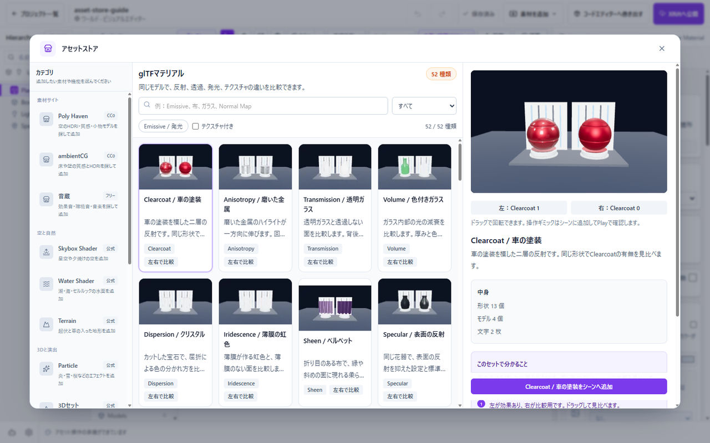
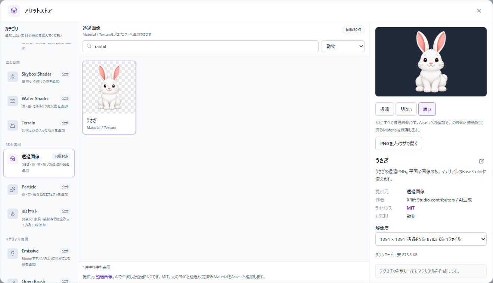

# カタログから素材を追加する

上部の「素材を追加 → アセットストア」から素材のカタログを開けます。「Assets → アセットストア」からも同じカタログを利用できます。見た目や機能を見比べながら、作品に合う素材を選んでください。

*素材の詳細で、見本と追加される内容を確認できます。*

## 選んで追加する

「アセットストア」を開き、左の一覧から配布元や素材の種類を選びます。たとえば、モデルや質感はPoly Haven、空はSkybox Shader、Emissiveの発光やClearcoat・TransmissionなどのglTFマテリアルは「マテリアル表現」、家具や装飾は「3Dセット」、PortalやMirrorなどは「XRift公式コンポーネント」から探せます。

名前や説明で検索し、詳細画面で見本と追加される内容を確認してください。解像度や形式を選べる場合は、容量も確かめてから追加します。取り込みが終わったら、Assetsやシーンに追加された結果を確認してください。ダウンロードに失敗した場合は、表示されたエラー内容を確認します。

- **3Dモデル**：配布元がGLB形式で提供している場合はそのままGLBとして保存します。glTF形式のみのモデルは、モデル本体と必要なテクスチャをまとめて取り込みます。GLBのダウンロードや取り込みにアプリ独自の容量上限はありません。Poly HavenとambientCGからの直接追加はデスクトップ版で利用できます。
- **HDRI**：配布元が用意するHDRまたはEXRから選び、元の形式で保存します。Poly Havenでは素材ごとに配信形式を選べ、ambientCGではEXRを使います。「追加後にSkyboxに設定」を選ぶと、そのまま背景にも設定できます。
- **音蔵（効果音・環境音・楽曲）**：デスクトップ版とブラウザ版の両方で直接追加できます。「音蔵の音源分類」で「すべて」「SFX（効果音・環境音）」「BGM（音楽、歌入り楽曲を含む）」を切り替えられ、分類と検索を組み合わせて探せます。一覧は120件ずつ表示され、下部の「さらに○件を表示」で続きを開けます（検索は未表示の音源も含む全件が対象です）。詳細画面の「プロジェクトに追加」を押すとOGG音源がAssetsに保存されるので、Audio Sourceに設定して使ってください。

## 選択したEntityにモデルを設定する

Entityの名前や位置・回転・大きさはそのままに、見た目の3Dモデルを追加したり差し替えたりできます。空のEntityにも設定できます。

1. Hierarchyで対象のEntityを選びます。
2. InspectorのMesh Rendererにあるモデル選択から、Assets内の3Dモデルを選びます。Mesh RendererがないEntityでは「3Dモデルを設定」から選びます。
3. 新しい素材を探す場合は、同じ欄の「素材ストア」を押します。素材の詳細画面で「追加後に『対象名』へモデルを設定」にチェックが入っていることを確認して実行します。チェックを外すと、Assetsへの追加だけを行います。
4. Scene ViewとInspectorで結果を確認します。モデルはAssetsにも保存され、この操作は「元に戻す」で取り消せます。

モデルを差し替えても、EntityのID・名前・Transform・ほかのComponents・手動で追加した子Entityはそのまま残ります。新しいモデルでは既定のMaterialが使われ、元のモデル専用のポーズは引き継がれません。自動Box Colliderは新しいモデルの寸法に合わせて調整され、手動Box Colliderはそのまま残ります。元のモデルが生成した子Entityに付いていたMesh Colliderは、新しいモデルへ引き継がれます。

モデルの一部を選んでいる場合は、Hierarchyで元モデルのEntityを選び直してください。元モデルの子に手動で追加したEntityやComponentがある場合、またはColliderに別の形状モデルを設定している場合は、編集内容が失われないよう差し替えを中止します。Inspectorで設定を整理してからもう一度試してください。元のモデルファイル自体は削除されません。

## AI LOWPOLY PROPSのローポリモデルを追加する

「素材サイト → AI LOWPOLY PROPS」では、小物・家具・建物などのローポリモデルを探せます。デスクトップ版とブラウザ版の両方で使え、APIキーの設定は不要です。

日本語・英語の名前やキーワードで検索できます。空白やカンマで区切って複数の語を入力すると、すべてを含むモデルがヒットします。一覧は120件ずつ表示され、「さらに○件を表示」で続きを開けます（検索には未表示のモデルも含まれます）。

詳細画面で見本・容量・CC0ライセンスを確認し、「プロジェクトに追加」を押すと、元のGLBがAssetsに保存されます。追加後はAssetsのモデルを右クリックして「シーンへ配置」を選んでください。

配布されているのは静的な3D素材で、アニメーション・当たり判定・つかむ機能などは含まれていません。必要な機能は配置後に設定してください。一覧の読み込みや取り込みに失敗した場合は、エラーを確認して再試行します。

## 素材庫のモデル・画像を追加する

「素材サイト → 素材庫」では、配信中のGLBモデルやPNG画像・マスクを探せます。デスクトップ版とブラウザ版の両方で利用できます。詳細画面のファイル選択で、通常のモデルとアニメーション入りのモデルを選べます。

利用条件を確認して「プロジェクトに追加」を押すと、GLBはModel、PNGとマスクはTextureとして元のファイルのまま保存されます。マスクは色補正を行わないLinearで取り込まれます。追加後はAssetsから選んで使えます。なお、ライセンス欄が「未指定」になっている素材は、利用や再配布が許可されているとは限らないため注意してください。取得に失敗した場合は、エラーを確認して再試行します。

## 追加後に何が起きる？

| 素材 | 使い方 |
| --- | --- |
| モデル | Assetsに取り込んでから、シーンへ配置します。 |
| マテリアル | 使いたいEntityの表面に割り当てます。シーン全体に自動では適用されません。 |
| Skybox Shader | 追加時の設定に応じて、背景に割り当てられます。 |
| Water Shader | 水面にするメッシュへ割り当てるマテリアルです。 |
| Particle | 色や動きを持つ粒子の素材です。「追加後にシーンへ配置」で放出用のEntityも作れます。 |
| 3Dセット・Terrain | 詳細でEntityの構成を確認し、必要なものを配置します。 |

## Particleを選んで調整する

Particleには、炎・雨・雪・桜に加え、花火・水中の泡・滝のしぶき・地面の霧・落ち葉・魔法のオーラなど25種類のテンプレートがあります。名前や説明、カテゴリから探してください。

詳細画面の「追加前に設定を調整」を開くと、放出量・寿命・速さ・大きさ・形状・重力・色・描画方式を変更できます。Burst（一度に放出）では、放出時刻・数・回数・間隔を指定できます。変更内容は動く見本にすぐ反映されます。花火のように一度だけ放出する見本は、「見本を再生し直す」で確認してください。

「テンプレートの設定に戻す」を押すと、選択中のテンプレートの初期値に戻せます。ストアを開いている間は別のテンプレートを選んでも調整値が残り、追加に失敗した場合も設定は消えないため、そのままやり直せます。

テンプレートには、炎・煙と霧・水滴・泡・桜の花びら・落ち葉・紙片・雪の結晶・光のきらめきなど、用途に合った透明背景のテクスチャがあらかじめ設定されています。追加すると見本と同じPNG画像がプロジェクトに保存されてParticleに割り当てられ、公開時にも同じ画像が使われます。同じ画像と設定のTextureがすでにある場合は再利用されます。

追加後はAssetsでParticleを選び、Inspectorから引き続き編集できます。テクスチャの差し替えやマテリアルの割り当てもInspectorで行えます。すでに作成済みのParticleの設定が自動で書き換わることはありません。

## 動く見本から仕組みを覚える

ギミックは、ワールドとアイテムの両方に追加できます。音の出るボタン、灯りのスイッチ、自動で閉まる扉などの見本が用意されています。詳細の説明を読んで配置し、Playで動作を確かめてください。プレイヤーやルームが必要な動作は、アイテムの配置先ワールドでも確認します。

追加したギミックは、通常のEntityや素材と同じように編集できます。[仕掛けの入門](./interactivity.md)では、音の出るボタンの作り方を解説しています。

## 権利表記を確認する

素材の詳細画面で、配布元・作者・ライセンスを必ず確認してください。ほかの場所へ書き出す場合も、必要な権利表記を残します。

素材の使用条件は配布元ごとに異なります。用途や再配布の可否は、カタログに掲載されていることだけでは判断できないため、必ず各素材の条件を確認してください。

## 一日の空を選んで設定する

1. Assetsの「アセットストア」を開き、「空・自然 → Skybox Shader」を選びます。
2. 「一日の空・7つの時間帯」を押すと、夜明けから星の夜までの見本が並びます。
3. 好きな空を選んで「Skyboxに設定」を押します。通常のMaterialとしてAssetsに追加され、そのまま背景に適用されます。

天頂・地平線・雲の光と影などは、ストアの詳細画面や追加後のInspectorで調整できます。これら7種類の静止Skyboxには、現在時刻に合わせた自動変化や、飛行機・鳥などの動く要素は含まれません。

## 透過画像を追加する

「3Dと演出 → 透過画像」には、うさぎ・猫・犬・小鳥・花・葉・雲・光・飾りなど30点の透過PNGが収録されています。追加のアカウントやAPIキーは不要で、デスクトップ版・ブラウザ版のどちらでも使えます。

1. 名前やカテゴリで画像を探します。「rabbit」「うさぎ」のどちらでも検索できます。
2. 詳細画面で「透過」「明るい」「暗い」の背景を切り替え、輪郭や半透明部分のなじみ方を確認します。
3. 「プロジェクトに追加」を押すと、元のPNGと透過設定済みMaterialがAssetsに保存され、そのMaterialが選択されます。シーンには自動配置されません。
4. Materialを平面などに割り当てます。画像の板やParticleに使いたい場合は、一緒に保存されたTextureを選んでください。

ブラウザ版では「PNGを保存」から画像だけをダウンロードでき、デスクトップ版では「PNGをブラウザで開く」から元画像を開けます。同じ素材をもう一度追加しても、すでに編集した設定は上書きされません。画像はAI生成で、利用条件はMITライセンスです。取り込み先には`LICENSE.txt`も保存されます。
