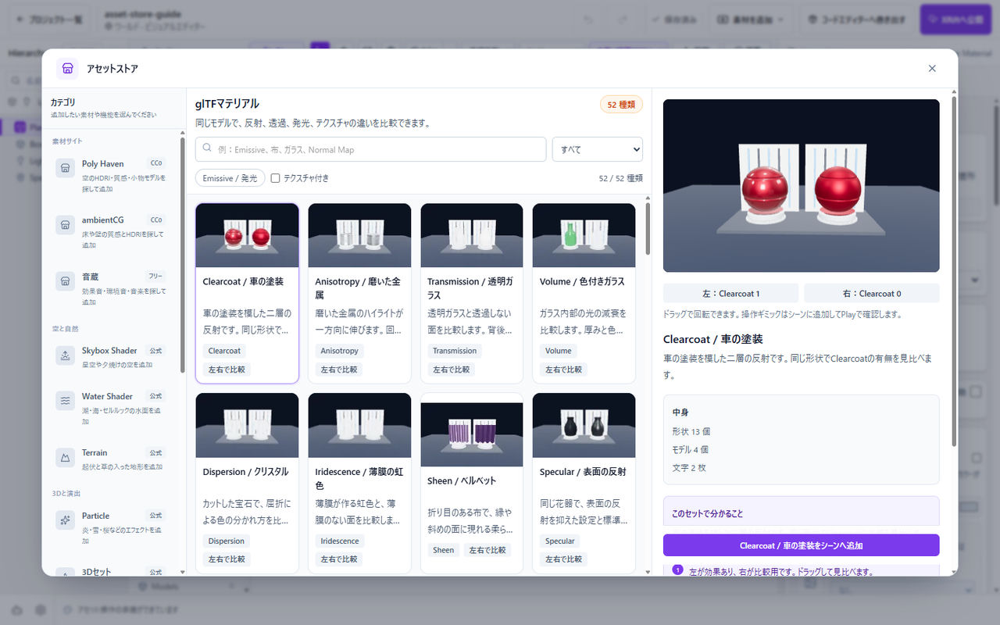
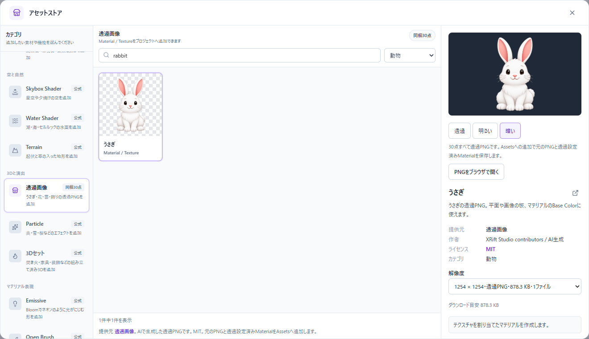

# カタログから素材を追加する

上部の「素材を追加 → アセットストア」で、素材のカタログを開けます。「Assets → アセットストア」からも同じカタログを使えます。見た目や機能を確認して、作品に合う素材を選んでください。

*素材の詳細で、見本と追加される内容を確認できます。*

## 選んで追加する

「アセットストア」を開き、左の一覧で配布元や素材の種類を選んでください。モデルや質感はPoly Haven、空はSkybox Shaderなどから探せます。名前や説明で検索し、詳細画面で見本と追加内容を確認します。解像度や形式を選べる場合は、容量も確認してから追加してください。

取り込みが終わったら、Assetsやシーンに追加された内容を確認します。ダウンロードに失敗した場合は、表示されたエラーを確認してください。

配布元が自己完結したGLBを用意しているモデルは、そのGLBを保存します。glTFだけのモデルは、必要なモデル本体とテクスチャを合わせて取り込みます。GLBのダウンロードと取り込みには、アプリ独自の固定容量上限を設けていません。

HDRIは、配布元が用意するHDRまたはEXRから選び、元の形式で保存します。Poly Havenでは素材ごとの配信形式を選べます。ambientCGのHDRIはEXRを使います。「追加後にSkyboxに設定」を選ぶと背景にも設定できます。

音蔵の効果音・環境音・楽曲は、デスクトップ版とブラウザ版の両方で直接追加できます。「音蔵の音源分類」で、すべて・SFX（効果音・環境音）・BGM（音楽）を切り替えられます。BGMには歌入りの楽曲も含まれます。分類と検索を組み合わせて探してください。一覧は120件ずつ表示されます。下部の「さらに○件を表示」で続きを表示してください。検索は未表示の音源も含む全件が対象です。音蔵で音源を検索し、詳細の「プロジェクトに追加」を押すと、OGG音源がAssetsに保存されます。追加した音源はAudio Sourceに設定してください。Poly HavenとambientCGからの直接追加は、デスクトップ版で使えます。

## 選択したEntityにモデルを設定する

Entityの名前・位置・回転・大きさを保って、見た目の3Dモデルを追加・差し替えられます。空のEntityにも設定できます。

1. Hierarchyで対象のEntityを選びます。
2. InspectorのMesh Rendererにあるモデル選択で、Assetsの3Dモデルを選びます。Mesh RendererがないEntityでは「3Dモデルを設定」から選びます。
3. 新しい素材を探す場合は、同じ欄の「素材ストア」を押します。素材の詳細で「追加後に『対象名』へモデルを設定」を確認し、追加と設定を実行します。チェックを外すと、Assetsへの追加だけを行います。
4. Scene ViewとInspectorで結果を確認します。モデルはAssetsにも保存され、同じ操作を「元に戻す」で取り消せます。

モデルを変更しても、EntityのID、名前、Transform、他のComponentsと手動の子Entityを保ちます。新しいモデルの既定Materialを使い、元モデル専用のポーズは引き継ぎません。自動Box Colliderは新しいモデルの寸法に合わせ、手動Box Colliderは保ちます。元モデルの生成した子にあったMesh Colliderは、新しいモデルへ引き継ぎます。

モデルの一部を選んでいる場合は、Hierarchyで元モデルのEntityを選んでください。元モデルの子に手動で追加したEntityやComponentがある場合、またはColliderに別の形状モデルを設定している場合は、差し替えを拒否して編集を守ります。Inspectorで設定を整理してから変更してください。元のモデルファイルは削除しません。

## AI LOWPOLY PROPSのローポリモデルを追加する

「素材サイト → AI LOWPOLY PROPS」で、小物・家具・建物などのローポリモデルを探せます。デスクトップ版とブラウザ版の両方で使え、APIキーの設定は不要です。

日本語・英語の名前やキーワードで検索できます。空白やカンマで区切った複数の語は、すべてを含むモデルを探します。一覧は120件ずつ表示し、「さらに○件を表示」で続きを開けます。検索には未表示のモデルも含まれます。

詳細で見本・容量・CC0ライセンスを確認し、「プロジェクトに追加」を押してください。元のGLBをAssetsに保存します。追加後は、Assetsのモデルを右クリックして「シーンへ配置」を選びます。

配布モデルは静的な3D素材です。アニメーション・当たり判定・つかむ機能は含まれません。必要な機能は配置後に設定してください。一覧や取り込みに失敗した場合は、エラーを確認して再試行してください。

## 素材庫のモデル・画像を追加する

「素材サイト → 素材庫」で、配信中のGLBモデルとPNG画像・マスクを探せます。デスクトップ版とブラウザ版の両方で使えます。詳細のファイル選択で、通常のモデルとアニメーション入りのモデルを選べます。

利用条件を確認して「プロジェクトに追加」を押してください。GLBはModel、PNGとマスクはTextureとして元のファイルを保存します。マスクは色の補正をしないLinearで取り込みます。追加後はAssetsで選択できます。ライセンスの「未指定」は利用・再配布の許諾を意味しません。取得に失敗した場合は、エラーを確認して再試行してください。

## 追加後に何が起きる？

| 素材 | 使い方 |
| --- | --- |
| モデル | Assetsに取り込んでから、シーンへ配置します。 |
| マテリアル | 使いたいEntityの表面に割り当てます。シーン全体に自動では適用されません。 |
| Skybox Shader | 追加時の設定に応じて、背景に割り当てられます。 |
| Water Shader | 水面にするメッシュへ割り当てるマテリアルです。 |
| Particle | 色や動きを持つ粒子の素材です。「追加後にシーンへ配置」で放出用のEntityも作れます。 |
| 3Dセット・Terrain | 詳細でEntityの構成を確認し、必要なものを配置します。 |

## Particleを選んで調整する

Particleには、炎・雨・雪・桜に加え、花火、水中の泡、滝のしぶき、地面の霧、落ち葉、魔法のオーラなど25種類のテンプレートがあります。名前や説明、カテゴリで探してください。

詳細の「追加前に設定を調整」を開くと、放出量、寿命、速さ、大きさ、形状、重力、色、描画方式を変更できます。Burst（一度に放出）では、放出時刻、数、回数、間隔を指定できます。設定は動く見本に反映されます。花火など一度だけ放出する見本は、「見本を再生し直す」で確認してください。

「テンプレートの設定に戻す」で選択中のテンプレートの初期値へ戻せます。ストアを開いている間は、別のテンプレートを選んでも調整値を保ちます。追加に失敗した場合も値を保つので、そのまま再試行できます。

テンプレートには、炎、煙と霧、水滴、泡、桜の花びら、落ち葉、紙片、雪の結晶、光のきらめきなど、用途に合う透明背景のテクスチャが設定されています。追加すると、見本と同じPNG画像をプロジェクトへ保存し、Particleに割り当てます。公開にも同じ画像を使います。同じ画像と設定を使うTextureが既にあれば再利用します。

追加後はAssetsでParticleを選び、Inspectorで引き続き編集できます。テクスチャの差し替えやマテリアルの割り当てもInspectorから行えます。既に作成したParticleの設定は、自動で変更しません。

## 動く見本から仕組みを覚える

ギミックは、ワールドとアイテムの両方に追加できます。音の出るボタン、灯りのスイッチ、自動で閉まる扉などの見本があります。詳細の説明を読んで配置し、Playで動作を確かめてください。プレイヤーやルームが必要な動作は、アイテムの配置先ワールドでも確認します。

追加したギミックは、通常のEntityや素材として編集できます。[仕掛けの入門](./interactivity.md)では、音の出るボタンの作り方を説明します。

## 権利表記を確認する

素材の詳細で、配布元、作者、ライセンスを確認してください。ほかの場所へ書き出す場合も、必要な権利表記を残します。

素材の使用条件は配布元ごとに異なります。用途や再配布の条件は、カタログへの掲載だけでは判断できません。

「マテリアル表現」では、Emissiveの発光や、Clearcoat、TransmissionなどのglTFマテリアルを試せます。家具や装飾は「3Dセット」、PortalやMirrorなどは「XRift公式コンポーネント」から追加してください。

## 一日の空を選んで設定する

1. Assetsの「アセットストア」を開き、「空・自然 → Skybox Shader」を選びます。
2. 「一日の空・7つの時間帯」を押すと、夜明けから星の夜までの見本が並びます。
3. 好きな空を選んで「Skyboxに設定」を押します。通常のMaterialとしてAssetsに追加され、背景に適用されます。

天頂・地平線・雲の光と影などは、ストアの詳細または追加後のInspectorで調整できます。現在時刻への自動追従、飛行機や鳥は、この7種類の静止Skyboxには含まれません。

## 透過画像を追加する

「3Dと演出 → 透過画像」には、うさぎ・猫・犬・小鳥・花・葉・雲・光・飾りなど30点の透過PNGが入っています。追加のアカウントやAPIキーは不要です。デスクトップ版とブラウザ版で使えます。

1. 名前やカテゴリで画像を探します。「rabbit」「うさぎ」のどちらでも検索できます。
2. 詳細で「透過」「明るい」「暗い」の背景を切り替え、輪郭や半透明の部分を確認します。
3. 「プロジェクトに追加」を押すと、元のPNGと透過設定済みMaterialがAssetsに保存され、Materialが選択されます。シーンには自動配置しません。
4. Materialを平面などに割り当てます。画像の板やParticleへ使う場合は、一緒に保存されたTextureを選びます。

ブラウザでは「PNGを保存」で画像だけをダウンロードできます。デスクトップでは「PNGをブラウザで開く」から元画像を開けます。同じ素材を再び追加しても、編集した設定は保ちます。画像はAI生成で、利用条件はMITです。取り込み先へLICENSE.txtも保存します。
