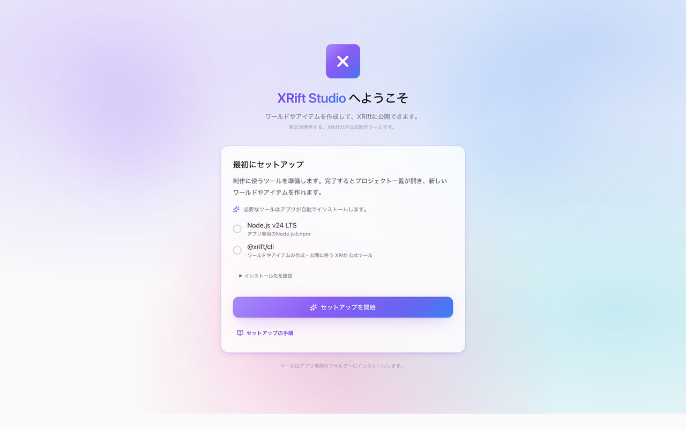
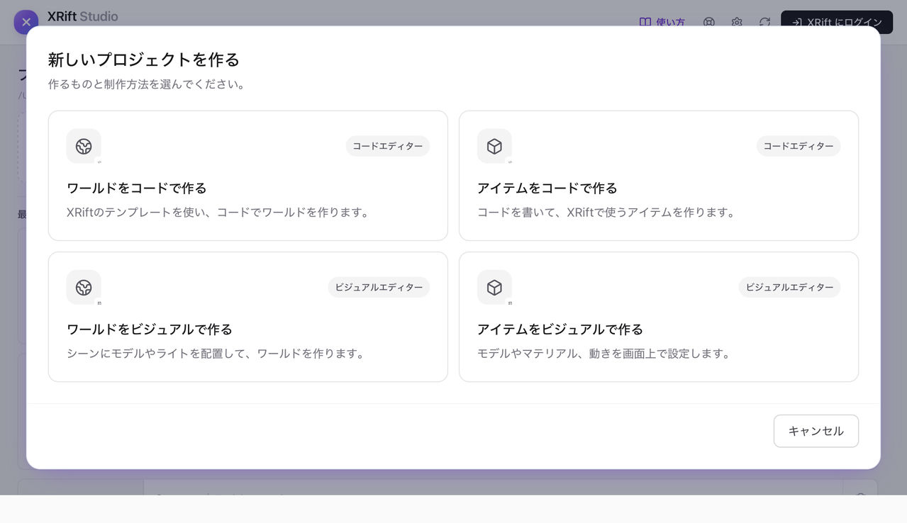
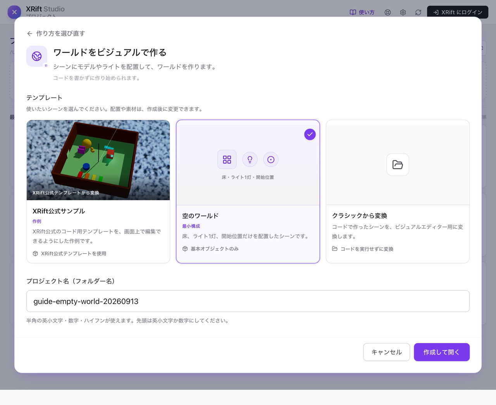
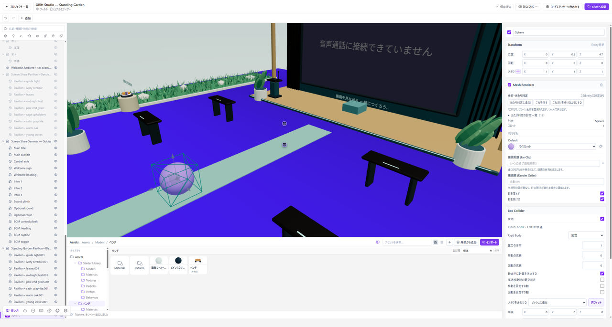
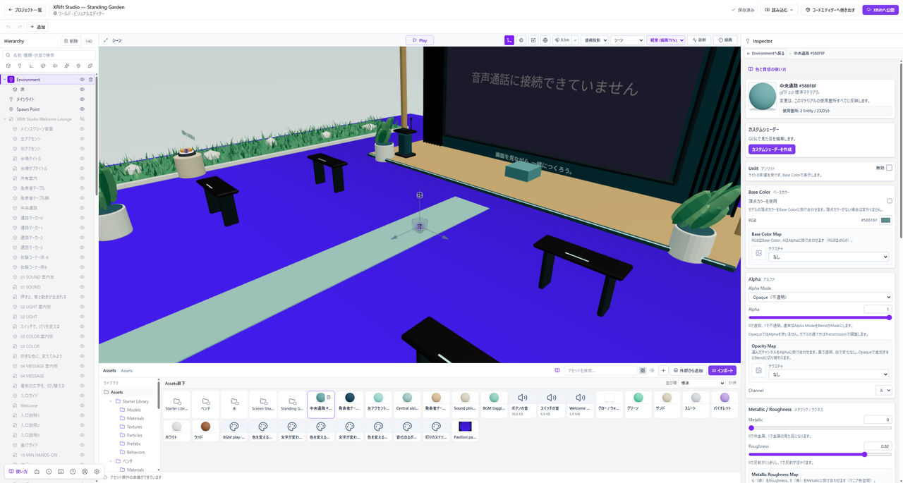
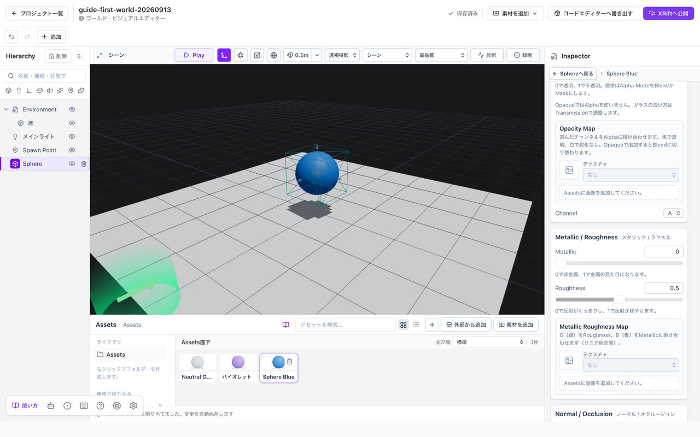
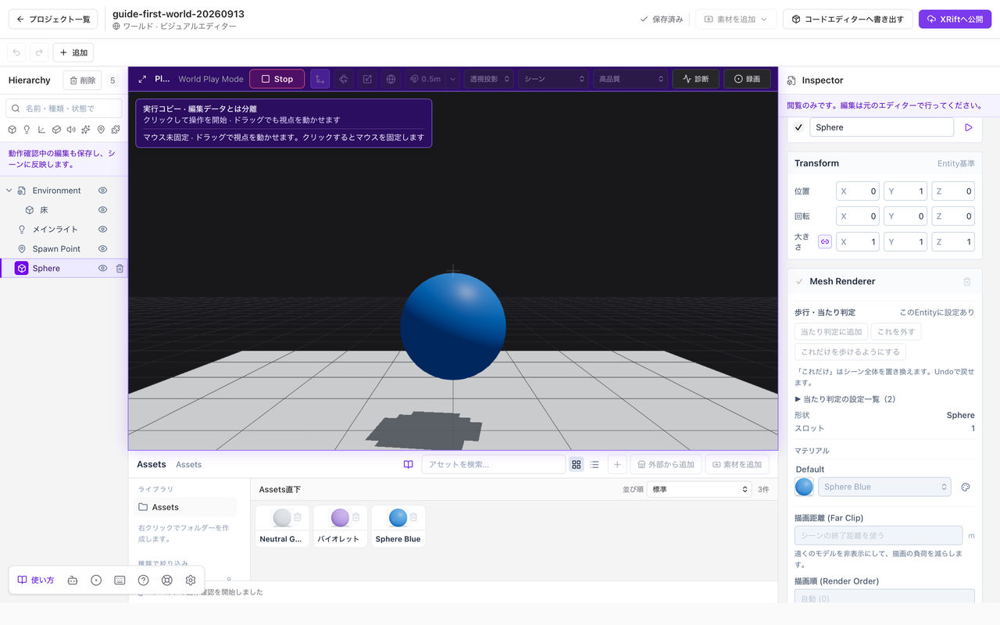

# 最初のワールドを作る

動画で操作を確認する：[新しいプロジェクトを作る](./lesson-01-01.md)

床の上に球を置いて色を変え、保存されたことを確認してからPlayで見て回るまでの流れを体験します。外部素材のダウンロードやMCP接続は必要ありません。

あらかじめ[インストールとセットアップ](./installation.md)を済ませておきましょう。すでに別の作品を編集している場合は、「保存済み」になっていることを確かめてから新しいプロジェクトを作ると安心です。

*この画面が出たら「セットアップを開始」を押します。完了してプロジェクト一覧が開いたら、次の手順へ進みましょう。*

## 1. 空のワールドを開く

プロジェクト一覧で「新規プロジェクト」を押し、「ワールドをビジュアルで作る」を選びます。

*左下のカードを選ぶと、ワールド用のビジュアルエディターへ進みます。*

テンプレートは最初から「空のワールド」が選ばれています。開いた直後の構成は次のとおりです（ブラウザ版の新規ワールドも同じです）。

- **Hierarchy**：Plane（床）、Box、Light、SpawnPoint（開始位置）が並んでいます。
- **Assets**：配置済みのPlane MaterialとBox Materialだけが入っています。色や質感のプリセットは、使いたいときに追加できます。

プロジェクト名には、たとえば`my-first-world`のように入力します。フォルダー名にも使われるため、半角の英小文字・数字・ハイフンのみが利用でき、先頭は英小文字か数字にする必要があります。作品の日本語タイトルはあとから別に設定できます。

*画面例では撮影用の名前を入力しています。名前を決めたら「作成して開く」を押します。*

PlaneとSpawnPointは消さずに残しておきます。SpawnPointはPlayを始めたときのプレイヤーの開始位置になります。Boxは最初から置かれている編集用の立方体で、Inspectorから色や大きさを変えられます。ここでは、そのBoxの横にSphereを追加してみます。

## 2. 球を置く

上部のメニューから「素材を追加 → Entityを作成 → Primitive → Sphere」を選びます。HierarchyにSphereが追加され、中央のシーンに球が現れます。

追加した球を選び、右側の「Inspector → Transform」で次のように設定してみましょう。

- **位置**：X `1.5` / Y `1` / Z `0`（床に埋まる場合はYを少し上げます）
- **大きさ**：X `1` / Y `1` / Z `1`

球が画面外にあって見当たらないときは、HierarchyでSphereを選んでFキーを押すと、球に視点が合います。視点を動かしても球そのものの位置は変わりません。

*HierarchyでSphereを選ぶと、右のTransformに位置と大きさが表示されます。画像はXを0にした配置例です。今回はBoxの横に並べるため、Xを1.5にします。*

## 3. マテリアルを作る

下部のAssetsで追加メニューを開くか、何もない場所を右クリックして「新規マテリアル」を選びます。作成されたマテリアルをクリックすると、Inspectorに色や質感の設定欄が表示されます。

Base Colorで好みの色を選び、Metallicを`0`、Roughnessを`0.5`に設定します。これで金属ではない表面になり、光の反射がほどよくやわらぎます。次の手順で、このマテリアルを球に割り当てます。

*例ではSphere Blueという名前を付け、Base Colorを青色にしています。*

*Inspectorを下へスクロールすると、MetallicとRoughnessの設定欄があります。*

## 4. 球に色を付ける

Hierarchyで球を選び、「Inspector → Mesh Renderer → マテリアル」の欄で作ったマテリアルを指定します。Assetsからこの欄へドラッグ＆ドロップしても割り当てられます。

球の色が変わったら完了です。Assetsでマテリアルを選び直してRoughnessの値を動かすと、反射のぼけ具合が変わるのも確かめられます。各数値の意味は[マテリアルの基本](./materials.md)で詳しく解説しています。

*球が青くなり、Mesh Rendererのマテリアル欄にもSphere Blueが表示されています。図では見やすいようにAmbient Lightを有効にしています。*

*マテリアルはこの欄で指定します。*

## 5. 自動保存を確認する

編集した内容は自動で保存されるため、操作のたびに保存ボタンを押す必要はありません。

画面上部のプロジェクト名の近くを見ると、「保存待ち → 保存中 → 保存済み」と状態が切り替わります。「保存済み」になっていれば、変更はきちんと保存されています。

もし「保存エラー」と表示されたときは、編集画面を閉じずにエラーの内容を確認してください。保存の仕組みや作品を開き直す手順は、[保存と制作の再開](./save-and-open.md)にまとめています。

## 6. Playで見て回る

画面上部のPlayを押し、読み込みが終わったら中央の画面をクリックします。WASDキーまたは矢印キーで移動し、先ほど置いた球をいろいろな角度から眺めてみましょう。

編集画面へ戻るときは、Escキーでマウス固定を解除してからStopを押します。マテリアルはPlay中に編集できないため、色や質感を変えたいときも一度Stopで戻る必要があります。

*中央のPlay Windowをクリックすると操作できるようになります。編集へ戻るには上部のStopを押します。*

球の配置、色の変更、保存の確認、そしてPlayから編集への切り替えまで一通り試せたら、最初のワールド作りは完了です。

## 次は何をする？

手元の3Dモデルや画像を置いてみたいときは[モデルや画像を取り込む](./assets.md)、表面の質感をさらに作り込みたいときは[色と質感を変える](./materials.md)をご覧ください。公開の操作は、作品が形になってから試せば大丈夫です。
