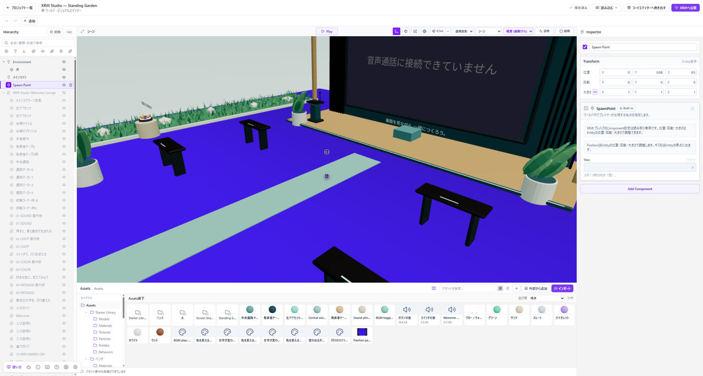

# 画面に出てくる用語

エディターの画面に表示される主な用語とその意味をまとめています。見慣れない英語の項目名が出てきたときの辞書としてお使いください。

*画面上の名前をそのまま検索欄に入れて探せます。各パネルの位置は画像を目安にしてください。*

## Entity

床・3Dモデル・ライトなど、シーンに配置する一つひとつのオブジェクトをEntityと呼びます。配置や整理の方法は[配置の手順](./objects.md)をご覧ください。

## Hierarchy

シーンに配置したEntityの一覧と、親子関係を表示するパネルです。使い方は[画面の見方](./editor-basics.md)で説明しています。

## Inspector

選択しているEntityや素材の設定を編集するパネルです。何を選んでいるかに応じて、表示される設定項目が切り替わります。

## Assets

3Dモデル・画像・音声・マテリアルといった素材をまとめて管理するパネルです。取り込んだモデルは、シーンへドラッグ＆ドロップするとEntityとして配置できます。

## Component・Components

Entityに追加して働きを持たせる機能をComponentと呼びます。音源・ライト・Colliderなどがあり、Inspectorの「Add Component」から選んで追加します。

## マテリアル・テクスチャ

マテリアルは表面の色や光沢・反射を決める素材、テクスチャは色柄や凹凸などを表す画像です。詳しくは[マテリアル](./materials.md)と[テクスチャ](./textures.md)をご覧ください。

## Base Color・Metallic・Roughness

マテリアルの基本となる3つの設定です。Base Colorは表面の色、Metallicは金属らしさ、Roughnessは反射のぼけ具合（表面の粗さ）を調整します。値による見え方の違いは[三つの基本設定](./materials.md)で紹介しています。

## Normal Map

陰影によって細かな凹凸を表現する画像です。見た目だけが変わり、メッシュの輪郭やColliderの形自体は変わりません。使い方は[テクスチャの説明](./textures.md#normal-mapで細かな凹凸を表す)をご覧ください。

## Skybox・IBL

Skyboxは空などの背景を表示する仕組み、IBLは環境画像を照明や反射の計算に使う仕組みです。両者の違いは[空と照明の違い](./sky-and-water.md#背景と照明を分けて設定する)で説明しています。

## Emissive・Bloom

Emissiveは表面そのものを光って見せる設定、Bloomは画面の明るい部分の光をふわっとにじませる画面効果です。どちらも周囲のオブジェクトを照らす光源ではないため、空間を明るくするには別途ライトが必要です。詳しくは[光の設定](./lighting.md#emissiveとbloomの違い)をご覧ください。

## Collider・Spawn Point

Colliderは衝突や接触を判定するための形状、Spawn Pointはプレイヤーがワールドに入ったときの開始位置です。設定手順は[歩ける床](./collision.md)をご覧ください。

## プレハブ・ノードグラフ

プレハブは、複数のEntityの組み合わせをひとまとめにして再利用できる素材です。Node Graphは、処理のブロックを線でつないで動きや仕掛けを組み立てる仕組みです。詳しくは[プレハブ](./prefabs.md)と[仕掛け](./interactivity.md)をご覧ください。

## Play・Stop

Playでワールドに入って動作を確かめ、Stopで編集画面へ戻ります。操作方法は[Playの使い方](./play-mode.md)にまとめています。
