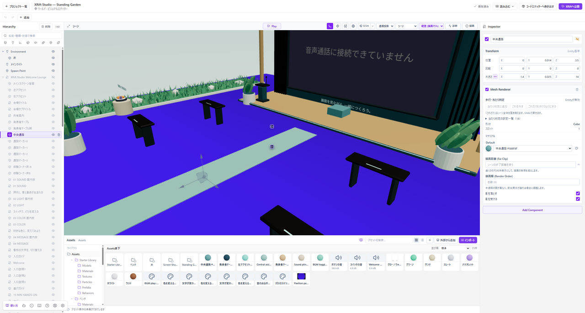

# XRift Studio 使い方ガイド

XRiftは、ブラウザからワールドに入って他の人と交流できるサービスです。XRift Studioでは、XRiftで公開するワールドやアイテムを作成できます。このガイドでは、画面上で素材を配置する基本操作から、仕掛けの追加や公開までの流れをまとめています。

初めて触れる方は、まず[XRiftとXRift Studioでできること](./course-introduction.md)からご覧ください。XRiftと制作ツールの関係や、Node Graph・コードで実現できることを紹介しています。

*左のHierarchyで球を選び、右のInspectorで設定を調整します。下のAssetsには、球に割り当てるマテリアルが並んでいます。*

## 制作から公開まで学ぶ

[制作から公開までのコース](./learning-course.md)では、準備・保存・素材・仕掛け・テスト・公開・更新・招待までの流れを順番に学べます。動画と文章を組み合わせた構成になっており、各レッスンで仕上がりを確認しながら進められます。

## 動画を見ながら試す

[動画で学ぶ XRift Studio](./video-tutorials.md)では、1本約1分の短い動画教材を4つの章に分けて掲載しています。配置・質感・仕掛け・仕上げの操作を、映像と要点メモで手早く確認できます。

## はじめて使う

アプリをまだ入れていない場合は、[インストール](./installation.md)から始めましょう。起動できたら、[最初のワールドを作る](./first-world.md)で簡単なワールドを一つ作ってみるのがおすすめです。

インストールせずにすぐ試したい場合は、[ブラウザのビジュアルエディター](https://webxr-jp.github.io/xrift-studio/editor.html)を利用できます。

- iPadでの操作やデータ引き継ぎ：[iPadで作り、パソコンへ引き継ぐ](./ipad.md)
- ブラウザ版βからの公開や、`.xriftstudio`ファイルをパソコンへ渡して公開する方法：[公開の手順](./publishing.md)

デスクトップ版では、初回セットアップを終えればそのまま制作を始められます。XRiftへのログインやMCP接続はあとから設定できるので、まずは素材を置いて色を変え、自動保存を確認したあとでPlayで歩き回ってみてください。

## 操作を調べる

各パネルの役割は[画面の見方](./editor-basics.md)、英語の項目名の意味は[用語集](./glossary.md)で確認できます。ガイド内の検索欄に画面の項目名や「床をすり抜ける」といった症状を入れると、該当ページをすぐに見つけられます。

## このガイドの対象

基本の制作手順はデスクトップ版を基準に説明しています。iPadでのタッチ操作や保存の仕組みは[iPadの案内](./ipad.md)をご覧ください。スマートフォンでも、パネルを切り替えながら配置や質感を編集できます。

なお、ブラウザ版で保存した作品をファイルとして手元に残すには書き出し、XRiftで他の人が入れるようにするには公開の操作が必要です。アプリのビルド方法やAPI仕様など開発者向けの情報は、GitHubリポジトリのドキュメントにまとめています。

## 作ったものを別のプロジェクトでも使う

家具やギミックなど、Hierarchyで選んだ一部だけを`.xriftstudio`ファイルに書き出せます。別のワールドやアイテムへ取り込む手順は、[Entityを別のワールド・アイテムへ渡す](./hierarchy-transfer.md)をご覧ください。

## MToon・GLSL・録画を使う

- [MToonの陰影と輪郭線](./materials.md#mtoonマンガのような陰影と輪郭線を付ける)
- [GLSLでマテリアルを編集する](./custom-shaders.md)
- [ワールドを動画に録画する](./recording.md)

※ ガイド内のスクリーンショットには過去のバージョンの画面が含まれる場合があります。最新の操作名や対応範囲は本文の記載をご確認ください。
