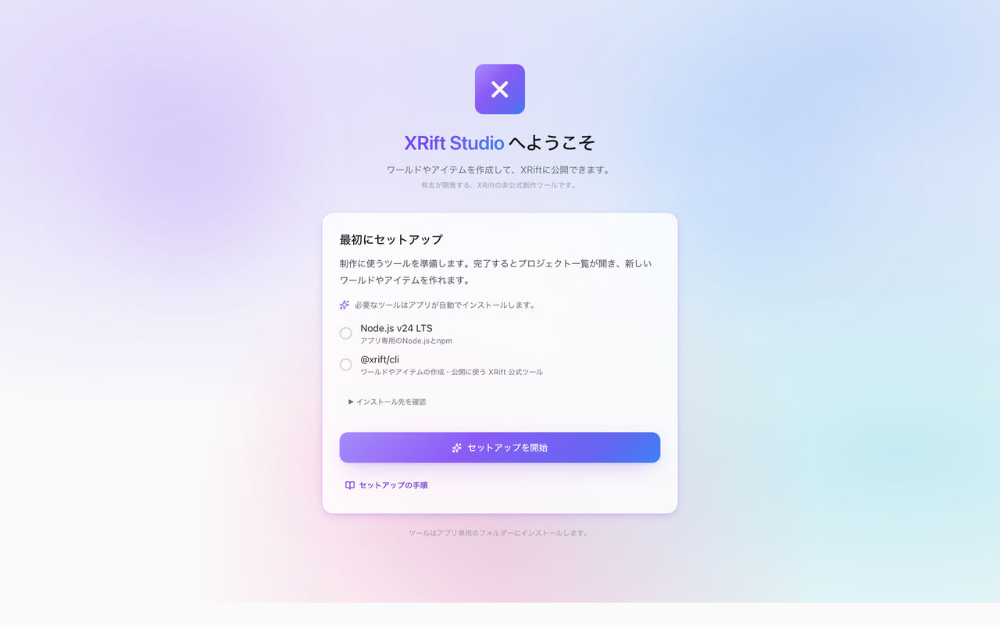

# インストールして起動する

アプリをインストールして初回セットアップを終えると、すぐに制作を始められます。必要なツールはセットアップ中に自動で用意されるため、インストーラーを使う場合はコマンド入力などの事前準備は不要です。

## 1. アプリをダウンロードする

[XRift Studioのダウンロード案内](https://webxr-jp.github.io/xrift-studio/#download)から、お使いのパソコンに合ったインストーラーを入手します。目的のファイルが見当たらないときは、[配布ファイルの一覧](https://github.com/WebXR-JP/xrift-studio/releases/latest)も確認してみてください。なお、「Source code」と書かれたZIPはアプリ開発用のファイルです。

### Windows

Windows用の`.msi`または`.exe`を開き、画面の案内に沿ってインストールを進めます。完了後は、スタートメニューからXRift Studioを起動できます。

### macOS

`.dmg`を開き、XRift Studioをアプリケーションフォルダーへドラッグして移します。配布しているuniversal版は、Apple SiliconとIntelのどちらのMacにも対応しています。

Homebrewを使っている場合は、次のコマンドからもインストールできます。

```bash
brew tap webxr-jp/xrift-studio https://github.com/WebXR-JP/xrift-studio.git
brew install --cask webxr-jp/xrift-studio/xrift-studio
```

インストールが終わったら、アプリケーションフォルダーからXRift Studioを起動します。Homebrewでの更新や削除の方法は、[Homebrewの導入手順](https://github.com/WebXR-JP/xrift-studio/blob/main/docs/PACKAGE_MANAGERS.md#homebrew)にまとめています。

開発元に関する警告が出て開けないときは、[アプリを開けないとき](./installation-problems.md#macosで開けない)の手順をご確認ください。警告の内容を確かめず、macOSの保護機能を一括で無効にする操作は避けてください。

### Linux

`.deb`、`.rpm`、`.AppImage`の中から、お使いの環境に合う形式を選びます。うまく起動できない場合は、[インストールで困ったとき](./installation-problems.md)をご覧ください。

## 2. セットアップする

初回起動時の画面で「セットアップを開始」を押します。インターネットに接続したまま、必要なツールのダウンロードとインストールが終わるまで少しお待ちください。



*セットアップが完了すると、自動でプロジェクト一覧が開きます。*

途中でエラーが出て止まった場合は、表示されたメッセージを確認したうえで「セットアップを再試行」を押してください。

アプリの更新後に「制作ツールの更新が必要です」と表示されたときは、画面上のバージョンを確認して「制作ツールを更新」を押します。必要なNode.jsやXRift CLIが更新されますが、保存済みの作品やログイン情報はそのまま引き継がれます。推奨版より新しいCLIがすでに入っている場合は、現在のバージョンが維持されます。

## 3. ビジュアルエディターを開く

プロジェクト一覧の「新規プロジェクト」から、ワールドのビジュアルエディターを選びます。すでにプロジェクト一覧が開いている場合は、ここから始められます。

まずは[最初のワールドを作る](./first-world.md)に沿って、素材を一つ置いて色を変え、自動保存とPlayでの動作を試してみてください。

XRiftへのログインは、作品を公開するタイミングで行えば問題ありません。詳しくは[公開の手順](./publishing.md)をご覧ください。

## 途中で止まったら

アプリを起動できないときは[インストールで困ったとき](./installation-problems.md)、起動後の操作に迷ったときは[画面の見方](./editor-basics.md)を確認してみてください。
