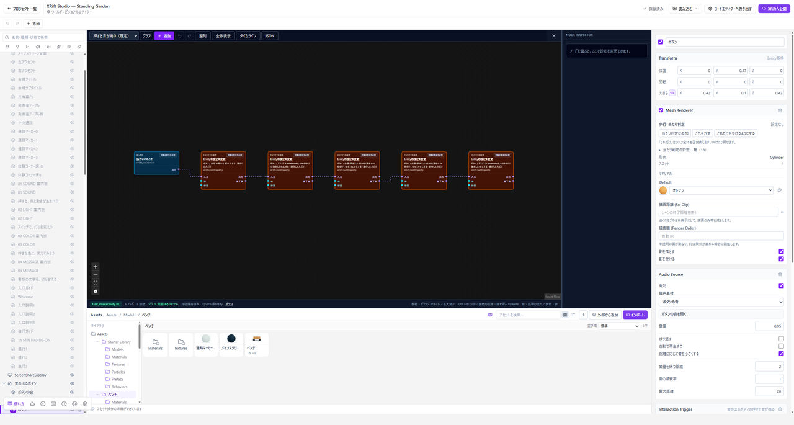

# ボタンで動く仕掛けを作る

動画で操作を確認する：[ノードをつないで箱を動かす](./lesson-03-00.md) / [押すと動くボタンを作る](./lesson-03-01.md) / [Delayで待ってから動かす](./lesson-03-02.md) / [テンプレートでBoxを回転させる](./lesson-03-04.md)

Node Graphを使うと、「きっかけ」と「処理」を線でつないでワールドに仕掛けを組み込めます。まずは押すと音が鳴る見本を配置し、全体の構成を確かめてみましょう。

*きっかけから処理へとつながる線を確認できます。最初は値を1つだけ変えて動きを試すのがおすすめです。*

## 1. 音の出るボタンを置く

「Assets → アセットストア → 3Dセット → 音の出るボタン」を選び、詳細を確認してシーンに追加します。

カタログを閉じてPlayを押し、ボタンに近づいてクリックしてみてください。音が鳴れば配置は完了です。

## 2. ボタンの構成を見る

Stopで編集画面に戻り、HierarchyでボタンのEntityを選びます。Inspectorを見ると、Interactable、Audio Source、Interaction Triggerの3つが設定されています。

このように、押すと音が鳴るボタンは、見た目のモデルに加えて「操作を受け付ける機能」「実行する処理」「再生する音」の組み合わせで成り立っています。

## 3. グラフを開く

Assetsからボタンに割り当てられているNode Graphを開くと、きっかけと処理が線でつながっている様子を確認できます。各ノードをクリックすると、Node Inspectorで対象や設定値を調整できます。

まずは音量など1つの値だけを変えて、Playで変化を確かめてみてください。仕組みがつかめたら、自分の用意したモデルや音声へ差し替えてみましょう。

## 自分でグラフを作る

1. Assetsの追加メニューから、新しいNode Graphを作成します。
2. Hierarchyで仕掛けを取り付けたいEntityを選び、グラフ編集画面の上部にある案内から取り付けます。
3. プレイヤーが押して動かす仕掛けにする場合は、同じEntityにInteractableも追加します。

Node GraphはEntityに取り付けて初めて動作します。ワールド開始時に動かす `On Start` 始点のグラフであっても、いずれかのEntityへ取り付ける必要があります。

## きっかけと処理をつなぐ

`On Interact` はボタンが押されたとき、`On Start` はワールドが始まったときに処理を開始します。それぞれのノードから、実行したい処理へ線をつないでください。処理の流れは紫の線、データの値は水色の線で表されます。

待機時間やアニメーションなど、完了までに時間がかかる処理の「あと」に次の処理をつなぐときは、必ず **Done** から線を伸ばしてください。**Out** は処理を開始した直後にすぐ次へ進んでしまうため、完了を待ちません。

`Sequence` も同様に、接続先の処理を順番に開始するだけです。前の処理が終わるのを待ってから次へ進めたい場合は、前の処理の **Done** から次の処理へつなぎます。

## 自分だけ・みんなでの違い

シーンの見え方を変える処理やプレイヤーを移動させる操作は、基本として操作した人の端末だけに反映されます。同じワールドにいるほかの人の画面や位置は変わりません。

扉の開閉や色の変化など、ほかのプレイヤーとも状態を共有したい場合は、対象の設定で「同じ部屋の全員に反映する」を有効にします。同期の動作は1人のPlayでは確かめられないため、公開先で複数人に入って確認してください。

## 動かないとき

仕掛けが反応しないときは、次の点を確認してみてください。

- グラフがEntityに取り付けられているか
- 押す仕掛けの場合、EntityにInteractableが追加されているか
- 処理で参照している音源やモデルが正しく設定されているか
- グラフ内の「問題の一覧」に警告やエラーが出ていないか、保存が完了しているか

なお、「実行未対応」と表示されるノードは保存できても動作しません。エラーが残っていると保存が止まることもあるため、画面を閉じる前に状態表示を確認してください。
