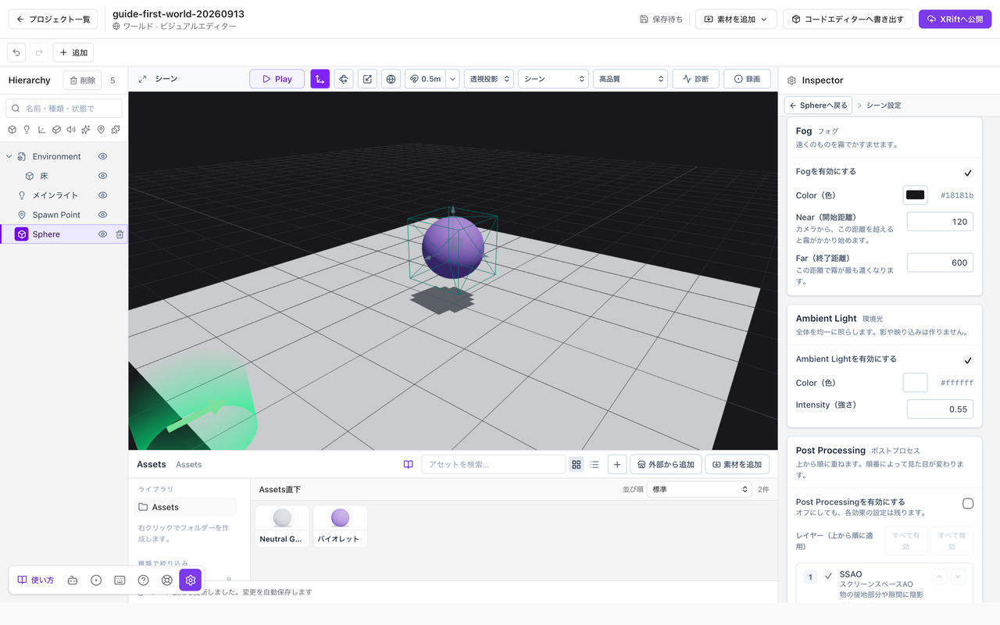

# ライトと画面の明るさを調整する

動画で操作を確認する：[ライトの明るさと影を調整する](./lesson-01-06.md) / [Bloomで光をにじませる](./lesson-04-08.md)

ライトはシーン内の物を照らし、画面効果（Post Processing）は画面全体の見え方を整えます。ライトの設定はPlay中でもInspectorから変更して見え方を確かめられます。

*Ambient Lightを有効にすると、シーン全体が均一に照らされます（画像はIntensityが0.55の状態）。*

## ライトで物を照らす

「追加」メニューからライトを配置し、Hierarchyまたはシーン上で選んでInspectorから位置、色、強さを調整します。

最初はライトを1つだけ置き、どの範囲まで光が届くか確認するのがコツです。シーンが暗く感じるときも、いきなりライトを増やすのではなく、まずは位置や向きを調整してみてください。

Directional LightとSpot Lightの向きは「照らす方向」で変えられます。Point Light、Spot Light、Rect Area LightではPowerでも明るさを入力でき、PowerとIntensityの数値は連動して変わります。

## 影を調整する

Directional Light、Point Light、Spot Lightで影を落とすには、`castShadow` を有効にします。ライトごとに次の項目を調整できます。

- `shadow.intensity`：影の濃さ
- `shadow.mapSize.x/y`：影の解像度（初期値は256 px）
- `shadow.radius`：影の縁のぼかし具合
- `shadow.bias` / `shadow.normalBias`：表面に縞模様が出る場合や、影が物体から浮いて離れる場合に調整する値

床や建物など動かないオブジェクトの影は、[ライトベイク](./light-bake.md)であらかじめ焼き込むこともできます。リアルタイム描画の負荷を抑えつつ、縁のやわらかい影や跳ね返った光を加えられます。

シーン全体で使うThree.jsの影アルゴリズムは、「シーン設定 → Shadow Map」で切り替えられます。

- **PCFShadowMap（初期値）**：やわらかな影を描画します。各ライトの初期設定は解像度256 px、Radius 2です。なお、現在のThree.jsでは `PCFSoftShadowMap` を指定しても `PCFShadowMap` へ変換されます。
- **BasicShadowMap**：シンプルな影を描画します。Radiusを変更しても影はぼけません。
- **VSM**：ぼかし回数を各ライトのBlur Samplesで調整できます。

## 全体の明るさを調整する

エディター左下から「シーン設定」を開くと、シーン全体の明るさを調整できます。Ambient Lightでは影の部分も含めて全体を均一に照らし、Exposureでは画面全体の露出（明るさ）を変えられます。背景の空だけ明るさを変えたい場合は、Skybox側の設定で調整します。

## 金属が暗い・反射が見えない

[マテリアル](./materials.md)のMetallicを1に設定しても、周囲に映り込む環境がないと金属が黒っぽく見えてしまいます。

「シーン設定 → Skybox」でSkybox TextureにHDRIなどの環境画像を指定し、IBLを有効にしてください。IBLを有効にすると、その画像が周囲の照明や反射の計算に使われます。Skybox Shaderを背景に設定しただけでは、反射用の照明は用意されません。

## EmissiveとBloomの違い

見た目が似ていますが、EmissiveとBloomは役割が異なります。

- **Emissive**：マテリアルの表面そのものを光らせる設定
- **Bloom**：画面上の明るい部分から光をにじませる画面効果

どちらも周囲の物を照らす光源にはならないため、近くの床や壁を明るくしたい場合は別途ライトを配置してください。

光る看板などを作るときは、マテリアルのEmissiveとEmissive Strengthを調整したうえで、シーン設定の「Post Processing → Bloom」を有効にします。Bloomでは、次の3つの値を少しずつ動かしてバランスを整えます。

- **Threshold**：光をにじませ始める明るさの境目
- **Strength**：にじみの強さ
- **Radius**：にじみの広がり

## 陰影や色味を整える

SSAOを有効にすると、物の接地部分や狭い隙間に自然な陰影が加わります。Color Gradingでは、画面全体のコントラストや色味を仕上げられます。

画面効果を重ねる前に、まずはライトとマテリアルだけでオブジェクトの形がはっきり見えているか確認しておくのがおすすめです。エフェクトを増やすほど描画負荷も高くなるため、必要なものだけを選んで使ってください。

## 影やBloomが見えない

編集中に影やBloomが反映されないときは、表示モードが「シーン」、描画品質が「高品質」になっているか確認してください。軽量表示では影やPost Processingが省略されます。

思ったような見た目にならない場合は、一度ほかの画面効果をオフにして、ライト、Emissive、Bloomを1つずつ確認すると原因を切り分けやすくなります。
