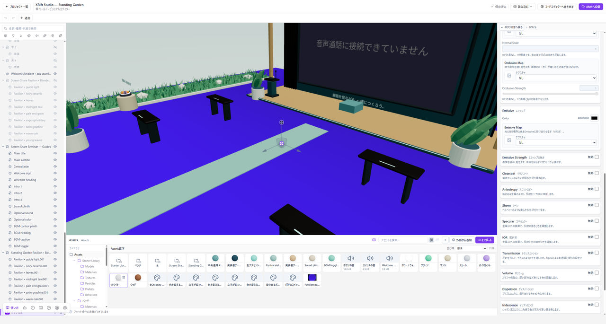

# Clearcoat・Iridescenceなどを使う

[Base Color、Metallic、Roughness](./materials.md)でベースとなる質感を作ったら、表現したい素材に合わせて必要な拡張機能を有効にします。glTFなどの仕様書やほかの制作ツールと照合しやすいよう、各項目名は英語で表記しています。

このページでは、「Shading → マテリアルの種類」が **Standard (PBR)** の場合を説明します。マンガのような陰影や輪郭線を作りたいときは、[MToon](./materials.md#mtoonマンガのような陰影と輪郭線を付ける)を使ってください。

*表現したい質感に合わせて、必要な拡張だけを有効にします。*

## Clearcoat

Clearcoatを使うと、車の塗装やニス仕上げのような透明な光沢層を表面に重ねられます。下地のRoughnessと上塗り層のRoughnessは別々に調整できます。

Clearcoat専用のNormal Mapも、上塗り層にだけ適用されます。まずは上塗りの量と粗さを変えながら、下地との違いを見比べてみてください。

## Iridescence

Iridescenceでは、シャボン玉や玉虫色の塗装のように、薄膜によって見る角度ごとに反射色が変わる表現を作れます。設定を変えたら、視点を動かして色の変化を確認します。

- **Thickness Min / Max**：薄膜の厚みをnm（ナノメートル）単位で指定します。マップを使わない場合はMaxの値がそのまま適用されます。
- **IOR**：薄膜の屈折率を表します。素材本体のIORとは別の設定です。

なお、VolumeのThicknessは「メッシュ内の距離」、IridescenceのThicknessは「薄膜の厚み」を指します。ほかのツールから数値を移すときは、それぞれの単位と意味を混同しないよう確認してください。

## Sheen・Anisotropy・Specular

| 拡張 | 表現できること |
| --- | --- |
| Sheen | ベルベットのような、やわらかな布の光沢を加えます。 |
| Anisotropy | ヘアライン加工の金属のように、反射を一方向に引き伸ばします。 |
| Specular | 非金属の反射の強さや色を調整します。金属度を決めるMetallicとは別の設定です。 |

## Transmission・Volume・Dispersion

Transmissionで光の透過を、Volumeで材質の厚みと光の減衰を設定します。基本的な使い方は[透明な素材の手順](./transparent-materials.md)を参照してください。

Dispersionを使うと、プリズムのように透過光を波長ごとの色に分けて表現できます。Dispersionを有効にするとVolumeとTransmissionも同時に有効になるため、透過量や厚みの設定もあわせて確認してください。

## Unlit

Unlitを有効にすると、ライトの影響を受けないフラットな見た目になります。その際、併用できない反射や透過の設定は自動で解除されます。

Roughnessなどによる反射の違いを確かめたいときは、Unlitをオフにして確認してください。

## ほかのツールから値を移すとき

別の3Dツールやシェーダーから設定を移すときは、名前が似ていても意味や挙動が異なる項目に注意が必要です。

- Base ColorとDiffuse Colorは、同じ意味とは限りません。Base Colorは非金属の表面色だけでなく、金属の反射色も兼ねています。
- RoughnessとSmoothnessは増減の向きが逆です。数値をそのままコピーする前に、シェーダーの仕様やテクスチャ画像のチャンネル割り当てを確認してください。
- ClearcoatとCoat、IridescenceとThin Filmのように、近い項目名が対応する表現を探す手がかりになることはあります。ただし、名前を置き換えるだけで同じ描画結果になるとは限りません。最終的な見た目はシーン上で調整してください。
