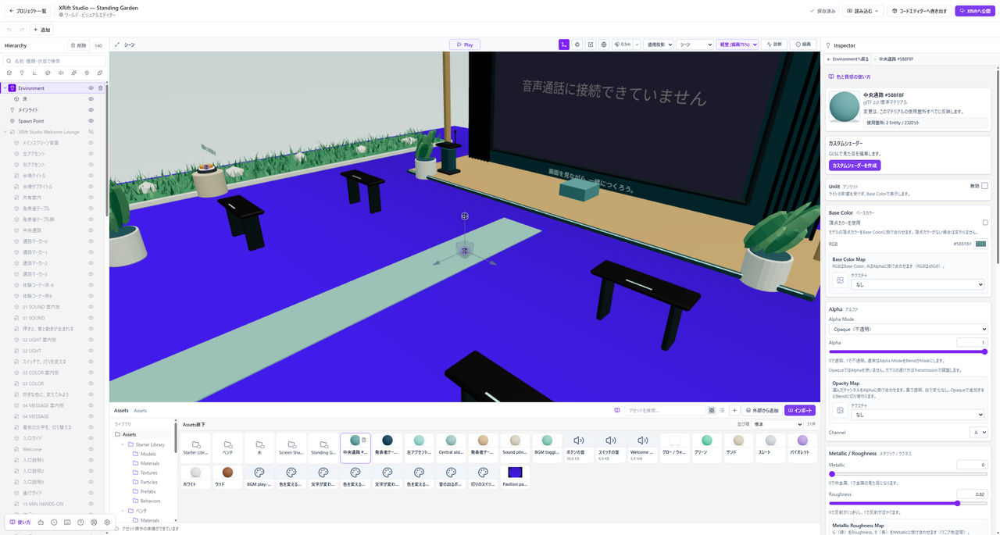
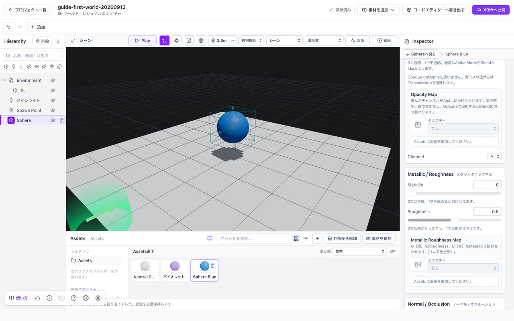

# 色と質感を変える

動画で操作を確認する：[PBRの色と光沢を調整する](./lesson-02-03.md) / [MToonでアニメ調の陰影を作る](./lesson-02-07.md)

マテリアルでは、表面の色や光の反射を設定します。まずは基本となるBase Color、Metallic、Roughnessの3つから試してみてください。

シーンに球などのオブジェクトを1つ置いてから始めると変化が分かりやすくなります。Play中であれば、Stopを押して編集画面に戻っておきます。

*Assetsでマテリアルを選ぶと、InspectorにBase Colorが表示されます。*

## 作って割り当てる

1. Assetsの追加メニュー、または空いている場所の右クリックメニューから「新規マテリアル」を選びます。
2. 作成したマテリアルを選択し、InspectorでBase Colorを変更します。
3. Hierarchyで色を付けたいEntityを選び、「Inspector → Mesh Renderer → マテリアル」で作ったマテリアルを指定します。Assetsからこの欄へドラッグ＆ドロップしても割り当てられます。

シーン上の色が変われば割り当ては完了です。色が変わらない場合は、Mesh Rendererの設定を確認してください。複数のマテリアルスロットを持つモデルでは、変えたい面に対応するスロットに割り当てる必要があります。

## MToon：マンガのような陰影と輪郭線を付ける

アニメやマンガのような陰影と輪郭線を付けたいときは、MToonを使います。Assetsでマテリアルを選び、「Inspector → Shading → マテリアルの種類」から **MToon 0.x** または **MToon 1.0** を選択します。

- 明るい面の色：Base Color
- 暗い面の色：「MToon → Shade Color」
- 輪郭線の色：「Outline → Outline Color」
- 輪郭線の太さ：Outline Width

初期状態の輪郭線は黒色で、幅は0.003 m（3 mm）です。モデルの大きさに合わせて調整してください。輪郭線を消したいときは、「Outline Width Mode → None（なし）」を選びます。

素材のプレビューや見本カードでは、斜めからのDirectional Lightと弱い環境光が当たっているため、Base Colorの明るい面とShade Colorの暗い面を見比べられます。シーンに割り当てたあとは、実際のワールドの照明下で見え方を確認しましょう。

見本から試したい場合は、「アセットストア → glTFマテリアル」にある「MToon 0.xアウトライン」または「MToon 1.0アウトライン」を使うと、標準マテリアルと並べて比べながらシーンへ追加できます。

### MToon 0.x と MToon 1.0 の違い

MToon 0.xはVRM 0.xと互換性のある陰影、MToon 1.0は新しい方式の陰影を使います。0.xと1.0を切り替えても、色、陰影、輪郭線、テクスチャの設定はそのまま引き継がれます。

初めてMToonに切り替えたときは、Base ColorのRGBを0.8倍した色がShade Colorに自動で入り、Base Color MapもShade Multiply Mapへ引き継がれます。照明への反応は方式によって変わるため、切り替え後の見た目を確認して微調整してください。

### 主な陰影・表現の設定

| 設定 | 値を変えたときの見え方 |
| --- | --- |
| Shading Shift | 大きくすると、明るい面の範囲が広がります。 |
| Shading Toony | 1に近づけると、明暗の境界がくっきりします。 |
| GI Equalization | 1に近づけると、環境光による明暗差が抑えられて均一になります。 |
| Outline Lighting Mix | 0では設定した輪郭線の色がそのまま使われ、1ではライトの影響を受けた色になります。 |

同じInspectorでは、次の表現も細かく調整できます。

| 項目 | 調整できること |
| --- | --- |
| Shading Shift Map | Rチャンネルの値を使って、場所ごとに陰影の境界をずらします。Scaleで効き具合を調整し、負の値にすると明暗の変化が反転します。 |
| Matcap | Matcap MapとMatcap Colorで、見る向きに応じた映り込みを加えます。 |
| Rim Lighting | 縁の色、画像、広がりを調整します。Fresnel Powerを大きくすると縁に集中し、Liftを大きくすると広い面に現れます。Lighting Mixでライトの影響度を変えられます。 |
| UV Animation | 画像をX・Y方向にスクロールしたり回転させたりできます。速度0で停止し、負の値にすると逆向きに動きます。回転速度の単位はrad/秒です。Mask MapのBチャンネルで場所ごとの速さを変えられます。 |
| MToon Rendering | 半透明の深度書き込みと描画順を調整します。Render Queue Offsetは−9〜9の範囲で指定し、値が大きいほどあとに描画されます。 |

輪郭線や描画に関する補足設定は、次のとおりです。

- **Outline Width Mode**：World（m）ではモデルと同じ空間の単位で幅を指定し、Screenでは画面の高さに対する割合で指定します。画像で幅に強弱を付けたい場合は、Outline Width Multiply MapのGチャンネルを使います。
- **頂点カラー**：MToonでも「Base Color → 頂点カラーを使用」を切り替えられます。有効にするとモデルの頂点カラーが基本色に掛け合わされ、無効にすると使われません（モデルに頂点カラーがない場合は有効にしても見た目は変わりません）。この設定は保存され、Playや公開後にも反映されます。
- **共通設定と半透明**：Base Color、Alpha、Normal Map、Emissive、Double SidedはMToonでも利用できます。半透明にするには「Alpha Mode → Blend」を選びます。Transparent With ZWriteを有効にすると、「Rendering → Depth Write」が自動のときに半透明の面の深度が書き込まれます。

### Standard (PBR) との切り替え

MToonを選んでいる間は、MetallicやRoughness、反射・透過などのPBR向け拡張設定は非表示になりますが、設定値自体は残ります。Standard (PBR) に戻すと元のPBR設定を再び編集でき、もう一度MToonへ切り替えればShade Colorや輪郭線、MToon専用のテクスチャ設定も戻ります。種類の切り替えや色・幅の変更は「元に戻す」で取り消せます。

| 切り替え時に引き継ぐ設定 | 扱い |
| --- | --- |
| Base Color / Diffuseと対応する画像 | Base ColorとBase Color Mapとしてそのまま引き継がれます。 |
| Normal・Emissiveと対応する画像 | 同じ色、強さ、画像が使われます。 |
| Alpha / Opacityと対応する画像 | Alpha Mode、Opacity Map、Channelがそのまま残ります。 |
| テクスチャのUV・位置・拡大率・回転 | 画像ごとの設定がそのまま残ります。 |
| Metallic・RoughnessなどPBR専用の設定 | 内部に記録されており、Standard (PBR) に戻すと再び有効になります。 |

### 複数のマテリアルをまとめて編集する

Assetsで `Ctrl` または `Shift` を押しながら複数のマテリアルを選ぶと、「Inspector → マテリアルの一括変更 → マテリアルの種類」からStandard (PBR)、MToon 0.x、MToon 1.0へまとめて切り替えられます。各マテリアルの色や画像の設定は引き継がれ、同じマテリアルを使うすべての面に反映されます。この操作は1回の「元に戻す」で取り消せます。

モデルや画像を一緒に選択していても、変更対象になるのはマテリアルだけです。なお、カスタムシェーダーを使うマテリアルは種類の一括変更から除外されます。

選択したマテリアルの種類がすべてそろっていれば、Base Color、Alpha、Normal Map、Emissive、Renderingに加えて、その種類固有の全設定をまとめて編集できます。MToon 0.x同士やMToon 1.0同士であれば、陰影、輪郭線、Matcap、Rim Lighting、UV Animationも表示されます。種類が混在している場合は、先に種類をそろえてから編集してください。

マテリアル間で値が異なる項目には「一部異なる」と表示され、実際に変更した項目だけが反映されます。たとえばShade ColorのRだけを変更すれば、GとBは各マテリアルの元の値がそのまま残ります。画像だけを差し替えてもUV設定は変わらず、UVの変更はすでに画像が割り当てられているマテリアルにだけ適用されます。一括編集の変更も、1回の「元に戻す」でまとめて取り消せます。

[VRM 0.xやVRM 1.0を取り込んだ場合](./assets.md#vrmアバターを取り込む)も、モデルのMaterialsからマテリアルを選べば同じMToonの設定を編集できます。

編集したMToonは、[.xriftstudioでの受け渡しやコードエディターへの書き出し](./save-and-open.md#バックアップする)にも含まれます。Entityだけを別の作品へ渡したいときは、[Hierarchyから書き出してください](./hierarchy-transfer.md#mtoonvrmモデルを渡す)。

## Base Color：色を決める

Base Colorは、非金属では表面の色、金属では反射の色を決める設定です。

まずはMetallicを0にした状態でBase Colorを変えてみてください。画像を割り当てている場合は、画像の色にBase Colorが掛け合わされます。画像本来の色をそのまま出したいときは、Base Colorを白にします。

*RGBの右にある色の欄をクリックすると色を変更できます。*

## Metallic：金属かどうかを決める

Metallicは金属度を表す値です。0で非金属、1で金属になります。プラスチックや塗装された面は0、金属がむき出しの面は1から試すのが基本です。

作りたい素材に合わせて調整してください。金属が暗く見えたり反射が分かりにくかったりする場合は、[照明とIBL](./lighting.md#金属が暗い反射が見えない)の設定も確認しましょう。

*説明と数値を確認しながら、1つずつ調整します。*

## Roughness：反射のぼけ方を決める

Roughnessは表面の粗さを表します。0に近いほど周囲の映り込みや反射がくっきりし、1に近いほどぼやけてマットな見た目になります。モデルの形状に物理的な凹凸を付ける設定ではありません。

同じ色の球を2つ並べ、0.15と0.8で見比べると違いがよく分かります。見え方は周囲の環境やライトに大きく左右されるため、実際のシーンに配置した状態で仕上げてください。

### 設定の出発点

| 作りたい表面 | 最初に試す設定 |
| --- | --- |
| つやのあるプラスチック | Metallic 0、Roughness 0.2 |
| つやを抑えた面 | Metallic 0、Roughness 0.8 |
| 磨いた金属 | Metallic 1、Roughness 0.15（IBLなど、反射する環境も用意する） |

素材の見た目は、これらの数値だけでなくテクスチャ画像や照明によっても変わります。模様や細かな凹凸を加えたいときは、[テクスチャ](./textures.md)を使います。

## 一つだけ色を変える

マテリアルを編集すると、そのマテリアルを割り当てているすべてのEntityに一斉に反映されます。変更する前に、Inspectorで使用箇所を確認しておくと安心です。

特定のEntityだけ色を変えたい場合は、新しいマテリアルを作成して、そのEntityに割り当ててください。Entityを複製しただけでは元のマテリアルを共有したままになることがあるため注意が必要です。

## 質感が変わらないとき

値を変えても見た目が変わらない場合は、次の点を確認してみてください。

- Stopを押して編集画面に戻っているか
- 編集しているマテリアルが対象のEntityに正しく割り当てられているか
- 複数スロットがあるモデルで、変えたい面に対応するスロットを選んでいるか
- 表示モードが「シーン」になっているか、ライトとIBLが有効か
- マテリアルのUnlitが有効になっていないか（Unlitがオンだとライトの影響を受けません）

## 基本の次に進む

基本の質感が作れたら、目的に合わせて次のガイドへ進んでみてください。

- 模様や凹凸を加える：[テクスチャ](./textures.md)
- ガラスや半透明を表現する：[透明な素材](./transparent-materials.md)
- 上塗りの光沢や薄膜の反射を加える：[マテリアルの拡張](./material-extensions.md)
