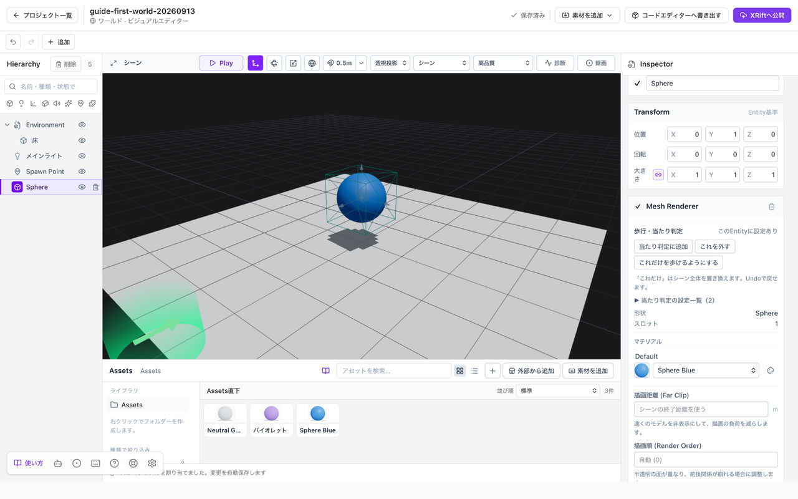

# 配置・移動・整理する

動画で操作を確認する：[オブジェクトを移動・拡大縮小する](./lesson-01-02.md) / [複製とUndo・Redoを使う](./lesson-01-04.md)

シーンに置いたEntityは、選択してから位置・回転・大きさを調整できます。色や質感を変えたいときは、Entityの位置設定ではなくAssetsのマテリアルを編集します。

*この例ではSphereの位置がX 0、Y 1、Z 0になっています。動かしたいEntityをHierarchyかシーンで選んで操作します。*

## 物を配置する

球や箱などの基本形状を置くときは、上部の「素材を追加 → Entityを作成 → 基本形状」から選びます。取り込んだ3Dモデルを置く場合は、Assetsから中央のシーンへドラッグ＆ドロップします。配置したEntityは、左のHierarchyにも自動で追加されます。

## 位置・回転・大きさを変える

シーンまたはHierarchyでEntityを選ぶと、右のInspectorにTransformが表示されます。X・Y・Zの数値で位置や大きさを調整でき、Yが上下方向です。回転は画面に表示される度数で入力します。

シーン上の移動ツールの矢印、回転ツールの輪、拡縮ツールのハンドルをドラッグして直感的に動かすこともできます。位置や角度をきれいにそろえたい場合は、数値を直接入力するのが確実です。

大きさ（Scale）は初期状態でX・Y・Zを個別に変えられます。縦横比を崩さずに拡大・縮小したいときは、大きさの欄の横にある鎖ボタンで「Scale比率を固定」をオンにします。

なお、色はマテリアル、明るさはライトやシーン設定で調整します。これらを変えるためにEntityの位置を動かす必要はありません。

## XRiftのItemを配置する

コードで作成したワールドに配置する場合は、[Itemの配置ガイド](./world-items.md#コードエディターで配置する)をご覧ください。

ビジュアルエディターのワールドでは、「素材を追加」のXRift一覧からItemを配置できます。

1. 配置したItemのInspectorで「Item ID」にUUIDを入力します（マイアイテムやマーケットのURL末尾にあるUUIDです）。自作のアイテム、または自分のライブラリにあるアイテムを利用できます。
2. 位置・回転・大きさは、他のオブジェクトと同じようにEntityのTransformで調整します。
3. 「Placement ID」は配置ごとの識別名として自動で割り振られ、複製すると別の値になります。移動や更新のために書き換える必要はありません。

配置したItem IDは、公開用の`world.items`へ自動で追加されます。読み込みに失敗した場合は、ログイン状態・利用権・審査状況を確認したうえで「Itemを再読み込み」を押してみてください。ブラウザ版でプレビューするときはInspectorにプレビュー用APIキーを入力します（キーはプロジェクトへ保存されません）。

既存のコードプロジェクトへ変換した場合は、完了画面に表示されるItem IDを既存の`xrift.json`の`world.items`へ追記してください。コードプロジェクトのローカルプレビューには、`vite.config.ts`へ`@xrift/sdk/vite`の`xriftDev()`を追加します。

## 複製する

シーン上のEntityまたはHierarchyの行を右クリックして「複製」を選びます。複製されたEntityは元の位置に重なって作られることがあるため、必要に応じて少し動かして確認してください。

複製したEntityは、元のEntityと同じマテリアルを共有している場合があります。片方だけ色を変えたいときは、[マテリアルを分けて編集](./materials.md#一つだけ色を変える)してください。

## コピーして貼り付ける

シーン上のEntityまたはHierarchyの行を右クリックして「コピー」を選び、続けたい場所で右クリックして「貼り付け」を選びます（コピーするまで「貼り付け」は選べません）。

左右対称の配置など反転したコピーを作りたいときは、「反転して貼り付け → X軸 / Y軸 / Z軸」を使います。選んだ軸だけ大きさの符号が反転したEntityが追加されます。Inspectorで大きさの比率を固定していても利用できます。

反転は各Entityのローカル軸を基準に行われ、位置と回転はそのままです。門の反対側に置くような場合は、貼り付けたあとで位置を移動してください。貼り付け後は新しいEntityが選択状態になり、元のEntityはそのまま残ります。

複数選択や親子の扱いについては、次の点に注意してください。

- 複数のEntityをまとめてコピーできます。親と子を両方選んでいても、子が二重に複製・反転されることはありません。
- アニメーション付きモデルのBoneなど単独では表示できないノードが含まれる場合は、Hierarchyでモデル全体を選んでコピーしてください。
- 貼り付けたEntityは、選択中のEntityと同じ親の下に入ります（何も選んでいなければシーン直下）。「複製」の場合は、それぞれの元の親が維持されます。
- 貼り付けや複製は、1回のUndoでまとめて取り消せます。

基本形状は上部の「素材を追加 → Entityを作成」かHierarchyの右クリックメニューから作成し、3DモデルはAssetsから配置します。シーンの右クリックメニューには、コピーや複製といった編集操作がまとまっています。

## 親子にまとめる

HierarchyでEntityを別のEntityの上へドラッグすると、親子関係を作れます。たとえば机を親にして、その上の小物を子としてまとめると管理しやすくなります。

親を移動・回転・拡大縮小すると、子も連動して変わります。子の位置や大きさが入力した数値の見た目と合わないときは、親のTransformも確認してみてください。

## 削除と取り消し

Entityを削除するとシーンから取り除かれますが、Assetsにある元の素材は残ります。一方、Assetsから素材自体を削除すると、同じ素材を使っているほかのEntityにも影響する場合があるため注意が必要です。

間違えた直後なら、`Ctrl + Z`（Macでは `⌘ + Z`）で元に戻せます。大きく構成を変える前は、[プロジェクトの複製や.xriftstudioへの書き出し](./save-and-open.md#バックアップする)でバックアップを取っておくと安心です。
