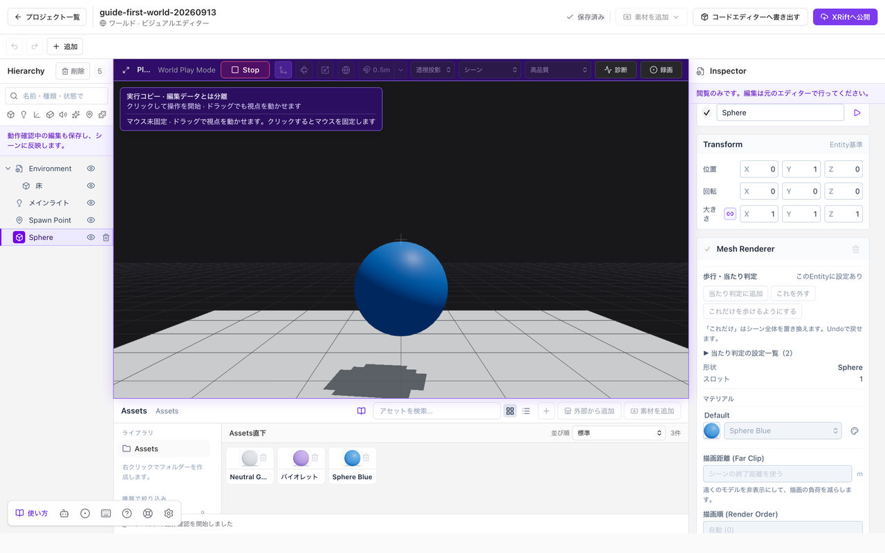

# Playで動作を確かめる

Playを押すと作成したワールドの中に入って試すことができ、Stopを押すと編集画面に戻れます。公開する前に、床を問題なく歩けるか、見た目や仕掛けが狙いどおりに動くかを一通り確認しておきましょう。

## 操作を始める

エディター上部のPlayを押し、モデルの読み込みが終わるまで待ちます。中央のPlay Windowをクリックすると操作できるようになります。

ワールドではプレイヤーの視点で自由に歩き回れます。アイテムの場合は、アイテム単体の見え方を確認する画面になります。

*実行中は中央がPlay Windowに切り替わります。編集へ戻るには上部のStopを押します。*

## 歩く・見る・操作する

| 操作 | キー・マウス |
| --- | --- |
| 移動 | WASDまたは矢印キー |
| 見る方向を変える | マウス（マウス固定が使えない環境では画面をドラッグ） |
| ジャンプ | SpaceまたはE |
| 手の届く仕掛けを操作する | クリック |
| 掴む・置く | G |
| 掴んだ物を使う | 掴んでいる間にクリック |
| 掴んだ物の距離を変える | 掴んでいる間にホイールを回す |
| マウス固定を解除する | Esc |

マウス固定を解除した直後に再度固定できない場合は、少し間をおいてから画面をクリックしてみてください。

## 編集へ戻る

上部のStopを押すとマウス固定が解除され、Playに入る前の選択状態と視点に戻ります。

Play中のプレイヤーの位置や物理オブジェクトの移動・速度は、保存されるシーンデータには書き戻されません。また、仕掛けによって一時的に変わった値と、Inspectorから直接編集した値は別々に扱われます。

## Play中に変更できないもの

マテリアル・素材・シーン設定を編集したいときは、一度Stopで編集画面に戻ります。素材のドラッグ配置やギズモによる移動・回転・拡縮も編集モードで行います。

一方、位置・回転・大きさなど一部のInspector操作はPlay中でも編集データに反映され、履歴や自動保存の対象になります。Play中の操作がすべて元に戻るわけではない点にご注意ください。

## 床から落ちる・出現位置がおかしい

Stopで編集画面に戻り、[床のColliderと開始位置](./collision.md)を見直してください。床のモデルが見えていても、Colliderが設定されていなければプレイヤーは上に立てません。

## 公開前に確かめること

入口（SpawnPoint）から実際に歩き、さまざまな角度から見た目を確かめ、ボタンなどの仕掛けも押して動作をチェックしましょう。

なお、複数人での同期や画面共有、端末ごとの権限の違いは、一人で行うPlayだけでは確認しきれません。公開先のワールドでも、実際の利用環境に近い条件で試しておくのが確実です。

## VehicleとSeatを試す

「アセットストア → ギミック → カスタム車」を開き、「カスタム車をシーンへ追加」を押すと車を配置できます。「XRift公式コンポーネント → Vehicle」からも同じ車を追加可能です。椅子だけを置きたい場合は、「XRift公式コンポーネント → Seat」を選びます。

1. Hierarchyで車の親Entityを選び、床の上に配置します。
2. Playを押し、座席に近づいてクリックすると乗り込めます。
3. 進行方向に向かって左が運転席です。「運転する」と表示される座席をクリックしてください。
4. `W` / `S` で前後移動、`A` / `D` で旋回、`Space` で降車できます。同乗席やSeat単体では、座ったときの視点を確認できます。

走行中はタイヤが回転し、後方から煙が出ます。停止するとタイヤの回転と新たな煙の放出も止まります。

### 車の動きと設定のポイント

- **速度と地面追従の調整**：車の親Entityを選ぶと、InspectorのScriptから速度・旋回速度・「地面に追従」のオン／オフ・登れる坂の角度を変更できます。「地面に追従」は初期状態でオンになっており、固定されたColliderのある地面に沿って走行し、初期設定では45度までの坂を登れます。
- **走行時の制限**：地面が途切れたり大きな段差があったりすると停止します。壁への車体衝突や崖からの落下は再現されません。
- **座席の高さと保存**：座席の高さは、Hierarchyで座席Entityを選んでInspectorのTransformから調整します。配置や設定の変更は自動保存されます。なお、以前に追加した車のScriptとモデルは自動では更新されないため、新しい仕様を使いたい場合はカスタム車を追加し直してください。
- **マルチプレイヤー時の見え方**：StudioではWorld Playのローカル操作を試せます。タイヤの回転と煙の表示は各参加者に届いた車体の動きから計算されるため、煙の粒子は参加者全員で完全に同じ位置にはなりません。車体の同期、タイヤや煙の見え方、あとから入室した人の見え方は、XRift上でも確認しておきましょう。
