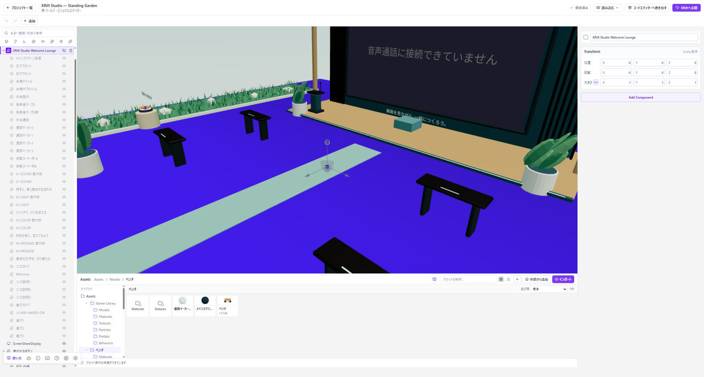

# 組み合わせをプレハブにする

動画で操作を確認する：[Prefabを作って再利用する](./lesson-02-08.md)

プレハブは、親子関係でまとめた複数のEntityを1つの素材として再利用できる機能です。同じ家具、看板、仕掛けなどをワールド内に何個も配置したいときに役立ちます。

*Hierarchyで親子関係を整理し、親EntityをAssetsへドラッグするとプレハブとして保存できます。*

## 組み合わせを作る

はじめに、まとめたいEntityをHierarchy上で1つの親Entityの下に整理します。親Entityを動かしたときに子Entity全体が一緒に付いてくることを確認してから、プレハブ化へ進みます。

## Assetsへ保存する

整理した親EntityをHierarchyからAssetsへドラッグ＆ドロップすると、子Entityも含めたプレハブとして保存されます。

保存できたら、そのプレハブをシーンへ配置して元と同じ構成になっているか確認しましょう。プレハブはシーン上にドロップした位置へそのまま置かれるため、元のEntityがシーンのどの場所にあっても配置位置がずれることはありません。

## 変更を反映する

プレハブの形や色をまとめて直したいときは、元のEntityを編集します。

1. Assetsで対象のプレハブを選び、Inspectorの「元のEntityを開く」を押して元のEntityを選択します。
2. 元のEntityを編集し、「プレハブに反映」を押します。配置されているすべてのプレハブへ変更が一斉に反映されます。

反映される範囲には、位置と回転・大きさで違いがあります。

- **位置**：元のEntityの位置はそのEntity自身の置き場所として扱われるため、元のEntityを動かしてから反映しても、ほかの配置済みプレハブは動きません。
- **回転と大きさ**：元のEntityの回転や大きさを変えて反映すると、すべての配置に伝わります。個別の向きや大きさを変えたい場合は、それぞれの配置のTransformで調整してください。

反映を実行する前に、同じプレハブをほかの場所でも使っていないか確認しておきましょう。広範囲に影響が出そうなときは、先にプロジェクトをバックアップしておくと安心です。

## AIに繰り返し作ってもらう

制作チャットや接続したAIに、木やベンチなど同じものを複数並べるよう依頼すると、AIはまず1つを仕上げてプレハブにし、残りはそのプレハブを配置します。Hierarchyでは元のEntityの下に部品が並び、ほかの配置はそれぞれ1行ずつ表示されます。

あとから「ベンチを木製にして」のように依頼すると、AIは元のEntityを修正してすべての配置へ反映します。自分で手動修正したい場合も、同様に元のEntityを編集してから「プレハブに反映」を押してください。

特定の1つだけを変えたいときは、そのEntityを選んだ状態で「このベンチだけ赤くして」のように依頼します。AIはその配置だけを通常のEntityへ展開してから編集するため、ほかの配置には影響しません。万が一、元のEntityを削除してしまった場合でも、AIに頼めば配置の1つを新しい元のEntityとして戻せます。なお、プレハブの展開は現時点ではAIからの操作にのみ対応しており、Inspectorにはまだボタンがありません。

## 素材の共有にも注意する

別々に配置したプレハブでも、内部で同じマテリアルを共有していることがあります。1つだけ色を変えたい場合は、[マテリアルを分けてください](./materials.md#一つだけ色を変える)。
