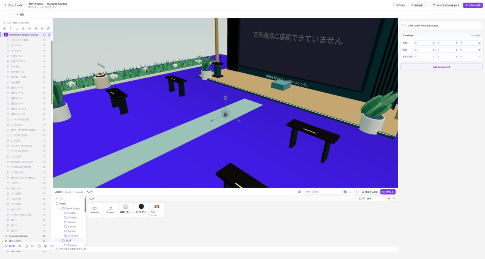

# 組み合わせをプレハブにする

動画で操作を確認する：[Prefabを作って再利用する](./lesson-02-08.md)

プレハブは、親子のEntityをまとめて再利用するための素材です。同じ家具、看板、仕掛けを繰り返し置くときに使えます。

*Hierarchyで親子関係を確認し、親EntityをAssetsにドラッグするとプレハブにできます。*

## 組み合わせを作る

Hierarchyで、まとめたいEntityを一つの親の下に整理してください。親を動かすと全体が一緒に動くことを確認してから、プレハブにします。

## Assetsへ保存する

親EntityをHierarchyからAssetsへドラッグしてください。子Entityも含むプレハブとして保存されます。

保存したプレハブをシーンに置き、元と同じ構成になっているか確認してください。プレハブは置いた位置に表示されます。元のEntityがシーンのどこにあっても、配置したプレハブの位置はずれません。

## 変更を反映する

プレハブの形や色を変えるときは、元のEntityを編集します。Assetsでプレハブを選び、Inspectorの「元のEntityを開く」を押すと、元のEntityを選択できます。編集後に「プレハブに反映」を押すと、配置したすべてのプレハブに変更が反映されます。

元のEntityの位置は、そのEntityを置いた場所として扱います。元のEntityを動かしてから反映しても、配置したプレハブは動きません。元のEntityの回転と大きさは、反映するとすべての配置に伝わります。配置ごとの向きや大きさは、それぞれの配置のTransformで変えてください。

反映前に、同じプレハブをほかの場所でも使っているか確認します。ほかの配置への影響に備えるには、先にプロジェクトをバックアップしてください。

## AIに繰り返し作ってもらう

制作チャットや接続したAIに、木やベンチなど同じものを複数置くよう頼むと、AIは一つを仕上げてプレハブにし、残りはそのプレハブを配置します。Hierarchyでは、元のEntityの下に部品が並び、ほかの配置は1行ずつ表示されます。

あとで「ベンチを木製にして」のように頼むと、AIは元のEntityを直し、すべての配置へ反映します。手で直す場合も、元のEntityを編集してから「プレハブに反映」を押してください。

## 素材の共有にも注意する

別々に配置したプレハブでも、同じマテリアルを使っている場合があります。一つだけ色を変えるには、[マテリアルを分けてください](./materials.md#一つだけ色を変える)。
