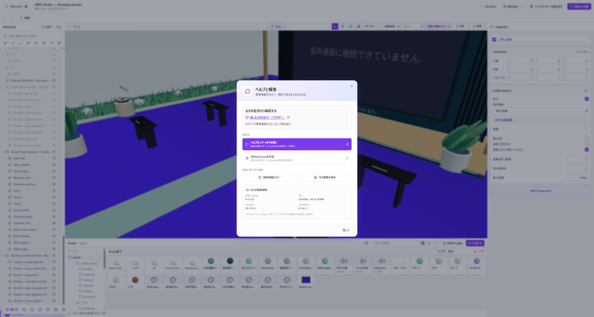

# データを守って復旧・問い合わせする

不具合が起きたときは、まず手元に残せる作品データをバックアップしましょう。完全リセットは、大切なデータの保全を確認してから最後の手段として検討してください。

*作品を保存・バックアップしたうえで、「ヘルプと報告」から問い合わせ用の情報を用意できます。*

## 先に確認する

まだ保存できる状態であれば、プロジェクトを複製するか、`.xriftstudio`ファイルに書き出してバックアップを取ります。保存エラーが出ている間は編集画面を閉じず、表示されたエラー内容をそのまま確認してください。

パネルの表示位置や大きさが崩れただけであれば、エディターのヘルプから「パネル配置を初期化」を使えば、データを消さずに元へ戻せます。

## 問い合わせに残す情報

次の内容を短くまとめておくと、原因を調べやすくなります。

- 何をしようとして、どの画面でどの操作をしたか
- その結果、何が起きたか
- 表示されたエラーメッセージ、アプリのバージョン、お使いのOS

アプリの「ヘルプと報告」を使うと、相談用情報のコピーやスクリーンショットの保存を手軽に行えます。送信する前に、中身に問題がないか一度目を通しておきましょう。

## 送らない情報

問い合わせやスクリーンショットには、次のような機密情報・個人情報を含めないでください。

- ログイン用トークン、APIキー、パスワード
- 個人情報や第三者の非公開データ
- スクリーンショットの背後に写り込んだ別ウィンドウの内容や、見られたくないファイル名

## 公開の結果が分からない場合

送信中にエラーが出ても、XRift側では公開処理が完了していることがあります。再送する前に、まずXRiftで公開状況を確認してください。詳しい確認手順は[公開の復旧手順](./publishing.md#送信結果が分からない)にまとめています。

## 完全リセットは最後にする

完全リセットでは、アプリ専用の実行環境、保存済みプロジェクト、ログイン情報などが削除され、元に戻せません。実行する前に削除される範囲を確かめ、残したい作品は必ずバックアップしてください。

リセットすべきか判断できないときは、実行する前に一度お問い合わせください。

## 不具合を報告する

[XRift Studioの不具合報告先](https://github.com/WebXR-JP/xrift-studio/issues)で同じ事象がすでに報告されていないかを確認し、見当たらなければ新しく報告してください。通常の利用や報告にあたって、GitHub上の開発者向け手順を読む必要はありません。
