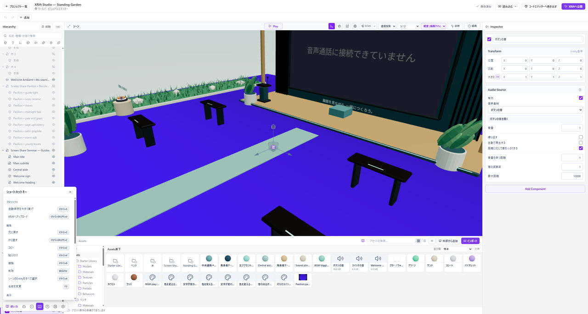

# よく使うショートカット

取り消しや視点合わせ、Playの切り替えなどをショートカットで覚えておくと、作業がぐっと速くなります。なお、テキスト入力欄にカーソルがある間は、文字入力の操作が優先される場合があります。

*画面左下の「ショートカットキー一覧」を開くと、現在のキー割り当てをいつでも確認できます。*

## すぐに保存する

編集内容は自動で保存されますが、任意のタイミングで今すぐ保存したいときは `Ctrl + S`（Macでは `⌘ + S`）を押します。

## 元に戻す

直前の操作を取り消すには、`Ctrl + Z`（Macでは `⌘ + Z`）を使います。大きく作り替える前は、取り消しだけに頼らずバックアップも残しておくと安心です。

## 選んだものへ視点を合わせる

シーンまたはHierarchyで対象のEntityを選び、`F` キーを押します。カメラの外にあるEntityでも、すぐに正面へ視点を合わせられます。

## Playを始める・止める

`Ctrl + Enter`（Macでは `⌘ + Enter`）でPlayと編集を切り替えられます。`F6` キーからもPlayを開始でき、もちろん画面上部のPlay・Stopボタンでも操作できます。

## マウス固定を解除する

Play中にマウスカーソルを自由に戻したいときは、`Esc` キーを押します。マウス固定だけが解除されてPlay自体は続くため、編集画面へ戻るにはStopを押してください。

## そのほかの操作

ここに記載していないキー割り当ては、エディター左下の「ショートカットキー一覧」で確認できます。ノードエディターと3Dシーンでは、同じキーでも操作の対象が異なる場合があります。
