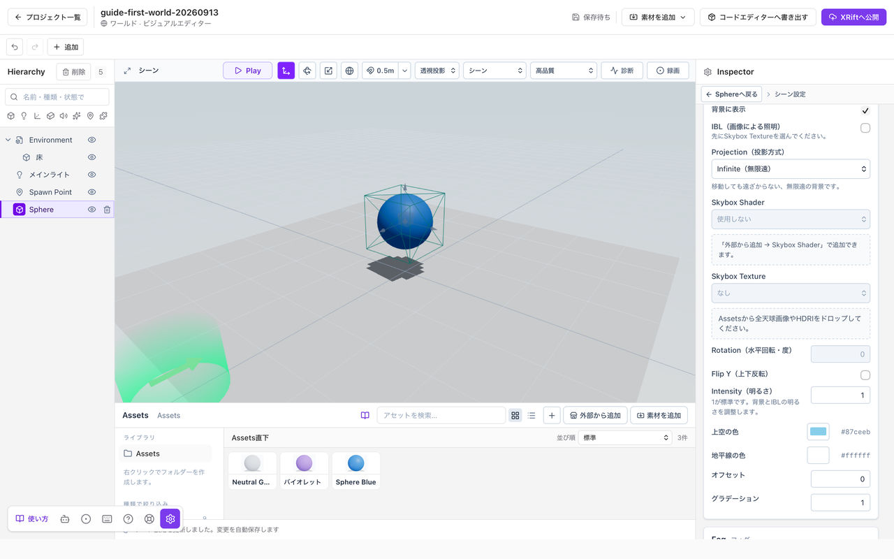

# 空と水を作る

動画で操作を確認する：[Skybox Shaderで青空を作る](./lesson-01-07.md) / [HDRIを背景と環境光に使う](./lesson-01-08.md)

空の背景にはSkyboxを、水面にはWater Shaderのマテリアルを使います。背景の設定と水面のメッシュにそれぞれ割り当てて表現します。

*上空と地平線のグラデーションで背景を作った例です。背景画像は使っておらず、IBLも無効の状態です。*

## 360度ペイントのPNGを背景にする

1. 「Assets → ファイルから素材を追加」で、360度ペイントなどから書き出したPNGやJPEGを取り込みます。横と縦の比率が2:1の全天球画像（Equirectangular）を用意してください。HDRやEXRも利用できます。
2. 「シーン設定 → Skybox」を開き、「Skybox Texture」で取り込んだ画像を選びます。Assetsからこの欄へドラッグ＆ドロップしても割り当てられます。
3. 「背景に表示」を有効にします。Skybox Shaderが設定されている場合は、Shaderを「なし」に切り替えると画像が背景として表示されます。
4. Rotationで水平方向の向きを合わせ、上下が逆になっている場合はFlip Yを切り替えます。明るさはIntensityの1を基準に調整してください。

背景に画像を表示するためだけに、専用のCubeやマテリアルを作る必要はありません。Skybox Textureには6面を展開したキューブマップではなく、1枚の全天球画像を指定します。画像を周囲の照明や反射にも活かしたい場合は、あわせてIBLを有効にしてください。

取り込みの初期設定は「原寸のまま」「画像形式を維持・圧縮しない」になっており、すでに取り込み済みの画像が自動で変換されることはありません。縮小や圧縮を自分で選んだ場合のみ、以降の取り込みにその設定が引き継がれます。

以前の設定でKTX2へ変換されて背景が正しく表示されないときは、Assetsでそのテクスチャを選び、Inspectorの「元の画像に戻す」で元のデータへ復元してください。元の画像が残っていない場合は、取り込み設定を確認したうえで元のPNGやJPEGを追加し、Skybox Textureに選び直します。

## Skybox Shaderを背景にする

「Assets → アセットストア → Skybox Shader」を開き、見本から好みの空を選びます。「追加後にSkyboxへ設定」にチェックを入れて追加すると、そのままシーンの背景へ反映されます。

チェックを外した場合は、マテリアルだけがAssetsに追加されます。追加済みのマテリアルを背景に使うには、カタログの「Skyboxに設定」を押すか、「シーン設定 → Skybox」から割り当ててください。Skybox Shaderが設定されているときは、Skybox TextureよりもShaderが優先して背景を描画します。

## 空の色や動きを変える

Assetsで追加されたSkybox用のマテリアルを選ぶと、Inspectorの「調整できる値」から見た目を変更できます。雲の量、太陽の位置、空の色など、調整できる項目はプリセットによって異なります。

初期状態へ戻したいときは「既定値へ戻す」を使います。同じプリセットをもう一度追加すると既存の調整値が上書きされることがあるため、現在の設定を残しておきたい場合は先にバックアップを取っておくと安心です。

## 背景と照明を分けて設定する

Skyboxは背景の表示、IBLは環境画像を使った照明や反射の計算というように、役割が分かれています。Skybox Shaderを追加しただけでは、周囲の照明や金属の反射は変わりません。

環境光や反射を加えたい場合は、「シーン設定 → Skybox」でSkybox TextureにHDRIなどの画像を選び、IBLを有効にしてください。Intensityで背景とIBLの明るさ、Rotationで水平方向の向きを調整できます（Skybox Shaderにもこれらの値が反映されるかどうかは、選んだShaderの仕様によります）。

Skybox Shaderは編集中も表示されます。背景が見えない場合は、表示モードを「シーン」に戻してください。UnlitやWireframeの表示モードではSkyboxは表示されません。

## 水面を作る

「アセットストア → Water Shader」から好みのプリセットを選んでマテリアルに追加します。水面となる水平なメッシュをシーンに置き、そのEntityの「Mesh Renderer → マテリアル」に割り当ててください。追加したマテリアルを選ぶと、Inspectorの「シェーダーの調整値」で波の動きや色を調整できます。

頂点が分割されていない単純な平面を使う場合は、「頂点変位」を0にしてください。波に合わせて水面の輪郭まで上下させたい場合は、十分に分割されたメッシュが必要です。

## 川を作る

「川・小川」カテゴリのプリセットは、一定方向へ流れる水面を表現します。細長い水平のPlaneを用意してマテリアルを割り当ててください。水はPlaneの中心線に沿って、PlaneのローカルX軸の向きへ流れます。流れる方角を変えたいときはEntity自体を回転させ、細かな角度は「流れる向き」で調整します。

水が表示されるのは「川幅」の内側だけです。Planeの幅を川幅より少し広めにしておくと、水ぎわが地面になじみやすくなります。岸に近い浅い部分は透けて見えるため、Planeの下に川底となる地面を配置しておいてください。

流れ自体はまっすぐ進む仕組みです。曲がりくねった川を作りたいときは、短いPlaneを複数つなぎ合わせます。川底や岩、地形に自動でフィットする機能はないため、Planeの端や継ぎ目は地形や岩で隠すように配置します。

## 風と波の関係

一般的な水面の波は、シーン設定の風と連動しています。プリセットにある波の速さは風に対する倍率で、0にすると波が止まります。なお、カタログ内の「プレビューに風を適用」はプレビュー表示専用の設定であり、シーン設定自体は変更されません。

川のプリセットでは、水の流れは「流れの速さ」で制御されます。シーン設定の風を止めても川は流れ続け、風の影響を受けるのは表面に立つ細かなさざ波だけです。流れも止めたい場合は、「流れの速さ」を0にしてください。

## 見た目と物理を区別する

水面のマテリアルを割り当てても、泳げる領域、浮力、岸のColliderなどは自動で作られません。歩ける範囲や落下を防ぐ床などは別途用意してください。川の流れも見た目だけの演出であり、アバターやEntityが流されることはありません。

岸の泡は指定した位置・方角・幅に沿って描かれるため、地形や岩との接触は自動検出されません。また、水面の反射には空色の近似が使われており、周囲の物体の映り込みや実際の水深は反映されません。
