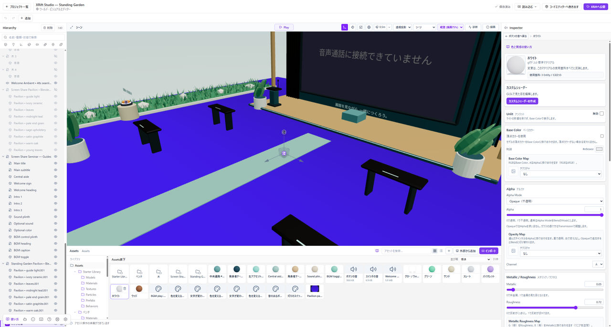

# テクスチャで模様を付ける

動画で操作を確認する：[画像を貼って、模様の大きさを変える](./lesson-02-04.md)

テクスチャは、モデル表面の色や細かな凹凸を表すための画像です。あらかじめ[マテリアルを作って割り当てる](./materials.md#作って割り当てる)手順を済ませておくとスムーズに進められます。

*InspectorのBase Color Mapから、表面の色に使う画像を選べます。*

## 色の画像を貼る

PNGやJPGなどの画像をAssetsに取り込んだら、設定したいマテリアルを選びます。InspectorのBase Color Mapで画像を指定し、まずはBase Colorを白にして画像本来の色を確認してください。

画像の色にはBase Colorが掛け合わされます。想定より暗くなったり色味が変わったりしているときは、Base Colorの色とライトの設定を見直しましょう。

## 元画像のサイズと形式を保つ

取り込みの初期設定では、画像が自動で縮小されたりKTX2へ圧縮されたりすることはありません。3Dモデルに含まれる画像も同じ扱いです。「取り込むテクスチャのサイズと圧縮」で縮小や圧縮を選ぶと、それ以降の取り込みから適用されます。初期状態に戻したいときは「原寸のまま」「画像形式を維持・圧縮しない」を選び直してください。

この設定を変えても、すでに取り込み済みの画像には影響しません。既存の画像を変換したいときは、Assetsで対象のテクスチャを選び、Inspectorから個別に変換します。変換時に元の画像が残されていれば、「元の画像に戻す」でいつでも復元できます。

360度ペイントの画像を背景に使いたい場合は、[360度ペイントのPNGを背景にする](./sky-and-water.md#360度ペイントのpngを背景にする)を参照してください。

## 貼る大きさや向きを変える

マテリアルのテクスチャ設定から、画像の繰り返し回数、位置、回転を調整できます。画像自体を選択すると、繰り返し方やフィルターの設定も確認できます。

モデル表面のどこに画像を貼るかは、モデル側のUVによって決まります。UVが設定されていなかったり模様の配置がずれていたりする場合は、モデルを作成したツール側で修正する必要があります。画像を差し替えるだけでは直せません。

## Normal Mapで細かな凹凸を表す

Normal Mapは、陰影によって細かな凹凸を表現する画像です。メッシュ自体は変形しないため、輪郭やColliderは変わりません。

割り当てる際は、Tangent SpaceのNormal Mapを使ってください。この画像は色補正をかけず、Linearとして読み込まれます。Normal Scaleは0で効果なし、1が標準です。まずは1で見た目を確認し、必要に応じて強さを調整します。

通常のカラー写真をそのまま割り当てても正しい凹凸にはならないため、配布元でNormal Map用の画像かどうかを確認してから使ってください。

## Occlusion Mapとの違い

Occlusion Mapは、画像を使って隙間やくぼみにあらかじめ陰影を付ける仕組みです。表面の凹凸を描くNormal Mapとは役割が異なります。

一方、SSAOは画面に映った形状をもとにリアルタイムで陰影を計算するシーン設定の画面効果であり、モデルに画像を貼る設定ではありません。

## PBR用の画像を使う

Metallic Roughness Mapでは、画像のGチャンネルをRoughness、BチャンネルをMetallicとして読み込みます。それぞれ別の画像として配布されている素材を使う場合は、チャンネルの割り当てが合っているか確認してください。

色を表すマップと数値を表すマップでは、色空間の扱いが異なります。各入力欄の案内を確認して割り当ててください。[外部カタログ](./external-resources.md)からマテリアルを取り込むと、設定済みの組み合わせを実例として確認できます。

## 遠くで模様がちらつく

遠くの細かい模様がちらつくときは、画像のMipmapsが有効になっているか確認します。縮小表示用の画像をあらかじめ用意し、遠景のちらつきを抑えるための設定です。

カスタムシェーダーで読むテクスチャは、uniform ごとに設定します。[遠くの面のちらつきを抑える](./custom-shaders.md#遠くの面のちらつきを抑える)を参照してください。

また、テクスチャの解像度は実際に見える大きさに合わせて選ぶことが大切です。容量や描画への影響については、[容量と描画負荷](./performance.md)もあわせて確認してください。
