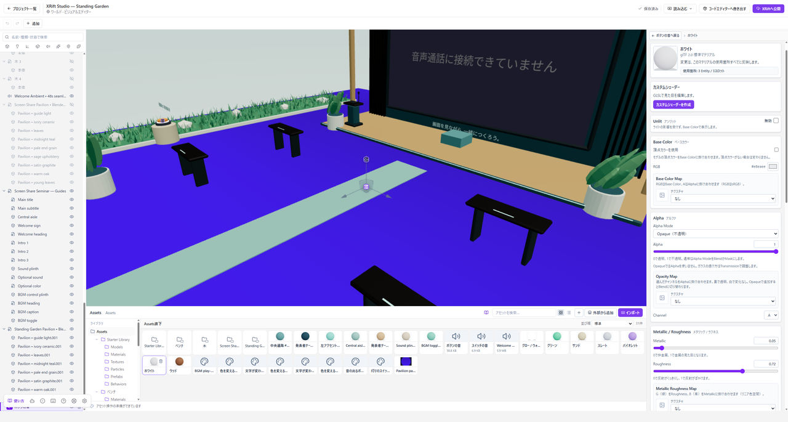

# 半透明・切り抜き・ガラスを作る

オブジェクト全体を半透明にするにはAlpha、ガラスのように光を通すにはTransmissionを使います。作りたい見た目に合うほうを選んで設定します。

作業を始める前に[マテリアルの割り当て](./materials.md)を済ませておき、Play中であればStopを押して編集画面に戻ってください。

*画像は変更前のOpaqueの状態です。全体を半透明にするには、Alpha ModeをBlendに切り替えます。*

## 全体を半透明にする

Alpha Modeを **Blend** に切り替え、Alphaの値を下げます。半透明の看板や薄いパネルなど、表面全体を透かしたいときに使います。

半透明の面どうしが重なると、描画順の関係で奥と手前が不自然に見えることがあります。不要な重なりを減らし、いろいろな角度から見て問題がないか確認してください。

## 葉やフェンスを切り抜く

Alpha Modeを **Mask** に切り替え、テクスチャ画像のAlphaとAlpha Cutoffで切り抜く境界を決めます。Alphaの値がAlpha Cutoffより小さい部分が切り抜かれます。

葉っぱや金網のように輪郭をはっきり切り抜きたい用途には、BlendではなくMaskを使います。薄い板を裏側からも見えるようにしたい場合は、Double Sidedの設定も確認してください。

## 不透明な面に戻す

Alpha Modeを **Opaque** に戻します。BlendingがNormalであれば、Alphaの値は無視されて不透明になります。

ただし、BlendingがNormal以外になっていると、Alpha Modeの設定にかかわらず半透明で描画されます。不透明に戻らないときはBlendingの欄もあわせて確認してください。

## ガラスのように光を通す

ガラスのような透明感を出したいときは、Transmissionを有効にし、次の設定から試してみてください。

- Alpha：1
- Alpha Mode：Opaque
- Metallic：0

そこからTransmissionで光の透過量、Roughnessで表面の曇り具合を調整します。IORは素材本体の屈折率です。Transmissionを使うと表面の反射と奥の透過を両立できるため、Alphaを下げて全体を薄く見せる方法とは質感が大きく異なります。

## 厚みのある色ガラス

Volumeを使うと、材質の厚みと、光が中を通るときの減衰を表現できます。計算が正しく働くよう、中身のある閉じたメッシュを使ってください。

- **Attenuation Color**：指定した距離を通過したあとに残る光の色です。「吸収される色」ではない点に注意してください。白に設定すると、色も明るさも変化しません。
- **Attenuation Distance**：光がAttenuation Colorへ変化するまでの距離です。短くするほど、薄い部分でも早く色が付きます。

## Opacity Mapを使う

Opacity Mapは、画像を使って部分的に不透明度を変える設定です。黒の部分が透明になり、白の部分は不透明のまま残ります。選んだチャンネルの値が、AlphaとBase Color MapのAチャンネルに掛け合わされます。OpaqueのマテリアルにOpacity Mapを追加すると、Alpha Modeは自動でBlendに切り替わります。

Opacity MapはXRift Studio独自の追加設定です。ほかのツールで同じ名前の項目を使っていた画像を流用する場合は、入力画像の形式やチャンネル構成が合っているか確認してください。
