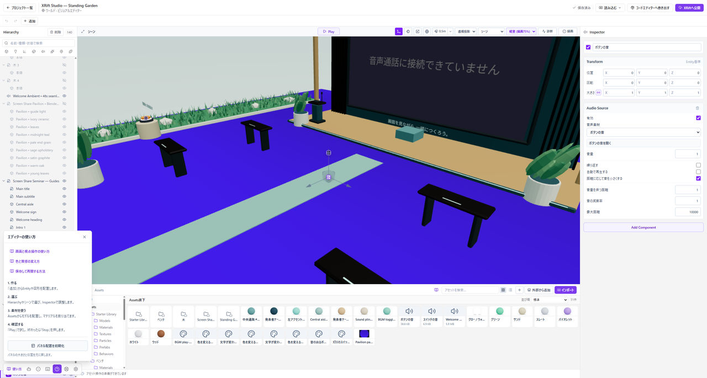

# 困ったときに探す

起きている症状に近い項目から確認してみてください。プロジェクトの削除や完全リセットを行う前に、必ず保存状態とバックアップを確かめておきましょう。

*パネルが見当たらなくなったときは、左下のヘルプから「パネル配置を初期化」を使えます。*

## アプリを起動できない

[インストールで困ったとき](./installation-problems.md)を開き、ダウンロードしたファイルの種類、OSごとの手順、表示された警告の内容を確認してみてください。

## モデルが見えない

Assetsに取り込んだモデルは、シーンへドラッグして配置するまで表示されません。すでにHierarchyに並んでいる場合は、そのEntityを選んで `F` キーを押すと視点を合わせられます。

それでも見えないときは、表示状態（非表示になっていないか）、大きさ、位置、読み込みエラーの有無を確かめましょう。詳しくは[モデルの取り込み](./assets.md)をご覧ください。

## 色や質感が変わらない

Play中はマテリアルを編集できないため、まずStopで編集画面に戻ります。そのうえで、編集しているマテリアルが対象のEntityに割り当てられているか、変更したい面のスロットを選んでいるかを確認します。

関係ないEntityの色まで一緒に変わってしまう場合は、複数のEntityが同じマテリアルを共有している可能性があります。分け方は[マテリアルの基本](./materials.md)をご覧ください。

## 床をすり抜ける

Stopで編集画面に戻り、床のColliderとプレイヤーの開始位置（SpawnPoint）を確認します。床の見た目があっても、Colliderが設定されていなければ上を歩けません。設定方法は[床と開始位置](./collision.md)にまとめています。

## 空・影・Bloomが見えない

編集画面の表示モードを「シーン」、描画品質を「高品質」に切り替えて確認してみてください。また、SkyboxとIBL、EmissiveとBloomはそれぞれ別の設定です。組み合わせ方は[ライトと明るさ](./lighting.md)をご覧ください。

## 音が鳴らない・ボタンが動かない

音声の割り当て、再生の開始条件、音量、聞こえる範囲を確認します。Node Graphで作った仕掛けは、対象のEntityに取り付けて初めて動きます。詳しくは[音](./audio.md)または[ボタンの仕掛け](./interactivity.md)をご覧ください。

## パネルがなくなった

エディター左下のヘルプから「パネル配置を初期化」を実行します。パネルの位置と大きさだけが元に戻り、作品のデータは消えません。

## 保存・公開で止まる

保存エラーが出ている間は編集画面を閉じず、表示されたメッセージを確認してください。公開の送信結果が途中で分からなくなった場合は、二重公開を防ぐため、再送する前にXRift側で公開状況を確認します。

それぞれの対処手順は、[保存の手順](./save-and-open.md)、[公開の手順](./publishing.md)、[復旧と問い合わせ](./recovery.md)にまとめています。
